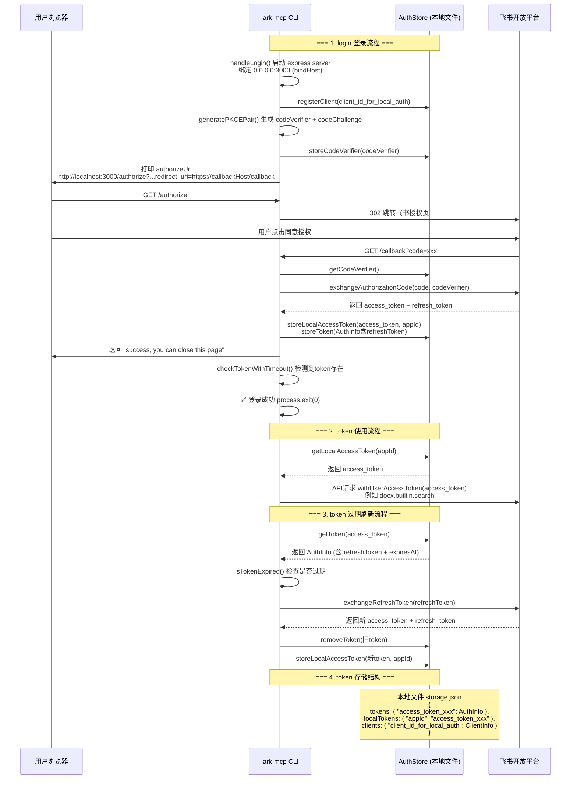

# 记录一次mcp server的PR

https://github.com/larksuite/lark-openapi-mcp/pull/70

scope 就是包名前面 `@` 开头的命名空间，用来区分包属于哪个组织

```shell
@zjmcp/lark-mcp
  ↑      ↑
scope   包名
```


## 配置.npmrc

有全局和项目`.npmrc`

```

registry=https://registry.npmmirror.com            # 其他走国内源
@scope:registry=https://xxx/repository/npm-group/  # 只有 @scope 走私有源

# Nexus 认证
//xxx/repository/npm-hosted/:_auth=[base64]
```


```shell
echo -n "账号:密码" | base64
```


## npm命令解析

**下载依赖**

```shell
npm install --registry https://registry.npmmirror.com
```

把 `package.json` 里 `dependencies` 和 `devDependencies` 列的包全部下载到本地 `node_modules/`,不编译、不执行、不改代码。


`prepare` 是 npm 的生命周期钩子，**`npm install` 的时候会自动触发**，不是 `npm run build` 触发的。

```
npm install
  → 下载依赖
  → 自动执行 prepare   ← 这里触发了 yarn build → 报错
```

`npm run build` 直接执行 `scripts.build`，跟 `prepare` 没关系，所以单独跑 `npm run build` 不会有问题。

之前报 `yarn: command not found` 就是 `npm install` 时 `prepare` 钩子触发导致的。


**编译**

```shell
npm run build
```

执行 `package.json` 里 `scripts.build` 定义的命令

```json
"scripts": {
  "build": "rm -rf dist && tsc"
}
```

就两步：

1. `rm -rf dist` — 删旧的编译产物
2. `tsc` — 把 `src/` 下的 TypeScript 编译成 JavaScript 输出到 `dist/`

**npx 执行流程**

- 检查本地有没有装过，没有就从 registry 下载到临时目录

  - 相当于`npm install @tiangong/lark-mcp --prefix ~/.npm/_npx/<hash>/`

- 找到 package.json 里 bin 字段对应的文件执行

  - ```json
    "bin": {
      "lark-mcp": "dist/cli.js"   // ← npx 找这个
    }
    ```

- **执行完不删除**，下次同版本直接用缓存 , 可以用`npm cache clean --force`清除


执行编译，测试

```shell
npm run build

node dist/cli.js login xxxxx
```

push tgz 到私有源

```shell
npm run build

npm publish [--registry https://xxx/repository/npm-hosted/]
```

不指定源，在 `package.json` 里加 `publishConfig`，以后直接 `npm publish` 就行

```json
{
  "name": "@xxx/lark-mcp",
  "publishConfig": {
    "registry": "https://xxxx/repository/npm-hosted/"
  }
}
```


## callback 流程



