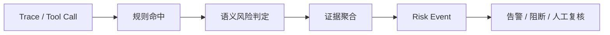
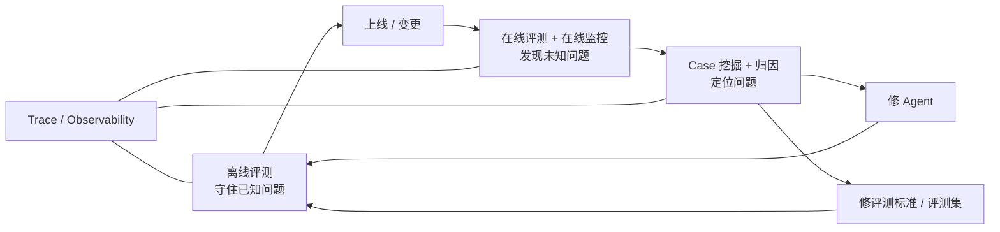
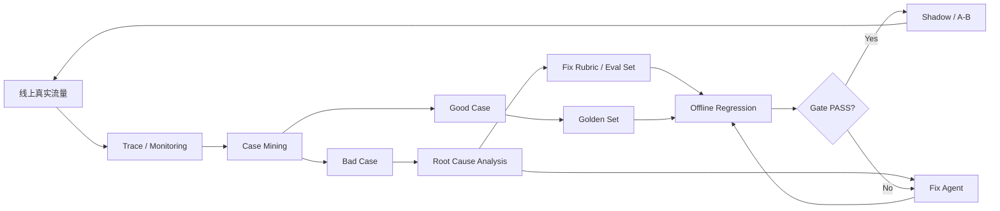
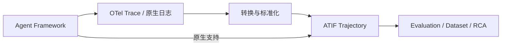
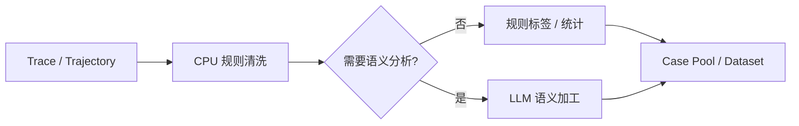
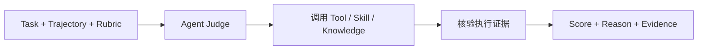
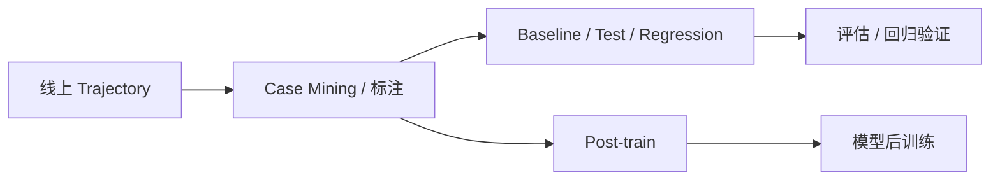
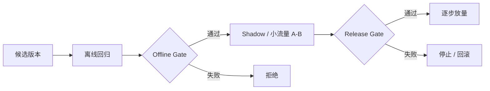
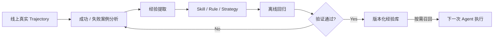

# 目前的agent架构

ReAct 的核心循环

```
Reason
  ↓
Action       ← 我要做什么
  ↓
Observe      ← 做完以后发生了什么
  ↓
Reason       ← 根据结果决定下一步
  ↓
Action
  ↓
Observe
  ↓
...
```

例子

```
Action                      Observation

read_file("a.py")      →    文件内容
shell("pytest")        →    stdout + stderr + exit_code
web_search("xxx")      →    搜索结果
git_diff()             →    diff
write_file(...)        →    写入成功/失败
database_query(...)    →    查询结果
delegate(subagent)     →    Subagent 返回结果
```

现代 Harness 实际上是,ReAct 是 Engine，Harness 是 Engine 外面的控制系统。

```
                    Harness
┌──────────────────────────────────────────┐
│                                          │
│  Context Manager                         │
│       ↓                                  │
│     LLM ←──────────────────────┐         │
│       ↓                        │         │
│   tool_call                    │         │
│       ↓                        │         │
│  PreTool Hook                  │         │
│       ↓                        │         │
│  Permission / Policy           │         │
│       ↓                        │         │
│     Tool                       │         │
│       ↓                        │         │
│  PostTool Hook                 │         │
│       ↓                        │         │
│ Observation ───────────────────┘         │
│                                          │
│ State / Trace / Budget / Checkpoint      │
│ Compact / Skill / Validator              │
│                                          │
└──────────────────────────────────────────┘
```

普遍 Agent Framework 可以拆成 7 个模块

```
Agent Runtime
│
├── ① Model Adapter
│      GPT / Claude / Gemini
│
├── ② Context Manager
│      messages
│      compact
│      memory
│      context injection
│
├── ③ Tool Registry
│      read_file
│      shell
│      search
│      browser
│      MCP
│
├── ④ ReAct Loop
│      LLM → Action → Observation
│
├── ⑤ Hook / Middleware
│      before_model
│      after_model
│      before_tool
│      after_tool
│
├── ⑥ State / Persistence
│      task
│      checkpoint
│      artifacts
│      trace
│
└── ⑦ Policy / Verification
       permission
       budget
       test
       validator
       max_steps
```

skill tool mcp

```
Skill
  ↓
改变 ReAct 的行为策略

Tool
  ↓
提供 ReAct 的行动能力

Hook
  ↓
限制 ReAct 的行为边界

State
  ↓
保存 ReAct 的真实进度

Verifier
  ↓
判断 ReAct 是否真的完成

Harness
  ↓
管理以上所有东西
```

multi agent

```
于是：

Main ReAct
│
├── Tool
├── Tool
│
├── Subagent
│      │
│      └── ReAct Loop
│
└── Tool

```

纯 ReAct, 非常灵活，但容易乱跑 , 通常两者和 Plan-and-Execute混合，外层 Plan-Execute，内层 ReAct，最外面再由 Harness 管住。

```
                 Task
                  ↓
              High-level Plan
                  ↓
       ┌──────── Step 1 ────────┐
       │                        │
       │       ReAct Loop       │
       │ LLM → Tool → Observe   │
       │        ↑        ↓      │
       │        └────────┘      │
       └──────────┬─────────────┘
                  ↓
              Verify Step
                  ↓
               Step 2
                  ↓
              ReAct Loop
```


# plan

> **Planning 不是让 LLM 完全自由地“自己想”，而是用 Prompt + 程序结构约束它怎么拆、怎么执行。**

```
用户任务
   ↓
拆成子任务
   ↓
决定执行顺序
   ↓
逐步执行
   ↓
根据结果调整后续步骤
```

适用场景 ： **出错代价大的地方，不要让模型自由规划。**

- 任务不确定
- 场景变化大
- 需要语义理解
- 需要灵活拆解

实际工程里最常见

```
固定 Workflow
      ↓
到动态节点
      ↓
LLM Planning
      ↓
程序校验
      ↓
执行
      ↓
Observation
      ↓
需要时重新规划
```

Code:控制流程边界、LLM:负责动态决策、Validation：防止计划跑偏

- ReAct：**不提前生成完整 Plan，而是每一步现想现做。**
- Plan-Execute：**先做宏观计划，再执行。**
- Tool Routing：**下一步 Tool 选择。**


# multiagent

单 Agent 的主要问题

```
上下文越来越长
→ 容易遗忘前文、结论前后不一致

任务天然可以并行
→ 单 Agent 串行执行太慢

不同任务能力要求不同
→ 一个 Prompt 很难同时兼顾检索、分析、写作
```

所以 Multi-Agent 的价值主要是：分工，并行，独立上下文


```
1. Supervisor
   → 决策权和执行权分离，Supervisor 拆任务

2. Parallel
   → plan 计划怎样执行
   Graph / workflow → 负责明确哪些任务能并行、哪些必须等前置任务完成

3. Retry + Degrade
   → 子 Agent 失败不传染整个系统 (如果失败retry几次后，标记失败原因)

4. Merge Rules
   → 多 Agent 结果冲突时有显式规则 (去重,处理数据缺失,检测矛盾,按照业务优先级裁决,明确标注冲突,生成最终摘要)
```


- **冲突优先级必须显式定义，不能让 LLM 每次自己决定。**
- **一个子 Agent 的失败，不应该阻塞整个任务。**


动态调度时，Orchestrator 往往是一个 Supervisor Agent；固定调度时，Orchestrator 往往只是代码。Prompt 本身永远不是 Orchestrator，只是 Orchestrator Agent 的行为规则。

流程决策

```
Who
→ 谁执行

When
→ 什么时候执行

Where
→ 消息发给谁

What next
→ 下一步是什么

Stop
→ 什么时候结束
```


## Agent 之间的 4 种主要交互方式

| 模式                   | 怎样交互                                                     | 适用场景                   |
| ---------------------- | ------------------------------------------------------------ | -------------------------- |
| ① Agent as Tool        | 主 Agent 调用子 Agent，等待结果返回                          | RAG、多专家分析、报告生成  |
| ② Handoff              | Agent A 把控制权交给 Agent B，不一定自动返回 A；要返回时，需要额外设计交回控制权的路径。 | 客服分流、专业任务接管     |
| ③ Shared State / Graph | 不同 Agent 通过共享任务状态协作                              | 固定工作流、并行与依赖调度 |
| ④ Message / A2A        | Agent 之间通过消息或协议通信                                 | 跨进程、跨服务、跨框架     |

前两种是 OpenAI Agents SDK 明确支持的主要编排模式；后两种主要描述状态协作和通信机制，可以与前两种组合

需要区别 MCP 和 A2A：

- MCP：Agent 调用 Tool / Resource。
- A2A：独立 Agent 之间发现能力、委派任务和协作。

两者可以一起使用，并不冲突


**共享 Memory 和共享 Context 是一回事吗？**

不是。这是 Multi-Agent 很容易出现问题的地方。

| 数据类型           | 是否建议共享     | 原因                   |
| ------------------ | ---------------- | ---------------------- |
| System Prompt      | 默认独立         | 各 Agent 职责不同      |
| 当前任务目标与约束 | 必须按需传递     | 防止偏离目标           |
| 完整聊天 Messages  | 不建议默认共享   | Token 成本与上下文污染 |
| Task State         | 推荐共享         | 协调任务进度           |
| 长期 Memory        | 按权限检索共享   | 防止数据越权和冲突     |
| Artifacts          | 推荐通过引用共享 | 避免大结果反复传输     |

尤其并行 Agent，如果都能修改 `state["final_answer"]`，就可能产生竞态。

```
Agent A → state.research
Agent B → state.analysis

         ↓

State Reducer / Merge
         ↓
      Validate
         ↓
    Final Answer
对同一个字段的并发更新，要有明确的 Merge Rule、版本控制或单写者规则。
```


Harness + ReAct + Plan-Execute 架构，我建议：**Agent 并不是直接修改同一个全局 Dict。每个 Agent 读取状态快照，执行任务，返回局部更新；Runtime 将更新合并成新的共享状态。**

- 单进程：Python `asyncio` + 内存 State，最简单。
- 需要断点恢复：LangGraph + PostgreSQL。
- 多进程或多节点：PostgreSQL 保存任务真实状态，Redis 或消息队列负责异步任务分发；Orchestrator 负责协调。

其中，PostgreSQL 是状态的持久化存储，不是 Agent 之间必须经过的通信总线；Redis 也不是必需品。


## Agent 之间具体传递什么

建议不要直接把 Agent A 的全部 Messages 塞给 Agent B。更合理的是通过**结构化的任务协议通信**。


# Async Agent Runtime

短任务：

```
HTTP
↓
Agent Loop
↓
Response
```

长任务：

```
API
↓
Task Queue
↓
Worker
↓
Checkpoint
↓
Event
↓
Notification
```

用户关闭浏览器： HTTP 生命周期 ≠ Agent 生命周期

```
Request断开

↓

Agent继续执行

↓

checkpoint保存

↓

完成通知用户
```


# agent 循环打断机制

**工具调用循环**:    同一个工具反复调用，一直不进入总结

**目标漂移。**    做完主任务后不断扩展子任务，永远不交付

**自我怀疑循环。**    已经完成，但不断 Review / 重写 / 优化

**幻觉性进展**。   看起来一直在分析，实际上只是换说法重复

```
Agent 开始执行
    ↓
① max_iterations  (硬步数上限, 防止工具调用循环, 目标漂移)
限制最大循环次数 
    ↓
② step budget （即使 Agent 没超过最大步数，也不能无限烧钱。）
限制 Token / API / 总成本  
    ↓
③ 循环检测 （工具调用循环，幻觉性进展：3～5 步窗口，并对 input 做 normalize， 在给工具参数算 hash 之前，先把“写法不同但实际含义一样”的输入统一成同一种标准格式。  “你正在重复这个调用，请换策略”作为 Observation 返回模型，给一次自救机会。 ）
记录最近几步 (tool, input) 指纹
发现连续重复 → 中断循环
    ↓
④ Human Escalation
自动无法解决 → 打包当前状态交给人工

已执行多少步
已消耗多少预算
失败原因
最近几步做了什么
完整 transcript

继续
终止
调整策略
```


# context

Context 不是越大越好，关键是“信息保鲜

```
短期
→ 最近 N 轮完整保留

中期
→ 摘要压缩

长期关键事实
→ 提取成结构化 Memory
→ 外部持久化
→ 需要时重新注入
```

特别是：

```
硬约束 / 否定 / 身份属性
→ 尽量保留原义甚至原文

普通偏好 / 状态
→ 可以结构化提炼

过程性内容
→ 摘要或淘汰

寒暄
→ 不进入 Memory
```

## context 分层

```
Context

├── Static Context  (变化会影响 Prefix Cache)
│
│   system prompt
│   tool schema
│   skill metadata
│   policy
│
│   特点：
│   - 尽量稳定
│   - 保持 prefix cache
│
│
├── Dynamic Context
│
│   user query
│   tool result
│   observation
│   intermediate state
│
│
├── Summary Context
│
│   compact 后历史摘要
│
│
└── External State
    文件
    Database
    Vector DB
    Artifact
```


## context压缩

不要每轮对会都压缩一次。Compact 不只是减少 token，也是保持推理缓存稳定性的工程策略。

```
Token Threshold

        ↓

Batch Compact

        ↓

生成 Summary

        ↓

Freeze Summary

        ↓

原始轨迹落盘
```

summary

```
Task State

+
Important Constraints

+
Decisions

+
Pending Actions

+
External References
```

例如

```
Current Goal:
实现 Agent Runtime

Constraints:
不能引入复杂消息系统

Completed:
Run Lifecycle 已完成

Pending:
增加 Evaluation Diagnosis
```


核心原则：

> 压缩可以丢过程，但不能把以后无法恢复的关键约束压没。

不同的目标，压缩目的不一样,  例如长 Deep Research 更适合维护一个 Evolving Report / Research State：

```
研究目标

已确认事实
→ fact + source + confidence

待验证假设

信息缺口

当前研究焦点

当前结论草稿
```

关键变化是：

> 从“保存发生过什么”变成“保存现在知道什么”。


token 数 怎么拿

```
调用前
→ tokenizer 估算
→ 决定要不要 Compact


溢出前压缩

调用后
→ API response.usage
→ 记录真实 input/output token
```

`messages` 不要无限增长，旧的原始结果可以留在日志/存储里，活跃 Context 里只保留压缩后的研究状态。


# tool 

考虑风险等级、幂等性、权限


## Tool Router

先把几十个 Tool 缩成 1～5 个候选，再交给主 LLM 做最终 Tool Calling。

```
User Query
   ↓
Tool Router
   ↓
识别当前需要的能力
   ↓
候选 Tool Subset
   ↓
Main Agent / LLM
   ↓
选择具体 Tool + Args
   ↓
Schema Validation
   ↓
Execute
```

- tool < 5 , 就不需要，   tool  5~20 apability/tag + embedding Top-K ， Tool 20+ 使用混合路由

- **规则 / Tag 路由 ** ，最便宜、最稳定。每个 Tool 配 capability ：**适合意图非常明确的业务。**

  ```
  TOOLS = {
      "get_weather": ["weather", "天气", "温度"],
      "search_flights": ["flight", "机票", "航班"],
      "search_docs": ["document", "内部文档", "知识库"],
  }
  ```

- **Embedding 路由 **，把 User Query 和 Tool description 做向量相似度：**优点是便宜、快，而且不需要额外 LLM。**

  ```
  query embedding
        ↓
  和每个 Tool description embedding 比较
        ↓
  Top-K tools
  ```

- **LLM Router**：让一个小模型只做分类 : **优点是能理解复杂语义，缺点是多一次模型调用。**

  ```
  可选能力：
  weather
  flight
  hotel
  document
  web_search
  
  用户：
  “帮我看看明天北京天气，然后如果下雨帮我找个室内酒店”
  
  输出：
  ["weather", "hotel"]
  ```

- **Hybrid Router ， tool 20+** 

  ```
  User Query
     ↓
  权限 / 场景硬过滤
     ↓
  Rule / Embedding 粗召回
     ↓
  Top 3~5 Tools
     ↓
  Main LLM 最终选择
  ```

每个 Tool 至少有：

```
{
  "name": "search_flights",
  "description": "查询指定出发地、目的地和日期的航班",
  "capabilities": ["flight_search", "travel"],
  "required_context": ["origin", "destination", "date"],
  "permissions": ["travel.read"]
}
```

Router 主要根据：

```
用户意图
+
Tool capability
+
当前权限
+
当前任务状态
```

筛候选。


## 稳定性

Tool 调用不是“模型输出 → 直接执行”，而是  **路由 → 参数校验 → 执行 → 结果校验 → 错误分类 → Observation → Retry / 换策略 / 降级**

最后可以再压缩成你自己的 **Tool Stability 五层模型**：

```
1. Route
   → 减少 Tool 候选，降低选错概率

2. Validate
   → 调用前校验 Tool + Args

3. Execute
   → Timeout / Retry / Backoff

4. Observe
   → 统一错误协议 + Result Quality Check
   → 失败也必须返回模型

5. Guard
   → Loop Detection + Budget + Degrade + Logging
```


**减少错误发生：Tool Routing + Schema：**不要把所有 Tool 都暴露给模型。

```
User Query
   ↓
Tool Router
   ↓
筛选相关 Tool Subset
   ↓
LLM 选择 Tool
```

Tool 名称唯一、无歧义

- 参数名统一

- required / enum / type 明确

- 能用 strict JSON Schema 就使用


**Tool 执行前：参数校验**

```
LLM → Tool + Args
        ↓
Schema / 参数校验
        ├─ PASS → Execute
        └─ FAIL → 返回 Validation Error 给模型修正
```

**tool 调用失败，不同错误不能统一 retry** 

```
工具调用失败
   ↓
判断失败类型
   ├─ 临时性失败
   │    timeout / 500 / 网络抖动
   │    → Retry
   │
   ├─ 确定性失败
   │    404 / 403 / 参数或代码错误
   │    → 不重试，换策略或记录信息缺口
   │
   └─ 循环失败
        同一工具不断重复失败
        → 循环检测 + 强制干预
```

Tool Failure 本身也是一种 **Observation**，不能被 `try/except` 静默吞掉。


所有 Tool 统一错误协议

```
{
  "success": false,
  "error_type": "TIMEOUT",
  "error_message": "...",
  "is_retryable": true,
  "suggestion": "..."
}
```


**Tool Result 也要校验**:Tool 没报错 ≠ 结果有效。

还要检查：空结果 / 登录墙/404 页面/广告页/格式错误/字段缺失/明显垃圾内容


处理：

```
正常结果 → Observation

Empty Result
→ 换 Query

Garbage Result
→ 换来源

异常 Schema
→ 清洗 / Retry / 返回模型修正
```

防止 Agent 基于“成功返回的垃圾”继续推理。

**失败后的行为规则**

确定性的 Retry / Validation / Loop / Budget 应由 Runtime 代码控制， 让失败后的 Agent 行为可预测、可测试。Prompt 只负责告诉模型“失败后如何换策略”。

Runtime 负责硬规则

```
Retry 上限
Backoff
Schema Validation
Loop Detection
Timeout
max_steps / budget
```

这些尽量用代码强制。

System Prompt 负责策略规则

```
is_retryable = true
→ 修改参数 / Query 后再试
→ 不要原样重复调用

is_retryable = false
→ 换 Tool / 换来源
→ 或记录 information gap

核心信息拿不到
→ 不得猜测
→ 明确说明信息缺失

非核心信息拿不到
→ Degrade
→ 用已有信息继续任务
```

**Loop Detection 循环检查**

每次调用前记录：

```
tool_name + normalized_args
```

检查：

```
完全重复
+
必要时语义高度相似
```

命中后：

```
第一次
→ 不执行 Tool
→ Observation 告诉模型“该方向已尝试，请换策略”

继续循环
→ Stop / Degrade
```

**降级必须透明**

Tool 最终拿不到结果

```
不要：
静默跳过
凭空补答案

应该：
记录 information gap
继续完成能完成的部分
最终明确告诉用户：
- 哪些信息成功获取
- 哪些信息缺失
- 哪些结论因此可信度降低
```

**日志与 Badcase 闭环**

```
tool
args
status
error_type
retry_count
duration
loop_detected

Badcase
→ 定位是 Router / Schema / 参数 / Tool / Result 问题
→ 修改
→ Regression Test


```


## 工具链训练

连续工具调用，让模型学会完整的 `Plan → Tool Call → Observation → Next Tool → Final` 轨迹。

工具链本质 。 训练数据真正关键的是“完整轨迹”

```
Thought / Plan
   ↓
Tool Call
   ↓
Observation
   ↓
重新判断
   ↓
Next Tool Call
   ↓
Observation
   ↓
...
   ↓
Final Answer
```

先学会单工具

```
User
→ get_weather(...)
→ Tool Result
→ Final
学会
Tool Selection
Args Filling
Schema Format
```

多工具

```
User
→ recommend_hotels
→ Tool Result
→ get_hotel_reviews
→ Tool Result
→ Final
学会
Observation 后继续行动
+
上一步结果给下一步当参数
+
最终需要收尾
```

参数继承工具链核心能力

```
tool1 输出 A
tool2 输出 B
tool3 需要 A + B
```

半自动沙盒生成

```
Tool Chain
=
Planning
+
Tool Calling
+
Observation Handling
+
State Passing
+
Error Recovery
+
Stop Condition
```


# 沙箱安全

不要相信 LLM 生成的代码，也不要指望黑名单覆盖所有攻击。正确方案是：白名单最小权限 + AST 静态检查 + OS 级沙箱 + 资源限制。

```sh
用户上传数据
   ↓
① 输入限制
   → 文件大小 / 行数限制
   ↓
② LLM 生成代码
   → Prompt 明确允许能力
   ↓
③ 静态安全检查
   → Syntax + AST + 危险模式
   ↓
④ 进入 Sandbox
   → Docker / E2B
   ↓
⑤ Runtime 限制
   → Timeout
   → CPU
   → Memory
   → Network
   → Filesystem
   ↓
⑥ 执行并捕获输出
   → stdout / stderr / 图表
   ↓
⑦ 清理资源
   → 临时文件 / 容器
   ↓
⑧ 返回用户结果
```


## Agent 行为审计：从安全控制到可追溯风险事件

**Policy / Sandbox 负责阻止危险行为，Audit 负责识别、追踪和复核真实风险。**

例如 Tool Policy 阻止了一次未授权文件读取，行为审计还需要记录是谁发起、命中什么规则、涉及什么资源以及最终如何处置。



### Risk Event 数据结构

```json
{
  "risk_type": "UNAUTHORIZED_ACCESS",
  "severity": "HIGH",
  "trace_id": "trace_xxx",
  "rule_id": "policy_001",
  "evidence_refs": [],
  "decision": "BLOCK",
  "action": "REVIEW_REQUIRED"
}
```

重点能力：

- 从大量低保真告警中筛出高风险事件。
- 关联原始 Trace、工具调用和命中规则。
- 保留最小必要证据，敏感信息脱敏或受控访问。
- 根据严重等级进行告警、阻断或人工复核。
- 审计记录应可追溯，不依赖 LLM 自己描述执行结果。

**原则：安全执行控制由 Runtime / Policy 强制实现，Agent Judge 可以辅助识别风险，但不能代替确定性的权限检查。**


# Memory 工程化

触发memory: **第一目标不是“精确判断有没有重要信息”，而是“低成本地控制提取频率”**。

```
Claude Code
→ 按新增消息数触发
→ 便宜、确定、可预测

Generative Agents
→ 按信息重要性触发
→ 更智能
→ 但要先判断每条信息有多重要
→ 判断本身也有成本
```

每条记忆的重要性评分本身就有额外开销，事件密集时甚至可能更贵

```
第一层：消息数量,负责控制触发频率
→ 便宜地决定“值不值得启动一次扫描” 

第二层：Extraction LLM, 负责决定最终写什么
→ 真正根据内容判断“有什么值得记”
→ 没有值得记的就不写
```


| 记忆层                        | 内容                                                      | 生命周期                | 载体/作用域               |
| :---------------------------- | :-------------------------------------------------------- | :---------------------- | :------------------------ |
| **Working Memory** (工作记忆) | 当前消息、ReAct循环、临时变量                             | 单次请求/推理期间       | AgentScope InMemoryMemory |
| **Session Memory** (会话记忆) | 完整对话历史、会话摘要                                    | 当前会话，历史可持久化  | Redis + MySQL             |
| **User Memory** (用户记忆)    | 用户偏好、背景、纠错历史                                  | 跨所有Agent共享，长期   | MemOS · user_profile      |
| **Agent Memory** (Agent记忆)  | 项目上下文（sys prompt）、任务模式、放到（skill , tools） | Agent内跨会话复用，长期 | MemOS · agent_{id}        |

并行加载，提升效率
- **降级与容错**：长期记忆查询失败时，仅记录日志并返回空结果，**不影响主对话流程**，将其视为“增强能力”而非核心依赖

短期记忆：Redis 缓存 + MySQL 兜底
- 存储：采用 Redis 作为热点缓存（最新200条，TTL 7天），MySQL 作为持久化存储，确保数据不丢失。
- 读取：优先从 Redis 读取，未命中或异常时回退到 MySQL。
- 写入：采用双写策略，先写 MySQL，成功后异步写入 Redis；Redis 写入失败不回滚 MySQL 写入。
- Token 窗口控制：读取时进行 Token 窗口裁剪，并为摘要预留预算（约2000 tokens），避免上下文超限

长期记忆：MemOS 语义检索 + 智能写入

- load

    - 同时检索 `user_profile` 和 `agent_{agentId}` 两个 Cube。

    - 使用 `fast` 模式、相似度阈值 `0.45`、MMR 去重 ， 时间新鲜度 等参数控制召回质量。

    - 检索后过滤低分（`score < 0.3`）和过长（单条截断至1000字符）结果

- write
    - 会话结束后，异步触发
    - 调用 LLM 判断新增消息是否值得记忆，并决定记忆的类别、scope 和重要性
    - **去重与冲突处理**：
        - **本地预去重**：使用精确匹配、包含、Jaccard（阈值0.7）、Levenshtein（阈值0.8）等方法。
        - **冲突解决**：调用冲突检测服务，决定是写入新记忆、跳过，还是标记旧记忆待删除。
    - **“先写后删”策略**：为确保数据不丢失，**先向 MemOS 写入新记忆**，成功后再删除冲突的旧记忆；删除失败仅记录警告，不影响已写入的新记忆
- del
    - “有时效的信息”加 TTL；长期不使用、低重要性的记忆逐步降权或清理，避免 Memory 无限膨胀。


预算控制：Token 精细化分配

- **长期记忆**：默认总预算为 **4000 tokens**。其中 `user_profile` 最多占 60%，剩余预算分配给 Agent 记忆。
- **截断算法**：采用**按行截断**，尽量保留完整语义，避免拆散单条记忆

可靠性与可观测性

- **幂等与并发控制**：使用**Redis 分布式锁**（10分钟）防止同一会话被并发处理；使用**消息 Hash (MD5)** 实现去重，TTL 为7天。
- **可观测性**：提供运行概览、记忆类型分布、时间趋势、Top Agents 等查询能力，用于日常巡检和异常定位。检索准确率、信息时效性、跨用户隔离、有效记忆占比


# RAG

## 优化方向

| 方向                 | 主要做法                                                     | 解决什么问题                                                 |
| -------------------- | ------------------------------------------------------------ | ------------------------------------------------------------ |
| **检索与索引**       | BM25 + Embedding 混合检索；先召回再 rerank；索引分片、动态更新、元数据过滤 | 兼顾关键词匹配和语义覆盖，提高检索相关性，保持知识更新       |
| **生成控制**         | 按任务设置 Prompt 模板；资料不足时明确说明；事实一致性校验；结构化输出、引用和副模型复核 | 减少无依据回答，提升输出一致性与可追溯性                     |
| **Query 理解与路由** | 意图识别、多轮上下文融合、Query 改写与扩展；选择知识库、联网或数据库路径 | 减少歧义和无效检索，让问题进入合适的处理链路                 |
| **吞吐与稳定性**     | 异步与批量调用；高频 Query 缓存；模块独立部署；延迟监控、超时熔断与降级 | 降低响应时间和调用成本，提高并发承载能力，避免局部异常拖垮系统 |
| **评估与反馈**       | 自动离线评估；记录用户评分和失败案例；将高风险、低置信度回答纳入后续训练样本池 | 找到薄弱环节，持续改进 Query、检索和生成策略                 |

原文列举的评估指标包括 **BLEU、ROUGE、MRR、Coverage 和 Latency**。


## Query Understanding：先把问题读懂

规则
→ 轻量分类模型
→ 低置信度时 LLM 兜底

不要每个 Query 都拿大模型做分类。

```
1. Intent
   → 用户到底想查知识、计算、查数据库还是闲聊

2. Entity / Constraint 实体 / Constraint 提取
   → 时间、来源、产品名、ID、地区等
   {
  "intent": "knowledge_search",
  "entities": {
    "product": "车险",
    "time": "latest",
    "source": null
  }
}

3. Rewrite / Expansion
   → 把模糊 Query 改成适合检索的 Query

4. Route
   → 决定真正进入哪条处理链路
```


## 意图识别

```
User Query
   ↓
① 硬规则 / Policy  处理非常确定的东西 ,确定性强
   ↓
② 轻量语义 Router  如果业务 Intent 是固定集合 （小型分类模型、BERT 、Embedding Router、小 LLM）
   ↓{
  "intent": "xxx",
  "confidence": 0.93
}
③ 低置信度才交给 LLM   LLM 只处理疑难 Case 
   ↓
Intent + Entities + Confidence
   ↓
Route


```

**不确定性处理**

```
confidence 高
→ 正常 Route

confidence 低
→ LLM 二次判断

仍然不确定
→ 默认安全路径 / 澄清用户
```

**高准确率场景**

```
Route
→ Execute
→ Validate
→ Fallback

例如
Router → NL2SQL
        ↓
SQL 执行失败
        ↓
不能直接任务失败
        ↓
Fallback / Ask User / RAG
```


## 意图偏移

意图识别解决的是：当前这一轮是什么 意图？

```
上一轮是什么？
当前是什么？
是否发生 改变？
发生 改变 后该清什么、保留什么？
```

触发

```
重新 Route
+
结束/挂起旧 Flow
+
清除旧 Intent 的 transient state
+
保留仍有效的 Entity / User State
```

**实体偏移**

```
Intent 变
→ 重路由

Intent 不变 + Entity 变
→ 同 Agent
→ 更新实体

都不变
→ Continue
```

Harness 需要保存这些state

```
                    New Message
                         ↓
                Intent / Entity
                         ↓
                  State Reducer
                         ↓
              ┌──────────┼──────────┐
              │          │          │
        Intent Shift Entity Switch Continue
              │          │          │
              ▼          ▼          ▼
          Re-route    Update Slot (保留实体)   Keep Flow
          New Agent   Keep Agent
```


## 实体提取

一些像什么订单号等特定之类，其实可以直接前端之类直接传，不用走下面的流程

```
Regex / Parser （日期 / 时间、百分比等等）
      ↓
NER / Slot Model （{
  "product": {
    "value": "平安健康险",
    "confidence": 0.96
  },
  "version": {
    "value": "2023",
    "confidence": 0.94
  },
  "term": {
    "value": "等待期",
    "confidence": 0.99
  }
}）
      ↓
初步 Confidence / Completeness Check  （confidence 高，required slots 完整，不用 LLM| 有指代 / 多候选 / 关系是否明确等等，前面无论多好都要过一下LLM）
      ↓
需要 LLM？
 ┌────┴────┐
No         Yes
│           │
│      LLM Structured Extraction
│           │
└─────┬─────┘
      ↓
Entity Linking / Normalize
      ↓
Entity + Constraint  （语义变成系统真正能执行的条件  例如 metedata过滤条件sql）
   ↓
Validation + Confidence 
   ↓
Router / Retrieval / Tool
```

LLM 复杂、上下文相关的抽取: 复杂语义补全，不是替代所有实体提取。

```
“那帮我看看他们家最近那个新版产品”

“那”        → 多轮指代
“他们家”    → 公司实体依赖 Context
“最近”      → 时间约束
“新版”      → version = latest

{
  "company": "平安保险",
  "product": null,
  "version": "latest",
  "time_range": null
}
```

Normalize / Entity Linking :  **光提取字符串不够， 实体链接  需要一个实体库**

```
英伟达
NVIDIA
NVDA
老黄公司

最终最好统一成
{
  "entity_type": "company",
  "canonical_name": "NVIDIA",
  "symbol": "NVDA",
  "entity_id": "..."
}
```

Validation / Confidence : **过度解析可能比不解析更危险，置信度不足时宁可回退原始 Query。**

```
缺少必要 Constraint
   ↓
能从 Context 补？
   ├─ YES → 补
   └─ NO
       ↓
   Ask User / 使用安全默认路径
   
   
低置信度时也可以保留原始 Query：
Structured Filter
+
Original Query Retrieval
```


| 环节                               | 常用现成工具                                             | 适合干什么                                |
| ---------------------------------- | -------------------------------------------------------- | ----------------------------------------- |
| **Entity Extraction / NER**        | spaCy、GLiNER、Transformers NER                          | 人名、公司、产品、行业等实体抽取          |
| **字符串 Normalize / Fuzzy Match** | RapidFuzz                                                | 别名、拼写差异、模糊字符串匹配            |
| **日期 / 数字 / 时间 Normalize**   | dateparser、Duckling 类解析器                            | “昨天”“最近30天”“五十万”等转标准值        |
| **Entity Linking**                 | spaCy EntityLinker                                       | `mention → KB candidate → unique ID`      |
| **Record / Entity Resolution**     | AWS Entity Resolution、Reltio、OpenRefine Reconciliation | CRM/customer/product 等跨库实体合并、去重 |
| **自定义企业实体库搜索**           | Elasticsearch / OpenSearch + Vector DB                   | alias + BM25 + vector 候选召回            |


## RAG 召回差，先别急着换 Embedding

```
Query 有问题？
    ↓
文档解析有问题？
    ↓
Chunk 有问题？
    ↓
Metadata / Filter 有问题？
    ↓
单路检索有问题？
    ↓
融合 / Rerank 有问题？
    ↓
最后才考虑换 / 微调 Embedding
```

**离线知识库决定上限**


不要：

```
PDF
→ 提取文本
→ 每 500 字一刀
→ Embedding
```

更合理：

```
Document
   ↓
Layout / OCR / Table Parsing
   ↓
按标题 / 段落 / 表格等语义结构切分
   ↓
Chunk
   +
Metadata:
- 文档名
- 章节路径
- 日期
- 来源
- 类型
- 页码
```

Chunk 的目标不是“长度统一”，而是：

> **尽量做到一个 Chunk 是一个完整、可独立理解的语义单元。**


Rerank 提升 Precision / Ranking，但前提是正确文档已经进入候选集。

这是比较标准的一套：

```
Query
 ├───────────────┐
 ↓               ↓
BM25          Vector
精确匹配        语义匹配
 ↓               ↓
Top N           Top N
 └───────┬───────┘
         ↓
        RRF
         ↓
      Candidate
         ↓
      Reranker
         ↓
       Top K
```


如果业务明显偏向某一路：

```
Weighted RRF

BM25 weight = α
Vector weight = 1 - α
```

`α` 不靠感觉，应该：

```
人工标注 Query Set
→ Grid Search
→ Recall@K / MRR / NDCG
→ 选最优参数
```

文章里的案例也是这么做，而不是拍一个固定权重


**Generation 层也必须控制**

正确文档召回了，不代表 LLM 一定会正确使用。

所以 Prompt 应明确：

```
只根据 Evidence 回答
没有证据就说没有
冲突信息明确标注
答案关联来源
不要自己补事实
```

还可以做：

```
证据不足
   ↓
触发 Query Rewrite
   ↓
再检索一次
```

但需要：

```
max_retry = 1~2
```

避免 RAG 自己进入循环。


# TextSQL


```
User Query
   ↓
Intent / Query Understanding
   ↓
是不是结构化查询？
   ├─ No → RAG / 其他 Tool
   └─ Yes
        ↓
    Entity / Constraint 提取
        ↓
    条件完整？
       ├─ No → Ask User  (歧义必须在 SQL 之前解决,不能让 Text2SQL 自己猜,模糊问题先变成明确问题，再允许进入 SQL。)
       └─ Yes
            ↓
        Text2SQL Tool
            ↓
        Dynamic Schema Retrieval
            ↓
        SQL Generation
            ↓
        SQL Validation  
            ↓
        Execute
            ↓
        Result Validation
            ↓
        Observation
            ↓
        Agent Final / Next Action
```


**Dynamic Schema** , 不要把全库 Schema 都给模型 ,  全部 Schema → Prompt

```
Token 暴涨
+
表太多产生歧义
+
SQL 准确率下降
```

**Text2SQL 也需要自己的“小型 RAG”，但检索对象是 Schema。**


**SQL Validation 是硬约束**

```
只允许 SELECT
禁止：
DELETE
UPDATE
INSERT
DROP
ALTER

LIMIT 强制限制
表 / 字段是否合法
SQL Syntax
查询复杂度
权限范围
```

结构

```
LLM SQL
   ↓
Parser / Validator
   ↓
PASS → Database

FAIL
→ 不执行
→ Error Observation
→ 修正 / 终止
```

这里应该用 Runtime 代码强制，不靠 Prompt。


**Result Validation** 

```
SQL 能执行
≠
SQL 语义一定正确

结果是否为空
行数是否异常
数值是否越界
单位是否正确
结果是否符合用户问题
```

**Text2SQL 失败也走 Agent 的 Tool 容错体系**


# agent 评测和优化






```
Production Trace

↓

Case Pool

↓

Offline Replay

↓

Regression Test
```


```
Agent Loop
线上 Bad Case
→ 归因 
→ 修 RAG，Prompt / Skill / Context / Model/ 工程化流程等
→ 离线回归
→ 上线


Evaluation Loop
线上新 Case
→ 发现评测没覆盖 / Rubric 有问题
→ 更新评测集 / Rubric
→ 评测体系自身变准
```

评测资产则主要是：

```
Metrics / Rubric
+
黄金集
+
错题集
+
挑战集
+
必过集
```


## Trace → Trajectory：统一评测数据底座

**Trace 侧重调用链与性能观测，Trajectory 侧重完整任务执行过程；两者都可以用于调试、评估和归因。**

- **Trace**：通过 Span 记录 LLM、Tool、RAG 等调用关系、耗时、Token、错误及上下文信息。
- **Trajectory**：按时间顺序组织 Agent 的任务输入、交互步骤、Tool Call、Observation 和最终结果。
- **ATIF（Agent Trajectory Interchange Format）**：标准化 JSON 轨迹格式，统一表示不同 Agent 的执行记录，便于评估、回放、可视化和训练。

### 数据标准化流程



- **采集层**：通过 OTel、SDK、Hook 或框架原生能力获取运行数据。
- **标准化层**：统一调用关系、步骤、工具输入输出和标识符。
- **轨迹层**：按 ATIF 或自定义统一 Schema 保存任务过程，通过 `extra` 扩展业务字段。
- **消费层**：评估与回放系统不必逐一适配底层 Agent Framework。

ATIF 是数据交换格式，不是采集框架，也不是执行引擎。

**注意：格式统一不代表可以完整复现。** 仍需额外管理外部环境、工具响应、Context Snapshot 和相关版本。


### 数据管线：CPU 规则清洗 + LLM 语义加工



| CPU 确定性处理       | LLM 语义加工 |
| -------------------- | ------------ |
| Schema 标准化        | 意图识别     |
| 精确去重             | 主题聚类     |
| 错误码、超时识别     | 复杂失败分类 |
| Token / Latency 统计 | 业务语义标注 |
| 脱敏、规则过滤       | 风险语义判断 |

**不需要把所有 Trace 都交给 LLM。** 确定性问题直接用规则识别，只有需要语义理解的 Case 才进入 LLM 加工。

### 回放需要保存什么

至少关联：

- `task_id / session_id / run_id / trace_id`
- `agent_version / model_version / prompt_version`
- `tool_name / tool_args / tool_result`
- `context_snapshot / environment_snapshot`
- `steps / observation / final_answer / outcome`

原始 Trace 保留可追溯引用；Trajectory 用于下游结构化消费。

**关键：统一数据格式不等于能够完全复现。** 回放还必须控制模型版本、工具响应、外部环境和执行时可用的证据。


## Agent 评测到底评什么

长程 Agent 不能只看 Final Answer。

| 层级                                                         | 关注什么             | 例子                               |
| ------------------------------------------------------------ | -------------------- | ---------------------------------- |
| **Result / Outcome**（**任务执行结束后，真实环境最终变成了什么状态。而不是单单模型输出**） | 最终事情有没有办成   | 文件是否真正生成、订单是否真正创建 |
| **Trajectory / Process**                                     | 中间路径是否合理     | Tool 是否选对、步骤是否多余        |
| **Efficiency**                                               | 成本是否合理         | Token、耗时、Tool Calls、Steps     |
| **Risk / Safety**                                            | 有没有越权或危险动作 | 非授权写操作、错误删除数据         |

长期 Agent 最终应该验证 **Environment State / Outcome**，不能只验证模型自己声称“完成了”。


> **短程 Agent 主要评“Answer”，长程 Agent 要同时评“Trajectory （整条执行轨迹） + Outcome（最终转态）”。**

**不只看 Task Success 平均值，还看失败率分布、严重问题比例、不同任务类型与执行阶段的变化，逐层下钻到 Trace 和 Evidence。**


所以评测数据从：

短agent

```
Query + Ground Truth + Answer
```

长agent

逐渐变成：

```
长agent 流程
Prompt
↓
Agent Execution
↓
Tool Call
↓
Observation
↓
Next Action
↓
...
↓
Outcome

评测数据
Prompt
+
Expected Behavior
+
Trace / Trajectory
+
Outcome
+
Rubric

```

这正是长程 Agent 评测最核心的变化


### Agent-as-a-Judge：工具增强型评估

传统 LLM-as-a-Judge 主要根据输入、输出和 Rubric 评分。

**Agent-as-a-Judge 将评估器本身设计为 Agent，可以调用 Tool、Skill 和企业知识验证真实执行结果。**

| 方式        | 适用场景                                 |
| ----------- | ---------------------------------------- |
| Code Judge  | Schema、规则、实际环境状态等确定性检查   |
| LLM Judge   | 回答质量、语义相关性等                   |
| Agent Judge | 需要工具调用、外部事实核验的复杂业务任务 |
| Human Judge | 高风险案例、争议判定和评估器校准         |



例如 Coding Agent 声称完成代码修复：

- LLM Judge：判断代码和文字说明是否合理。
- Code Judge：运行测试、检查文件和程序退出状态。
- Agent Judge：根据任务要求选择必要的验证工具，结合测试结果和业务约束完成综合评估。

**优先使用确定性验证，不要让 LLM Judge 代替可以用代码检查的事实。**

### Judge 自身也需要版本管理

建议记录：

```json
{
  "judge_version": "v2",
  "rubric_version": "v3",
  "dataset_version": "v5",
  "evidence_snapshot_id": "snapshot_001",
  "score": 0.85,
  "passed": true,
  "reason": "...",
  "evidence_refs": []
}
```

- 固定输入和证据 Snapshot，对比 Judge V1/V2。
- Judge 改版不等于 Agent 质量提升。
- 高风险评分需要人工校准，重点关注误报、漏报和严重分歧。
- Judge 输出必须能够关联原始证据，支持复核。

**Agent Judge 的执行边界：** 默认使用只读 Tool、证据快照和隔离环境进行验证。涉及写操作时，应通过 Mock、Sandbox 或受控测试环境执行，避免评估过程本身修改真实业务状态。


## 评测集怎么设计


一个 Task 基本可以理解成：

```
{
  "prompt": "分析销售数据并生成报告",
  "expected_behavior": [
    "读取销售数据",
    "校验数据完整性",
    "进行分析",
    "生成最终报告"
  ],
  "rubrics": [
    "是否生成有效报告",  // 一条“怎么判断这个 Task 做得好不好”的具体评分规则。 尽量二元判断，而不是模糊指标（1~10分）
    "是否使用正确数据",
    "是否出现越权操作"
  ]
}
```

**rubrics 复杂标准要拆成二元的**

| 类型                   | 回答什么问题               |
| ---------------------- | -------------------------- |
| **E2E Evaluation**     | 这件事情最终有没有办成     |
| **Process Evaluation** | 如果没办成，中间哪一步坏了 |

客观指标和 LLM Judge 不应该二选一：**高频、结构化、可规则化的部分尽量客观评测；开放性和复杂业务判断使用主观评测，并用人工对齐机器评测**

| 场景              | 评测方式           |
| ----------------- | ------------------ |
| Schema 是否正确   | 代码               |
| Tool 是否调用正确 | Trace Rule         |
| 是否越权          | Policy Rule        |
| SQL 是否执行成功  | 程序               |
| 文件是否创建      | Environment Check  |
| 回答是否自然      | Human / LLM Judge  |
| 分析是否有洞察    | Expert / LLM Judge |
| 是否忠实使用证据  | Rule + LLM Judge   |

**相同输入、相同 Rubric 下的人工与 LLM 独立评分**：严重问题检出能力 ， 误报情况，评测标准是否足够明确、是否分歧严重程度、严重评分反转比例、F1 score


Weighted Kappa 则考虑评分偏差有多严重，并校正随机一致带来的影响。

对于有序的 0/1/2 分数，可以使用 Quadratic Weighted Kappa（QWK）。

| 分歧   | 严重程度 | 二次加权惩罚 |
| ------ | -------- | ------------ |
| 0 vs 0 | 无       | 0            |
| 0 vs 1 | 轻       | 0.25         |
| 0 vs 2 | 严重     | 1.00         |


### 数据集生命周期：Baseline / Test / Regression / Post-train

现有的黄金集、错题集、挑战集、必过集是按**样本特征与风险**划分。

还需要按**工程用途**管理：

| 数据集                 | 主要用途                                                 |
| ---------------------- | -------------------------------------------------------- |
| Baseline（基准集）     | 模型切换、大版本变更时进行质量基线比较                   |
| Test（测试集）         | Bad Case 复现、局部修复与优化验证                        |
| Regression（回归集）   | Prompt / Tool / Skill / Knowledge 变更后防止历史问题复发 |
| Post-train（后训练集） | 从高质量轨迹与专家标注中构造 SFT / RL 数据               |



**关键原则：**

- 数据集必须版本化，保存来源、标注、Rubric 和适用任务。
- 参与优化的样本与最终独立验证样本应合理隔离，避免数据泄漏。
- Good Case 不等于天然正确的训练样本，仍需验证其 Outcome 和过程质量。
- Post-train 数据需要额外进行质量筛选、格式转换与安全审查。


## 离线/在线评测

**离线**

- 模型、Prompt、Skill、Memory、Context Manager 等任何东西改变，都应该重新跑固定评测集

- 要控制变量，多次测试（agent随机性）

**在线**

- 在线评测主要有：

```
Shadow
→ 影子流量，收集数据

A/B
→ 上线后验证真实业务收益

Inspection / 巡检
→ 持续检查质量稳定性
```

- 监控主要看：

```
Tool success / failure / timeout
Token
Latency
Steps
任务分布
Skill 调用分布
平均对话轮数
```

**Evaluation Harness**

跑评测：准备 Task、执行/回放、收集 Trace/Outcome、调用 Grader、汇总结果

你的 Harness 最好至少记录，**最低要求：一个 Bad Case 出来以后，你能不能完整复现它到底发生了什么。**

**保证评测的是当时真实可用的证据，而不是回放时重新检索出的新数据。**需要更严格地区分**输入变化和评测器变化（最好版本控制）**。

使用同一份 Snapshot 对比 `Judge V1/V2`


测试集保存字段

```
Task Input
↓
Context Assembled
↓
Model Input / Output
↓
Planning
↓
Tool Selection
↓
Tool Args
↓
Tool Result
↓
Observation
↓
State Update
↓
Retry / Fallback
↓
Final Answer
↓
Outcome
```


### Release Gate：评测结果怎样决定是否发布

**Gate 不只是判断平均分是否上升，而是同时验证质量、成本、稳定性和安全边界。**

| 维度                | 判定要求                        |
| ------------------- | ------------------------------- |
| Task Success        | 达到预设业务成功率目标          |
| Critical Regression | 核心必过样本不得退化            |
| Safety              | 高危越权和严重违规不得放行      |
| Cost                | 单次成功任务成本不能超出预算    |
| Latency             | P95 / P99 满足业务要求          |
| Reliability         | Tool 错误率、超时率不能明显恶化 |

### Gate 执行原则

1. **锁定 Baseline**：固定评测集、Rubric、环境及旧版本。
2. **Offline Regression**：验证已知任务和历史失败案例，通过离线门禁。
3. **Shadow / 小流量 A/B**：在真实业务分布中验证候选版本；涉及写操作时需要防止影子流量产生副作用。
4. **Release Gate**：根据线上质量、成本、稳定性和安全指标决定是否扩大流量。
5. **Release / Rollback**：通过后逐步放量，发现重大退化立即停止或回滚。

对于成功率、时延等有波动的指标，需要结合样本量、置信区间和多次运行结果，不要依赖一次随机测试。

**硬门禁与软指标分开：**

- 硬门禁：严重安全违规、关键必过案例失败，直接阻断。
- 软指标：成本、延迟、一般质量变化，根据业务阈值与统计证据判断。

核心目标：**防止局部优化导致整体退化。**




## Case 处理

线上出现：用户投诉 （只能发现用户主动反馈的问题），监控异常（发现有指标的问题），Judge Fail，规则命中（只能发现你已经想到的问题），随机抽样（发现你完全没想到的问题）

都应该进入：Case Pool 

```
Good Case
→ 黄金集

Bad Case
→ 错题集 / 修 Agent

New / Difficult Case
→ 挑战集
```

不能只收 Bad Case,  这样好和差才有标准。强调随机抽样不能完全去掉


定位问题不能，随便改。Bad Case 也可能是 **Rubric 判错了**，而不是 Agent 错了。

```
Bad Case
↓
Replay Trace
↓
定位：

Intent？
Router？
Planning？
Context？
Memory？
Skill？
Tool？
Tool Result？
Environment？
Model？
Rubric 本身？
```


### Experience Loop：从失败修复到经验资产化

现有两个闭环：

- **Agent Loop**：发现失败 → RCA → 修改 Agent → 回归。
- **Evaluation Loop**：发现评测盲区 → 修改 Rubric / Dataset → 重新验证。

还可以增加：

- **Experience Loop**：从真实轨迹提取有效经验 → 验证 → 沉淀为可复用的 Skill / Rule / Strategy。



### Memory、Skill、Experience 的区别

| 概念       | 主要保存什么                         |
| ---------- | ------------------------------------ |
| Memory     | 用户、任务、历史环境等事实信息       |
| Skill      | 可复用的任务执行方法或操作流程       |
| Experience | 从实际执行结果中总结并验证的有效经验 |

例如 Coding Agent 多次处理 CUDA Kernel 性能问题：

```text
成功案例
→ 先 Profiling，再判断瓶颈，最后针对性优化
→ 多个任务验证
→ 提取适用条件与操作流程
→ 封装 Kernel Optimization Skill
→ 回归验证
→ 版本化发布
→ 后续任务按需加载
```

### 经验不能直接自动写入 Skill

必须检查：

- **适用条件**：什么任务、环境和输入下有效？
- **执行证据**：是否真的改善了 Outcome？
- **失败边界**：在哪些场景下不适用？
- **版本依赖**：依赖什么 Tool、Model、环境？
- **回归结果**：是否对其他任务造成退化？

### Agent 自进化的三个阶段

| 阶段         | 实现方式                                               |
| ------------ | ------------------------------------------------------ |
| 专家优化     | 专家复盘、修改 Prompt / Tool / Skill                   |
| AI 辅助优化  | AI 根据归因生成建议，人工审核并验证                    |
| 经验驱动复用 | 验证通过的经验沉淀到 Skill / Rule / Strategy，按需加载 |

**这里的自进化不等于 Agent 自己修改模型权重。**

本质是让成功经验持续进入下一次执行，使 Agent 的运行能力能够在明确边界内逐步改善。

生产上建议：先实现经验自动提取和人工审核，再考虑自动发布，避免错误经验污染整个系统。


# 工程问题

Agent 失败不是只有模型问题。

```
Failure

├── API / Provider Layer
│
│   429
│   timeout
│   rate limit
│   streaming stuck
│
│
├── Context Layer
│
│   overflow
│   compact失败
│   tool消息不匹配
│
│
├── Tool Layer
│
│   timeout
│   invalid arguments
│   external failure
│
│
├── Control Flow Layer
│
│   infinite loop
│   cancel
│   checkpoint failure
│
│
└── Environment Layer
    permission
    external state changed
```

不同层对应不同恢复方式。Recovery 必须有 Budget, 不能无限重试

| Layer        | Recovery                          |
| ------------ | --------------------------------- |
| API          | retry / backoff / fallback model  |
| Context      | compact / repair history          |
| Tool         | retry / fallback / validation     |
| Control Flow | checkpoint / cancel / resume      |
| Environment  | permission check / human approval |


## Trace First Error

问题定位 ： 固定其他变量

- 交换模型，观察性能变化，判断系统是否严重依赖模型能力。
- Harness 组件不同组件关闭，定位哪个 Harness 组件真正贡献
- 


不要看最后错误，**要找到第一次偏离正确轨迹的位置。**

例如最终：

```
SQL执行错误
```

可能原因：

```
Schema理解错误

↓

Prompt错误

↓

Tool参数错误

↓

SQL错误

↓

Database错误
```


## Evaluation 指标

```
Task Success

+

Tool Accuracy

+

Trajectory Quality

+

Cost

+

Latency
```


## 断开

### SSE 断了，但 Agent 服务器还活着

- Checkpoint 能告诉你：Agent 当前 State

- 但不能告诉客户端：断线期间漏掉了哪些 streaming token/event

run_id + resumable stream

```
stream_resumable = true
+
disconnect 后 server continue
```

客户端保存： `thread_id` 表示“一条长期会话/状态线”；`run_id` 表示“这条状态线上某一次具体执行”。

```
thread_id
run_id
Last-Event-ID
```

断线前：

```
event 100
event 101
event 102 ← 最后收到
💥 disconnect

Agent server:
103
104
105
106
继续跑
```

重连：

```
run_id = xxx
Last-Event-ID = 102
```

Server: 从 103 开始补

### Agent Server 自己 Crash

容器重启：

```
加载同样的 Graph / Deep Agent
↓
连接同一个 Postgres Checkpointer
↓
使用相同 thread_id
↓
加载最新 checkpoint
↓
重新执行失败的 Node
↓
继续
```

当前 Node 可能从头重跑。所以 Tool side effects 必须幂等的


### 主动停

`interrupt()` 恢复以后：**不是从 `interrupt()` 下一行精确恢复 CPU 指令。**而是：**重新进入包含 interrupt 的 Node**


执行到这里：

```
Agent
↓
interrupt()
↓
Checkpoint
↓
完全停住
```

用户半小时后点：

```
Approve
```

你：

```
from langgraph.types import Command

agent.invoke(
    Command(resume=True),
    config={
        "configurable": {
            "thread_id": "same-thread-id"
        }
    },
)
```

就继续


### 机制

```
① 创建聊天

POST /threads
        ↓
返回 thread_id


② 用户发送一条消息

POST /threads/{thread_id}/runs
        ↓
立即返回 run_id


③ 前端订阅执行过程

GET /runs/{run_id}/events
        ↓
SSE
```


## 取消

把 Run 状态直接改成 `cancelled`，并不能让正在执行的代码、线程或远程 Tool 自动停下来。

```
Cancel Request
↓
记录“有人要求停止”

Worker 到安全点
↓
确认停止后续执行  # 之前前端显示正在停止，

↓
Worker 最终提交 cancelled # 已取消
```

Worker 至少要在：**尽快阻止后续步骤。**

```
调用 Tool 前
↓
检查 cancel_requested

Tool 返回后
↓
再检查 cancel_requested

↓
决定是否继续下一个步骤
```

**结果提交也必须防“迟到成功”** : 谁先在数据库事务里完成有效提交，谁赢。

还可能发生：

```
Worker 已经生成好答案
↓
用户点取消
↓
Worker 又把 succeeded 写回去
```

所以最终提交必须再次检查：

```
status 是否仍然 running
worker_id 是否还是自己
cancel_requested_at 是否为空
```


## 提交

使用idempotency_key （客户端这次业务意图 ID，通常是**调用方在“用户产生一次新的业务意图”时生成**，最常见就是随机 UUID。）， 防止创建多个任务 `UNIQUE (org_id, idempotency_key)`

使用 `same key + same input hash`   这是同一次请求重试。相同key,不同hash （409 IDEMPOTENCY_CONFLICT）


**为什么不用 input_hash 作为唯一键**

因为：同样输入，不一定代表同一次执行意图

比如用户觉得第一次生成不好，点：重新生成

输入完全相同，但这是一次新的业务动作。
