# 1. Agent 架构

**ReAct 是执行循环，Planning 负责宏观任务拆解，Harness 负责控制整个执行过程。** 三者不是互斥的架构。生产系统根据任务复杂程度选择固定 Workflow、ReAct 或 Plan-and-Execute，而不是每个任务都使用完整的规划和多 Agent。

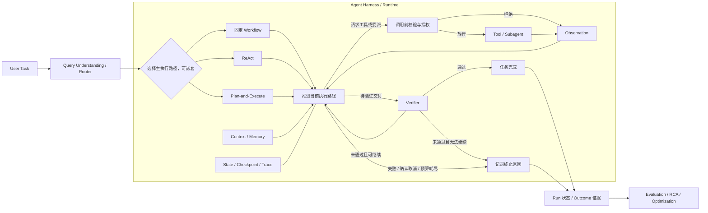

## 1.1 Agent Runtime 的 7 个模块

| 模块 | 主要职责 |
| --- | --- |
| Model Adapter | GPT / Claude / Gemini 等模型接口适配 |
| Context Manager | Messages、Context Injection、Compact、Memory 加载 |
| Tool Registry | Tool Schema、Capability、MCP 接入与工具发现 |
| Execution Engine | 推进固定 Workflow、ReAct 或 Plan-and-Execute。ReAct 按 LLM → Action → Observation 循环决策 |
| Hook / Middleware | before_model、after_model、before_tool、after_tool |
| State / Persistence | Task、Run、Checkpoint、Artifacts、Trace |
| Policy / Verification | 权限、预算、停止条件、Validator、真实结果验证 |

Skill 是可复用的业务操作方法，MCP 是工具与资源接入协议，Subagent 是可独立执行任务的 Agent。它们复用上述运行机制，不需要各自重复实现一套 Harness。

Skill 提供行动策略，Tool 提供行动能力，Hook 接入执行控制并可承载拦截，State 保存任务进度，Verifier 判断是否完成。Harness 负责协调这些机制，并通过 Policy 强制执行权限和预算。

一次工具调用可以按以下时序组织。具体 Hook 的位置由框架实现决定，真正执行前必须校验最终参数并完成授权。

```text
LLM 提出 Tool Call → PreTool Hook → 参数校验 / Policy 授权
  放行 → Tool 执行 → PostTool Hook / 结果校验 → Observation
  拒绝 → 错误 Observation
```

## 1.2 ReAct + Plan-and-Execute

```text
Reason → Action → Observation → Reason → … → Final / Stop
```

Observation 是下一步决策的依据。例如 `read_file("a.py")` 返回文件内容，`shell("pytest")` 返回 stdout、stderr 和退出码，`delegate(subagent)` 返回子 Agent 的结果。调用失败也产生 Observation。

| 方式 | 适用场景 |
| --- | --- |
| Workflow | 流程明确、出错代价高、需要确定性控制 |
| ReAct | 任务较简单或执行路径不确定，需要根据 Observation 动态决策 |
| Plan-and-Execute | 任务需要宏观拆解、依赖管理和阶段性验证 |
| Workflow + 局部 Planning | 整体流程明确，但部分节点需要语义理解、应对场景变化或灵活拆解 |

Planning 决定要做哪些事，ReAct 根据当前 Observation 决定下一步怎么推进，Tool Router 为当前步骤筛选候选工具（见 §4.1）。

复杂任务通常采用外层 Plan-and-Execute、内层 ReAct。

```text
固定 Workflow → 动态节点 → LLM 局部规划 → 程序校验 → 执行 → Observation
  按结果继续既定流程，或回到动态节点调整计划
```

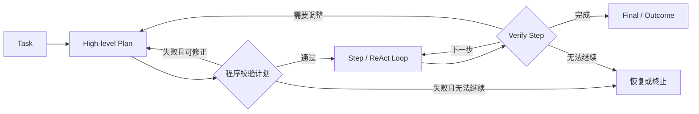

Planning 不是让 LLM 完全自由地规划：Code 控制流程边界，LLM 负责动态决策，Validation 防止计划跑偏。

计划校验或步骤验证失败时，在预算内修正。无法继续时按 §6.2 的统一机制处理。

## 1.3 Policy / Skill / Code / LLM 职责划分

| 模块 | 主要职责 |
| --- | --- |
| Policy / Config | 公共约束、权限、账户范围、参数红线 |
| Skill | 业务 SOP、操作方法、条件分支、停止条件 |
| Code / Runtime | 日期计算、筛选、格式解析、校验、强制流程边界 |
| LLM | 意图理解、动态规划、复杂语义判断、业务表达 |
| Lightweight Decision Model | 高频、答案空间明确的语义判断、分类、候选选择和质量评分 |


例如分析昨日销售数据：LLM 理解意图 → Code 根据时区计算日期 → Skill 定义分析步骤 → Policy 检查权限 → Tool 获取数据 → LLM 分析并生成报告。

**能够稳定使用代码解决的问题，不要反复交给 LLM 推理。** 权限、安全、硬性停止条件必须由 Runtime / Policy 强制执行，而不是只写在 Prompt 或 Skill 中。

### 轻量决策层Jev（Lightweight Decision Layer）

**将开放式生成与封闭式语义决策分离，避免所有判断都调用通用大模型。**

对于无法通过确定性规则解决，但答案空间明确的高频语义判断任务，可以使用分类模型、专用决策模型（如 Jev）或经过验证的小模型。

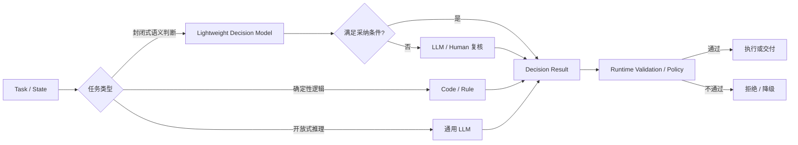

| 判断类型                   | Jev 对应能力                           | 适用场景                                         |
| -------------------------- | -------------------------------------- | ------------------------------------------------ |
| Boolean（二元判断）        | Noul：返回命题成立的概率               | 相关性判断、条件满足、风险识别                   |
| Classification（分类选择） | Choice：从预设选项中选择，返回候选概率 | Intent、Tool Routing、Action Selection、数据打标 |
| Ordinal Score（有序评分）  | Score：按照自定义有序档位评分          | 内容质量、完整程度、风险等级                     |

以 Jev 为例，其基本使用方式：

- State：待判断内容及必要上下文。
- Questions：需要判断的问题。
- Criteria：候选选项、业务定义或评分标准。
- Result：结构化判断结果、概率或评分。
- Code：根据业务规则进行采纳、复核、筛选和分流。

工程实现原则：

- **明确答案空间**：预先定义候选项、业务标准和判断边界，避免选项之间存在歧义。
- **减少重复调用**：多个判断项可共享同一份 State，按需批量或并发执行。
- **分层决策**：轻量模型处理边界明确的高频判断，复杂规划和开放式推理交给通用 LLM。
- **置信度与兜底**：模型分值不等于真实正确率。通过人工标注样本校准采纳阈值，低置信度、证据不足或高风险结果交由 LLM / Human 复核。
- **执行控制**：模型负责语义判断，Code 负责结果处理，Runtime / Policy 负责强制权限、参数校验和执行边界。
- **收益验证**：对比准确率、误判率、自动采纳比例、Latency、Cost 和端到端任务成功率，再决定是否替换原有方案。

轻量决策层是一种模型分工策略，不需要独立实现另一套 Agent Runtime。

**能够用 Code 解决的问题不使用模型；能够用轻量模型可靠完成的封闭式语义判断，不必调用通用 LLM。**


# 2. Query Understanding 与任务路由

Query Understanding 是 Agent 的通用入口，不是 RAG 专属模块。

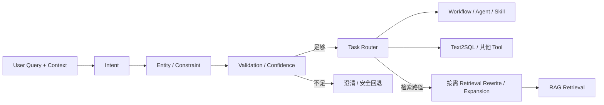

## 2.1 Intent 与 Router

```text
规则 → 轻量分类模型 → 低置信度或语义复杂时由 LLM 兜底
```

- 硬规则 / Policy：处理确定性强的业务条件。
- **轻量语义 Router**：固定意图集合使用分类模型、BERT、Embedding Router、专用决策模型（如 Jev）或小模型。预先定义候选意图及业务边界，根据判断结果和经过验证的采纳阈值进行路由（见 §1.3）。
- 低置信度或复杂语义才由 LLM 二次判断；仍不确定时澄清用户或走安全路径。
- Route 后仍需 Execute → Validate → Fallback；例如 NL2SQL 失败，应判断能否修正、澄清或改走合适的 RAG，而不是直接编造答案。

轻量分类器可以给出意图和置信度，供 Router 判断是否需要二次识别。

```json
{
  "intent": "knowledge_search",
  "confidence": 0.93
}
```

任务路由前结合 Context 理解意图、按需消解指代或补全省略信息，并校验实体和约束（见 §2.2）。Task Router 据此选择 Workflow、Text2SQL 或 RAG 等处理链路。进入检索分支后，再按需做 Retrieval Rewrite / Expansion，生成更适合召回的查询，并保留用户原话和已确认的时间、来源等约束。Text2SQL 等分支使用已校验的结构化条件。检索证据不足时，也可以在预算内改写后再检索（见 §8.1）。

## 2.2 Entity / Constraint

优先使用前端直接传入的业务 ID 和确定性解析结果。服务端负责校验业务 ID 的合法性和权限，LLM 负责复杂语义补全。

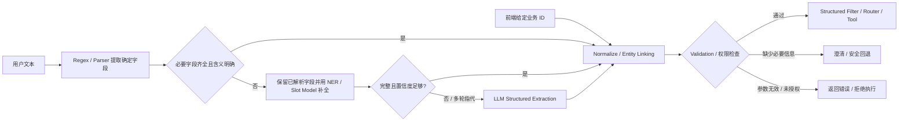

Normalize / Entity Linking：例如英伟达、NVIDIA、NVDA、老黄公司，应通过实体库统一到 canonical_name、symbol、entity_id。日期、百分比等约束也要转换为系统能够执行的标准参数。

字段级置信度可用于判断是否需要语义补全。例如先解析「最近 30 天」，保留该时间约束，再用 NER / Slot Model 提取产品和条款。必要字段齐全、含义明确且置信度足够时，可直接归一化。有指代、多候选或关系歧义时，再由 LLM 补全。以下分数为示意。

```json
{
  "product": {"value": "平安健康险", "confidence": 0.96},
  "version": {"value": "2023", "confidence": 0.94},
  "term": {"value": "等待期", "confidence": 0.99}
}
```

例如用户追问「那帮我看看他们家最近那个新版产品」。如果前文已明确在谈平安保险，就能补全公司，并把「新版」提取为版本要求。「最近」的具体区间和产品名仍可待确认。

```json
{
  "company": "平安保险",
  "product": null,
  "version": "latest",
  "time_range": null
}
```

缺少必要约束时先从 Context 补全，否则 Ask User 或安全回退。低置信度可保留 Original Query，与可靠的 Structured Filter 一起检索，避免错误过滤。

例如「查一下最新版车险」可同时保留意图和已提取的字段。用户没有指定来源，`source` 留空。

```json
{
  "intent": "knowledge_search",
  "entities": {
    "product": "车险",
    "version": "latest",
    "source": null
  }
}
```

以下为各环节的实现示例。

| 环节                               | 常用现成工具                                             | 适合干什么                                |
| ---------------------------------- | -------------------------------------------------------- | ----------------------------------------- |
| **Entity Extraction / NER**        | spaCy、GLiNER、Transformers NER                          | 人名、公司、产品、行业等实体抽取          |
| **字符串 Normalize / Fuzzy Match** | RapidFuzz                                                | 别名、拼写差异、模糊字符串匹配            |
| **日期 / 数字 / 时间 Normalize**   | dateparser、Duckling 类解析器                            | “昨天”“最近30天”“五十万”等转标准值        |
| **Entity Linking**                 | spaCy EntityLinker                                       | `mention → KB candidate → unique ID`      |
| **Record / Entity Resolution**     | AWS Entity Resolution、Reltio、OpenRefine Reconciliation | CRM/customer/product 等跨库实体合并、去重 |
| **自定义企业实体库搜索**           | Elasticsearch / OpenSearch + Vector DB                   | alias + BM25 + vector 候选召回            |

## 2.3 Intent Shift / Entity Switch / Constraint Change

| 变化 | Runtime 行为 |
| --- | --- |
| Intent 改变 | 重新 Route，结束或挂起旧 Flow，清除不再适用的 transient state |
| Intent 不变，Entity 或 Constraint 改变 | 更新实体和约束，清理受影响的计划或中间结果。当前 Flow 仍适用时继续，需要时重新路由 |
| Intent、Entity、Constraint 都不变 | Continue |

State Reducer 保留仍然有效的实体、目标和用户状态，不应因一次新消息无条件清空 Context，也不能让旧任务约束污染新任务。

例如用户仍要分析同一个账户，但改成「查上周，只预览」。保留账户，重新计算日期及依赖旧日期的结果，并取消计划中的报告写入。

如果旧执行仍在运行，由 Runtime 请求取消或暂停，阻止不再适用的后续动作。清理 State 不会停止 Worker，也不会撤销已发生的副作用，执行状态与结果按 §6.5 核验。

# 3. Context 与 Memory 工程化

Context 是本轮模型实际可见的输入，Memory 是可跨轮次 / 会话保存并按需注入的信息，State 是 Runtime 维护的任务真实进度。三者有关联，但不是同一个东西。

## 3.1 Context 分层

| 层 | 内容与策略 |
| --- | --- |
| Static Context | System Prompt、稳定的核心 Tool Schema、Skill Metadata、Policy。稳定前缀有助于复用 Prefix Cache |
| Dynamic Context | User Query、Tool Result、Observation、Intermediate State，以及按需注入到消息中的工具说明 |
| Summary Context | Compact 后的历史摘要 |
| External State | 文件、数据库、Vector DB、Artifact；按需获取，不全部塞进 Prompt |

通过供应商 API 的独立字段传入的工具定义按请求管理。它们在模型输入中的位置和缓存行为取决于 API 实现（见 §4.1）。

信息保鲜：最近 N 轮完整保留；中期摘要压缩；长期关键事实结构化持久化。硬约束、否定和身份属性尽量保留原义；普通偏好可提炼；过程性内容摘要或淘汰；寒暄不进入 Memory。

## 3.2 Context Compact

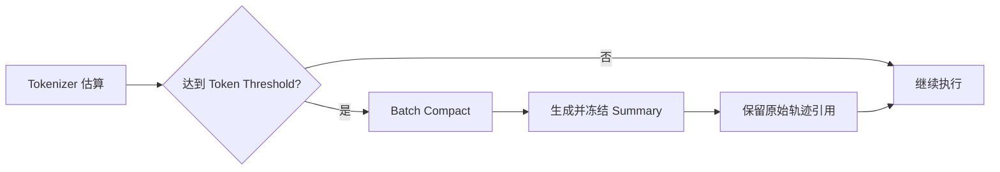

不要每轮压缩。批量 Compact、稳定已冻结的摘要和前缀，有助于减少重复计算。具体 Prefix Cache 命中取决于模型服务与请求前缀。工具定义落在缓存前缀中时，变动可能影响缓存复用（见 §4.1）。调用后通过 API response.usage 记录真实 input/output token。

Summary 至少包含：Task State、Important Constraints、Decisions、Completed / Pending Actions、External References。

```text
Current Goal: 实现 Agent Runtime
Constraints: 不能引入复杂消息系统
Completed: Run Lifecycle 已完成
Pending: 增加 Evaluation Diagnosis
```

长 Deep Research 更适合维护 Evolving Report / Research State：研究目标、fact + source + confidence、待验证假设、信息缺口、当前研究焦点、结论草稿。

普通执行型任务保留进度、决策、约束和待执行步骤。Deep Research 的重心是「从保存发生过什么，变成保存现在知道什么」。

**压缩可以丢过程，但不能把以后无法恢复的关键约束压没。** 原始工具结果与轨迹保存在外部存储，活跃 Context 只保留必要信息。

## 3.3 Memory 分层

| 记忆层 | 保存内容 | 生命周期与作用域 | 实现示例 |
| --- | --- | --- | --- |
| **Working Memory**（工作记忆） | 当前消息、Observation、ReAct 循环中的临时信息 | 当前 Run | AgentScope InMemoryMemory |
| **Session Memory**（会话记忆） | 完整对话历史、会话摘要 | 当前会话，历史可持久化 | Redis + MySQL |
| **User Memory**（用户记忆） | 用户偏好、背景、纠错历史 | 跨会话保存，由有权限的 Agent 检索（见 §5.3） | MemOS · `user_profile` |
| **Agent Memory**（Agent 记忆） | 项目事实、历史任务信息、可复用的任务模式 | 在 Agent 或已授权的项目作用域内跨会话复用 | MemOS · `agent_{agentId}` |

System Prompt、Skill 和 Tool 属于配置与能力资产，由 Runtime 根据任务按需装入 Context 或提供给模型（见 §3.1）。

## 3.4 记忆提取、检索与写入

### 提取触发

**先低成本地控制提取频率，再判断内容是否值得写入。** 两种触发思路的成本不同。

```text
按新增消息数触发（本文参考实现）
→ 计数开销低，触发时机确定、可预测

按近期事件的重要性累计分数触发（Generative Agents 的 Reflection）
→ 更能响应高重要性事件
→ 每条事件需要先评分，判断本身有成本
```

Claude Code 的公开文档描述了会话中的自动记忆维护。*Generative Agents* 论文描述的是近期事件的重要性累计达到触发条件后生成 Reflection。事件密集时，逐条评分也会增加开销。 [Claude Code Auto Memory](https://code.claude.com/docs/en/memory#auto-memory) · [Generative Agents §4.2](https://arxiv.org/html/2304.03442#S4.SS2)

```text
第一层：按新增消息数量控制触发频率
→ 判断是否值得启动一次扫描

第二层：由 Extraction LLM 判断内容
→ 决定哪些内容值得记，以及记忆的类别、作用域和重要性
→ 没有值得记的内容就不写
```

### 会话记忆：Redis 缓存 + MySQL 回源

以下中间件、阈值和预算为参考实现。

1. **存储**：Redis 缓存最新 200 条，TTL 为 7 天。MySQL 持久化会话历史。
2. **读取**：先查 Redis，未命中、缓存异常或版本过旧时回源 MySQL。读取时按 Token 窗口裁剪，为会话摘要预留约 2000 tokens。
3. **写入**：先提交 MySQL，再异步更新 Redis。缓存更新失败时，使旧缓存失效，或由读路径校验版本后回源。MySQL 的提交继续有效。异步回填按版本做条件写入，避免迟到的更新覆盖较新的缓存。

### 长期记忆：MemOS 语义检索与写入

**加载（Load）**

1. 在权限允许的范围内，并行检索 `user_profile` 和 `agent_{agentId}` 两个 Cube。
2. 使用 `fast` 模式、相似度阈值 `0.45`、MMR 去重和时间新鲜度等参数控制召回质量。
3. 参考实现对检索结果还做低分过滤（`score < 0.3`），过长的单条结果截断至 1000 字符。若召回阶段以 `0.45` 为硬性最低阈值，且两处使用同一个分数，后置的 `0.3` 不会再筛掉任何结果。两处采用不同评分时，各自按对应口径解释和校准。
4. 长期记忆是增强能力。查询失败时记录日志，返回空记忆，主对话继续执行。

**写入（Write）**

1. 会话结束后可异步处理新增消息。先通过触发门槛，再调用 LLM 决定是否写入、记忆类别、作用域和重要性。
2. **本地预去重**：检查精确匹配、包含关系，并按需做 Jaccard（参考阈值 `0.7`）和 Levenshtein（参考阈值 `0.8`）相似度比较。
3. **冲突处理**：由冲突检测服务决定新增、跳过或替换旧记忆。并发更新时校验待替换记录的版本，版本变更则重新判断冲突。
4. **先写后删**：先持久化新记忆，确认成功后切换检索使用的有效版本，使冲突的旧记忆退出召回，再异步清理旧记录。清理失败时记录并重试，检索继续使用已切换的版本。

**清理（Delete）**

- 有时效的信息设置 TTL。长期未使用、重要性低的记忆逐步降权或清理，避免记忆无限积累。

### 预算、可靠性与可观测性

- **长期记忆预算**：参考总预算为 4000 tokens，`user_profile` 最多占 60%，剩余预算分配给 Agent Memory。按行截断，尽量保留单条记忆的完整语义。
- **幂等与并发控制**：参考实现使用 Redis 分布式锁（10 分钟）减少同一会话的并发处理，用消息 Hash（MD5，TTL 为 7 天）去重。提交更新时仍由版本校验保护写入顺序。
- **可观测性**：提供运行概览、记忆类型分布、时间趋势、Top Agents，用于巡检和定位异常。关注检索准确率、信息时效性、跨用户隔离和有效记忆占比。

# 4. Tool 工程化

无论由模型选择还是由代码指定，工具调用都复用参数校验、授权、执行和结果验证。MCP Tool、RAG、Text2SQL、Subagent 等能力尽量复用同一套错误协议与 Runtime 控制。

工具稳定性可以记为 **Route → Validate → Execute → Observe**。**Guard** 贯穿调用前后，负责预算、循环检测、停止、降级与日志。

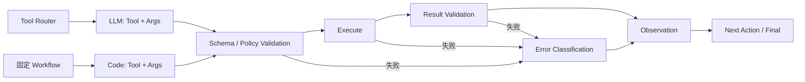

## 4.1 Tool Router

任务 Router 决定进入哪个 Agent、Workflow 或业务能力。Tool Router 为当前执行步骤筛选候选工具，Orchestrator 则负责 Agent 间的任务分配、依赖和调度。Tool Router 先做权限和场景硬过滤，再根据当前任务、步骤、Observation 和状态缩小候选集，最后由主 LLM 选择 Tool + Args。

| 方法 | 做法 / 适用情况 |
| --- | --- |
| 直接暴露 | 工具很少且区分明显时不必单独 Router |
| Rule / Tag | Capability / Tag 匹配，便宜、稳定，适合明确业务 |
| Embedding | 按 Query 与 Tool description 的向量相似度做 Top-K 粗召回，无需额外调用生成式 LLM。成本和时延取决于 Embedding 与检索实现 |
| LLM Router | 复杂意图分类，额外一次模型调用 |
| Hybrid | 权限过滤 → Rule / Embedding → Top-K → 主 LLM |

Rule / Tag 路由通过标签匹配候选工具。

```python
TOOLS = {
    "get_weather": ["weather", "天气", "温度"],
    "search_flights": ["flight", "机票", "航班"],
    "search_docs": ["document", "内部文档", "知识库"],
}
```

Embedding 路由比较查询与工具描述的向量相似度，选出 Top-K。遇到「帮我看看明天北京天气，如果下雨就帮我找个酒店」时，LLM Router 可以输出 `["weather", "hotel"]` 作为候选能力，是否调用酒店工具由天气结果决定。

**工具较少且区分明显时可直接暴露。作为调优起点，5–20 个工具可尝试 Tag / Embedding，超过 20 个可比较混合路由，并从 3–5 个候选开始测量。以候选召回率、选错率、Token 和时延验证效果。**

工具定义若位于缓存前缀中，频繁修改定义可能降低缓存命中。可按任务稳定核心工具集并按需加载额外工具，也可在 API 支持时保留同一份工具定义，每次请求只指定当前允许模型选择的子集。任务或权限变化时重新筛选，Runtime 仍须校验最终调用及参数的权限。效果结合候选召回、缓存命中率、首 Token 延迟和每个成功任务的成本验证。

每个 Tool 至少提供明确的 name、description、capabilities、required_context、permissions，以及实际参数 Schema。以下示例仅展示路由元数据。

```json
{
  "name": "search_flights",
  "description": "查询指定出发地、目的地和日期的航班",
  "capabilities": ["flight_search", "travel"],
  "required_context": ["origin", "destination", "date"],
  "permissions": ["travel.read"]
}
```

## 4.2 Tool Validation / Execute / Observe

调用流程见本章开头。参数校验、执行或结果校验失败时进入错误分类，错误作为 Observation 返回，再决定重试、换策略或降级。

- 调用前：名称唯一，参数名统一，required / enum / type 明确；使用 JSON Schema，条件允许时使用 strict 模式；检查参数、权限、风险等级和幂等性。
- 执行中：Timeout、有限 Retry / Backoff、必要的隔离；涉及副作用时先确认幂等或外部执行状态，不盲目重试。
- 调用后：检查结果格式、字段缺失、空结果、登录墙、广告页、垃圾内容等。Tool 没报错不代表结果有效。
- 无论成功或失败，都生成 Observation；错误不能被 try/except 静默吞掉。

| 失败类型 | 处理方式 |
| --- | --- |
| 临时性失败（网络抖动、部分 5xx / timeout） | Runtime 在预算内 Retry / Backoff；不适合重试的副作用操作先核验 |
| 参数或 Schema 错误 | 返回 Validation Error 供模型提出修正参数，由 Runtime 重新校验 |
| 权限拒绝、确定性 404 等 | 停止原样重试，换合法来源或策略并记录信息缺口 |
| 空结果 / 垃圾结果 | 合法空结果正常返回。证据不足可改 Query，垃圾结果可换来源，结果格式异常则按 Tool 约定清洗或返回错误 |
| 重复失败 | 交由统一 Loop Detection / Budget / Degrade（见第 6 章） |

工具错误可携带可选的 `recovery_action`，表示 Runtime 允许或要求的处置。`RETRY_SAME_CALL` 用于已确认可安全原样重试的调用，`REVISE_ARGS` 表示模型可提交修正后的参数供 Runtime 重新校验，`VERIFY_EXTERNAL_STATE` 要求先核验外部结果。以下示例中 `success: false` 表示本次调用未确认成功，外部写入仍可能已经发生。

```json
{
  "success": false,
  "error_type": "TIMEOUT",
  "error_message": "写入请求超时，外部结果待核验",
  "recovery_action": "VERIFY_EXTERNAL_STATE"
}
```

Runtime 负责 Retry 次数、Backoff、Validation、Timeout、Budget，并强制阻止未授权调用。模型按 Prompt / Skill 和 Observation 来决定如何换合法的工具或来源、改 Query、澄清或降级收尾。这些业务选择无需写进 `recovery_action`。

缺少 `recovery_action` 时，调用方不能据此自动重放原调用。是否允许原样重试仍由 Runtime 按错误类型、权限、幂等性和预算决定。

核心信息缺失不得猜测；非核心信息缺失可降级，并在结果中明确已获取信息、缺失信息及受影响的结论。

日志至少记录 tool、args（敏感字段脱敏）、status、error_type、retry_count、duration、loop_detected，并关联 Trace，供 Evaluation / RCA 使用。

# 5. Multi-Agent

单 Agent 的主要问题是 Context 越来越长、天然并行的任务被串行执行，以及单个 Prompt 难以覆盖多种专业职责。因此 Multi-Agent 的主要价值是分工、并行和独立 Context。

### Multi-Agent 的划分原则

Multi-Agent 不应该只是按照职业角色划分，例如前端 Agent、后端 Agent、数据库 Agent。在使用相同基础模型的情况下，仅修改角色 Prompt 并不能保证 Agent 获得真正的领域专业能力。

更重要的是划分两个边界：

| 边界                           | 核心思想                              | 工程实现                                                     |
| ------------------------------ | ------------------------------------- | ------------------------------------------------------------ |
| Context Boundary（上下文边界） | 每个 Agent 只处理与自身任务相关的信息 | 独立 Context、局部工具、证据提取、信息压缩                   |
| Model Boundary（模型边界）     | 根据任务复杂度选择合适的模型能力      | 小模型负责批量筛选、提取和初步探索，大模型负责复杂推理、冲突处理和最终综合 |

例如：

- Code Analysis Agent：读取完整代码、调用关系和错误堆栈，输出关键问题、证据和影响范围。
- Data Exploration Agent：处理大量原始数据、分布和异常，输出结构化统计结果和关键发现。
- 主 Agent：接收精简结论和 Evidence / Artifact 引用，进行综合判断，必要时回查原始数据。

Agent 之间传递的不应该默认是完整执行历史，而是与下游决策有关的结构化结果、关键约束和证据引用。

**Agent 的划分不仅是职责划分，也是 Context 隔离、信息压缩和计算资源分配。**

大小模型协作需要统一输出协议、结果校验、证据引用、预算和失败回退机制（见 §1.3）。


## 5.1 编排与协作

**Orchestrator 决定 Who / When / Where / What Next / Stop。固定编排通常由 Code / Graph 控制，动态编排可以由 Supervisor Agent 决策；Prompt 只定义行为规则，不等于 Orchestrator。**

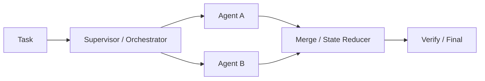

- Supervisor 拆解任务，Graph / Workflow 管理依赖、并行和调度。
- 各 Agent 内部可以使用 ReAct，也可以执行固定流程，可继续调用 Tool 或 Subagent。
- 子 Agent 失败执行有限重试、记录原因并按依赖关系降级；关键依赖失败时不能假装整体完成，非关键失败不应拖垮整条链路。
- Merge Rules 定义去重、缺失数据处理、矛盾检测和最终摘要规则。业务必须预先定义冲突优先级，由 Runtime 中的 State Reducer 或汇总代码按规则裁决。模型综合结果，并标注规则未能解决的冲突。

### 协作方式与控制权分配

Multi-Agent 的核心问题不仅是 Agent 之间如何通信，还包括：

- 谁负责拆解任务？
- 谁负责分配任务？
- 谁决定下一步行动？
- 谁验证任务是否完成？

| 协作方式               | 控制权                 | 核心机制                    | 适用场景                                   |
| ---------------------- | ---------------------- | --------------------------- | ------------------------------------------ |
| Master / Supervisor    | 中心编排者             | 主动分配任务（Push）        | 流程明确、依赖复杂、需要统一编排           |
| Task Board（任务看板） | 共享任务状态与领取协议 | Worker 主动领取任务（Pull） | 大规模并行、批量处理、长时间运行、故障恢复 |
| Advisor（顾问）        | 当前执行 Agent         | 按需咨询与辅助决策          | 专业盲区、方案分歧、复杂判断、风险审查     |

#### ① Master / Supervisor：中心调度

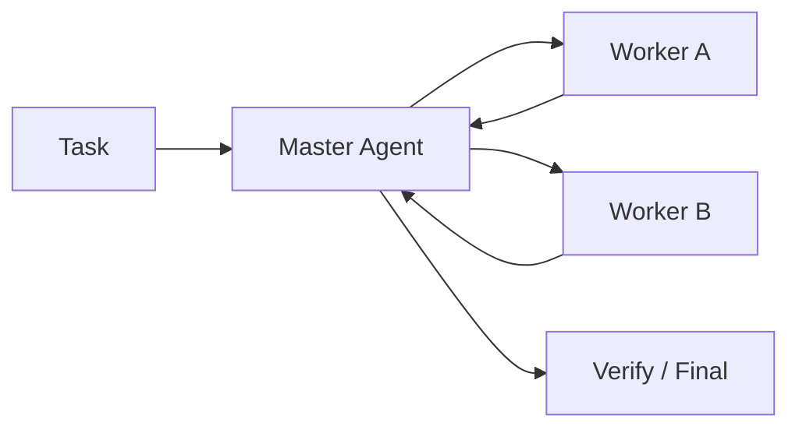

Master 负责理解目标、拆解任务、分配 Worker、处理任务依赖及汇总结果。

优点：

- 控制流清晰，便于统一编排和管理。
- 适合存在明确顺序、复杂依赖和全局决策的任务。

缺点：

- Master 需要持续处理 Worker 状态和中间结果。
- 任务数量和并行度增加时，容易产生中心调度瓶颈及额外 LLM 调用。

工程原则：Master 负责宏观任务规划和动态决策，确定性的依赖管理、状态更新、并发控制及失败恢复交给 Code / Runtime，不应全部交给 Master LLM。

#### ② Task Board：共享状态与自主领取

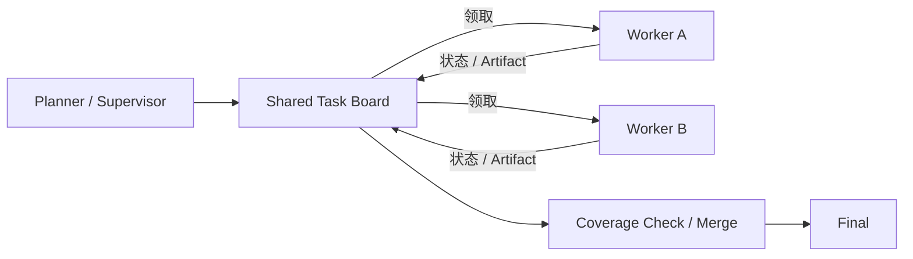

Planner 负责发布任务及依赖关系，Worker 根据自身能力、空闲容量和任务状态，主动领取满足执行条件的任务。

任务看板至少需要维护：

| 字段                     | 职责               |
| ------------------------ | ------------------ |
| task_id                  | 唯一任务标识       |
| required_capabilities    | 执行任务所需能力   |
| dependencies             | 前置依赖任务       |
| status                   | 当前执行状态       |
| worker_id                | 当前任务执行者     |
| lease / version          | 执行租约与版本     |
| retry_count              | 重试次数           |
| input_ref / artifact_ref | 任务输入与产出引用 |

任务状态流转：

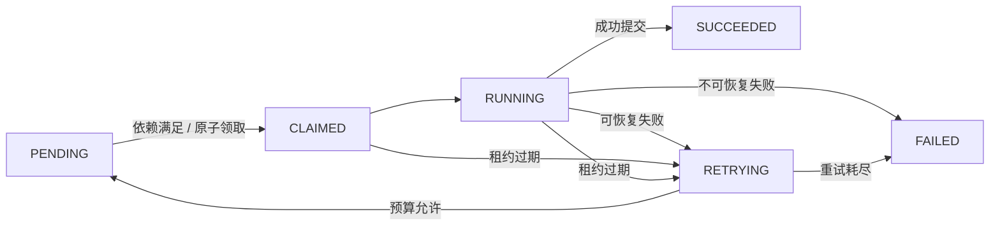

关键工程机制：

- **Atomic Claim**：通过数据库事务、CAS 或锁实现任务原子领取，避免多个 Worker 同时取得同一任务的有效执行权。
- **Lease / Heartbeat**：Worker 持有有限期限的执行租约，异常退出后允许任务被回收。
- **Dependency Management**：前置任务满足依赖条件后，下游任务才可以领取。
- **Idempotency**：任务重试或重新领取时，避免重复产生外部副作用。
- **Version / Ownership Check**：提交结果时校验执行权和版本，拒绝租约过期后到达的旧结果。
- **Coverage Check**：汇总时检查任务覆盖范围，区分成功、失败、未执行和数据不足。

Task Board 将调度压力从中心 Agent 转移到共享状态及协作协议上。任务领取、依赖判断、状态转换和租约回收应尽可能由确定性代码实现，不需要每次通过 LLM 决策。

任务状态、故障恢复和幂等机制复用第 6 章 Runtime 工程化设计。

#### ③ Advisor：执行过程中的按需咨询

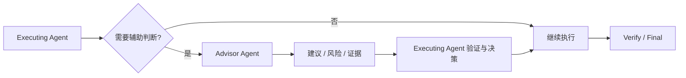

Advisor 不接管主任务，而是针对执行过程中的局部问题提供第二意见。

例如：

- Architecture Advisor：架构设计、事务边界、幂等性审查。
- Security Advisor：识别潜在安全风险。
- RCA Advisor：结合异常证据提出可能根因与验证方向。
- Domain Advisor：补充领域知识和业务判断。

执行 Agent 只传递与咨询问题相关的 Context、当前方案、Evidence 和具体疑问。Advisor 返回建议、风险、替代方案及待验证假设。

关键原则：

- Advisor 默认不拥有主任务的执行权，不直接修改主任务状态或产生业务副作用。
- 最终是否采纳建议，由执行 Agent 结合证据和业务约束判断。
- Advisor 的建议不能替代 Runtime / Policy 的强制安全控制。
- 设置咨询触发条件、次数预算和 Timeout，避免反复咨询形成新的循环。
- Advisor 不可用时，非必要咨询可以降级；强制审查未完成时，不得绕过对应的通过条件。

**Master 与 Task Board 是任务分配方式，Advisor 是辅助决策方式。三者不是互斥架构，可以在同一个系统的不同层级组合使用。**


## 5.2 Agent 交互方式

| 模式                   | 怎样交互                                                     | 适用场景                   |
| ---------------------- | ------------------------------------------------------------ | -------------------------- |
| ① Agent as Tool        | 主 Agent 调用子 Agent，等待结果返回                          | RAG、多专家分析、报告生成  |
| ② Handoff              | Agent A 把控制权交给 Agent B，不一定自动返回 A；要返回时，需要额外设计交回控制权的路径。 | 客服分流、专业任务接管     |
| ③ Shared State / Graph | 不同 Agent 通过共享任务状态协作                              | 固定工作流、并行与依赖调度 |
| ④ Message / A2A        | Agent 之间通过消息或协议通信                                 | 跨进程、跨服务、跨框架     |

前两种是 OpenAI Agents Python SDK 文档列出的常见编排模式。后两种描述状态协作和通信机制，可以与前两种组合。 [OpenAI Agents SDK 编排](https://openai.github.io/openai-agents-python/multi_agent/)


需要区分 Agent 的交互机制与协作方式：

| 协作方式            | 可复用的交互机制                                   |
| ------------------- | -------------------------------------------------- |
| Master / Supervisor | Agent as Tool、Shared State / Graph、Message / A2A |
| Task Board          | Shared State / Graph、Message                      |
| Advisor             | Agent as Tool、Message / A2A                       |

Agent as Tool 既可以用于 Master 委派子任务，也可以用于执行 Agent 向 Advisor 咨询。区别在于任务控制权及执行责任，而不是底层调用接口。

Task Board 是 Shared State 的一种任务调度实现。Handoff 则涉及任务控制权转移，与 Advisor 保留原执行者控制权的方式不同。

**协作方式决定任务如何组织，交互机制决定 Agent 之间如何传递任务、状态和结果。**


需要区别 MCP 和 A2A：

- MCP：Agent 调用 Tool / Resource。
- A2A：独立 Agent 之间发现能力、委派任务和协作。

两者可以一起使用。

## 5.3 Shared State / Memory / Context

| 数据类型           | 是否建议共享     | 原因                   |
| ------------------ | ---------------- | ---------------------- |
| System Prompt      | 默认独立         | 各 Agent 职责不同      |
| 当前任务目标与约束 | 必须按需传递     | 防止偏离目标           |
| 完整聊天 Messages  | 不建议默认共享   | Token 成本与上下文污染 |
| Task State         | 推荐共享         | 协调任务进度           |
| 长期 Memory        | 按权限检索共享   | 防止数据越权和冲突     |
| Artifacts          | 推荐通过引用共享 | 避免大结果反复传输     |

Agent 不直接并发修改同一个全局 Dict。读取 State Snapshot，执行任务，返回局部更新，由 Runtime 按 Merge Rule / 版本控制 / 单写者规则合并。

```text
Agent A → state.research ─┐
                         ├→ State Reducer → Validate → Final Answer
Agent B → state.analysis ─┘
```

**结构化任务协议按需传递目标、约束、输入、依赖、局部结果、状态和 Artifact 引用。完整 Messages 只在任务确实依赖时传递。**

实现选择：单进程 Python asyncio + 内存 State；需要断点恢复可使用 LangGraph + PostgreSQL；多进程 / 多节点可以用 PostgreSQL 持久化状态，Redis / MQ 异步分发，由 Orchestrator 协调。PostgreSQL 不是必经通信总线，Redis 也不是必需品。


### 混合协作架构：中间件巡检 Agent

实际业务不必只采用一种 Multi-Agent 协作方式，可以根据不同层级的任务特征组合 Master、Task Board 和 Advisor。

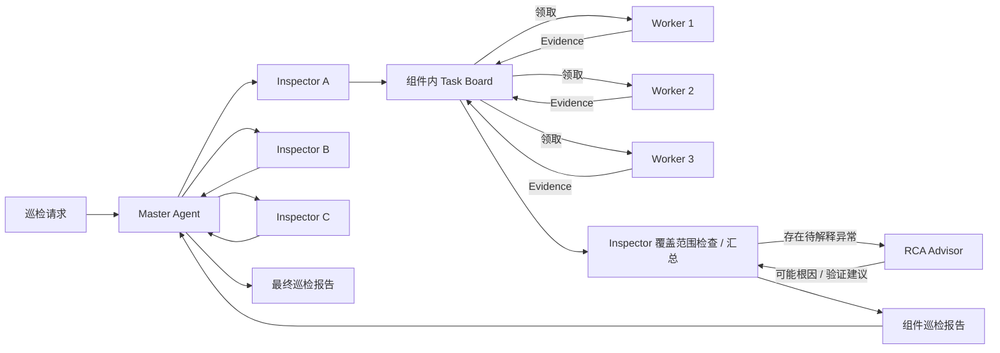

| 层级              | 协作方式                       | 主要职责                                                     |
| ----------------- | ------------------------------ | ------------------------------------------------------------ |
| 入口 Master Agent | Master / Supervisor            | 提取组件、时间窗口及巡检目标，路由到对应 Inspector           |
| Inspector Agent   | 局部 Planner / Orchestrator    | 根据指标目录和目标集合拆解任务，管理依赖、覆盖范围与组件级报告 |
| Task Board        | Shared State / Pull Scheduling | 保存待执行任务、执行状态、依赖、租约及产出引用               |
| Worker Agent      | 并行执行                       | 领取指标与目标批次，调用统计工具，输出结构化证据             |
| RCA Advisor       | 按需咨询                       | 结合异常证据提出可能根因、风险和验证方向                     |
| Master Agent      | 最终汇总                       | 保留各组件事实边界，综合巡检结论                             |

#### Context 与证据传递

Worker 调用确定性统计工具计算峰值、阈值超限、已观测持续时长等指标。

原始时序数据保留在工具层，正常对象压缩为统计汇总，异常对象保留必要明细和 Evidence 引用。Inspector 不需要将所有原始数据装入 Context，只需获取足以支持结论的证据，必要时回查。

#### 并行执行与故障恢复

Inspector 将任务拆解为「指标 × 目标批次 × 时间窗口」，由 Worker 并行领取。

Worker 异常退出后，已完成且有效提交的结果继续保留，未完成任务在租约到期后重新分配。通过有限重试、幂等执行和版本校验，避免整轮任务重新执行。

#### 完整性检查与按需咨询

Inspector 汇总结果时，需要区分：

- 当前仍在持续的异常。
- 时间窗口内出现过、当前已经恢复的异常。
- 数据不足或任务未完成，无法确认状态的对象。

对于已有充分证据的问题直接生成结论；只有存在关联指标难以解释、根因不明确或领域知识不足时，才调用 RCA Advisor。

Advisor 提供的是可能原因和验证建议，不能将时间相关性直接视为因果关系。Inspector 负责核验证据、采纳建议，并保留必要的不确定性。

**Master 负责宏观路由，Task Board 负责规模化执行协调，Advisor 负责局部认知补充，Runtime 负责可靠性和执行边界。**


# 6. Agent Runtime 工程化与稳定性

## 6.1 Async Runtime / Run Lifecycle

短任务可以直接 HTTP → Agent Loop → Response。长任务应将 HTTP 生命周期与 Agent 生命周期解耦：

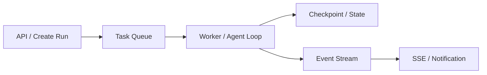

- `thread_id`：长期会话 / 状态线。
- `run_id`：一次具体执行。
- `event_id`：一次流式事件位置，用于断线补发。

接口设计：

```text
POST /threads                   → thread_id
POST /threads/{thread_id}/runs  → run_id
GET  /runs/{run_id}/events      → SSE
```

## 6.2 统一失败分类与恢复

| Layer | 常见失败 | Recovery |
| --- | --- | --- |
| API / Provider | 429、timeout、rate limit、streaming stuck | retry / backoff / fallback model |
| Context | overflow、compact 失败、tool 消息不匹配 | compact / repair history |
| Tool | timeout、invalid arguments、external failure | validation / retry / fallback（见第 4 章） |
| Control Flow | infinite loop、cancel、checkpoint failure | checkpoint / cancel / resume / budget |
| Environment | permission、外部状态变化 | 权限检查 / 状态核验 / Human Approval |

Recovery 在预算内执行。各类失败应结构化记录并关联 Trace。工具错误等需要 Agent 参与恢复决策的情况以 Observation 返回模型，Provider 失败、用户取消和 Checkpoint 故障由 Runtime 按对应机制处理。

## 6.3 循环打断、停止与降级

常见的四类问题如下。

- **工具调用循环**。反复调用同一工具，迟迟不进入总结。
- **目标漂移**。在主任务完成后不断扩展子任务，迟迟不交付。
- **自我怀疑循环**。在达到完成条件后继续 Review、重写或优化。
- **幻觉性进展**。重复换说法，任务状态和证据没有实际推进。

| 机制 | 作用 | 主要处理的问题 |
| --- | --- | --- |
| max_iterations / max_steps | 硬步数上限 | 为重复调用和任务范围持续扩张兜底 |
| Budget | Token / API / 成本 / 总时长限制 | 约束步数未超限但单步成本或耗时过高的执行 |
| Loop Detection | 最近 3–5 步记录 tool_name + normalized_args 指纹，必要时检查语义相似和实际进展 | 识别重复调用和看似推进、实质重复的步骤 |
| Verifier / Stop Condition | 检查任务真实完成情况，完成即收尾 | 防止交付条件已满足后仍扩展或反复自审 |
| Human Escalation | 自动恢复失败后交人工，或有条件地降级结束 | 处置仍无法继续的任务 |

预算耗尽后停止发起新的业务动作，依据已有结果和终止原因收尾。

Loop Detection：第一次命中，按场景阻止无效重复执行并返回 Observation 提醒换策略；继续循环则停止 / 降级。合法轮询、状态发生变化或预定重试不应简单按参数重复一律阻止。

生成指纹前先归一化参数，让等价的参数写法得到相同指纹，例如对象字段顺序不同。指纹适合发现重复调用，目标漂移、自我怀疑和幻觉性进展还需要结合完成条件、结果、外部状态和实际进度判断。

人工介入时提供已执行步数、消耗预算、失败原因、近期操作、完整 transcript 引用和当前 State；由人工决定继续、终止或调整策略。

## 6.4 断线、Crash 与主动暂停

**SSE 断开 ≠ Agent 停止。** Checkpoint 保存 Agent State，Event Log / Resumable Stream 保存客户端漏掉的事件。客户端用 `run_id + Last-Event-ID` 重连，服务器补发后续事件（前提是仍有保留的事件记录）。

```text
客户端接收事件
event 100
event 101
event 102 ← 最后收到
💥 disconnect

Agent server 继续执行，写入 Event Log
event 103
event 104
event 105
event 106

客户端用原 run_id 重连，携带 Last-Event-ID: 102
→ 服务端从 event 103 开始补发，再继续推送后续事件
```

**Agent Server Crash**：重启后加载同一 Graph / Agent 配置、连接持久化 Checkpointer，使用对应 thread_id 与 checkpoint 恢复，失败 Node 可能从头执行，因此 Tool Side Effects 必须幂等或可核验。

Human Approval / Interrupt：暂停时保存 Checkpoint，收到用户决策再恢复。以 LangGraph 为例，恢复会重新进入包含 `interrupt()` 的 Node。

```python
from langgraph.types import Command

agent.invoke(
    Command(resume=True),
    config={
        "configurable": {
            "thread_id": "same-thread-id"
        }
    },
)
```

## 6.5 Cancel 与结果提交

```text
Cancel Request → cancel_requested → Worker 到安全点 → cancelled
```

前端收到 `cancel_requested` 时可显示「正在停止」，此时 Worker 可能仍在执行。Worker 确认停止后续步骤并提交 `cancelled` 后，前端才显示「已取消」。

仅修改数据库状态并不会立即终止正在运行的线程、代码或远程 Tool。Worker 在 Tool 调用前后和下一步执行前检查取消标记，**确认停止后续执行后才提交 `cancelled`**。已发出的副作用操作需要单独核验，不能假设取消会回滚它们。

**最终提交必须防止迟到成功**，在数据库事务中验证 `status` 仍为 `running`、提交者持有本次执行权、`cancel_requested_at` 为空。若 `worker_id` 可能复用，还要核对本次执行版本或租约。取消与成功的竞争由有效的原子状态提交决定。

例如 Worker 已生成答案，用户此时点取消。如果取消请求已经提交，随后到达的成功提交应失效。Worker 到达安全点后确认停止后续执行，才把状态更新为 `cancelled`。反过来，如果成功已先提交，随后到达的取消请求应读到已完成的状态。

## 6.6 幂等与提交边界

| 环节 | 保护范围 |
| --- | --- |
| Run 创建去重 | 同一次业务请求的 HTTP 重试复用已有 Run |
| Tool 执行幂等 | Worker 重试或从 Checkpoint 恢复时，避免重复外部写入，必要时先核验外部结果 |
| Run 终态原子提交 | 通过执行权和状态校验防止迟到或重复提交覆盖终态 |

创建 Run 时，使用调用方在新业务意图产生时生成的 `idempotency_key`（如 UUID），而非单独使用 input_hash。

- `UNIQUE (org_id, idempotency_key)`。
- same key + same input hash：同一次请求重试，返回已有任务。
- same key + different hash：409 IDEMPOTENCY_CONFLICT。
- 相同输入的新业务动作（例如重新生成）使用新的 key。

# 7. 安全与行为审计

**Policy / Sandbox 负责阻止危险行为，Audit 负责识别、追踪和复核风险。**三者都是 Harness 的横切能力，不应由每个业务 Agent 分别实现一套。

## 7.1 Sandbox 安全

不要相信 LLM 生成的代码，也不能只靠黑名单或 AST 检查。采用白名单最小权限 + 静态检查 + OS 级隔离 + 资源限制。

```text
用户上传数据
   ↓
① 输入限制
   → 文件大小 / 行数限制
   ↓
② LLM 生成代码
   → Prompt 明确允许能力
   ↓
③ 静态安全检查
   → Syntax + AST + 危险模式
   ↓
④ 进入 Sandbox
   → Docker / E2B
   ↓
⑤ Runtime 限制
   → Timeout
   → CPU
   → Memory
   → Network
   → Filesystem
   ↓
⑥ 执行并捕获输出
   → stdout / stderr / 图表
   ↓
⑦ 清理资源
   → 临时文件 / 容器
   ↓
⑧ 返回用户结果
```

使用 Docker 等容器运行生成的代码时，需要配置进程权限、网络和文件系统访问，以及运行时的资源限制。

## 7.2 Agent 行为审计

例如 Tool Policy 在执行前阻止了一次未授权文件读取。行为审计记录谁发起、何时发起、命中什么规则、涉及什么资源，以及最终如何处置。审计发现新风险时可以要求人工复核或停止后续动作。

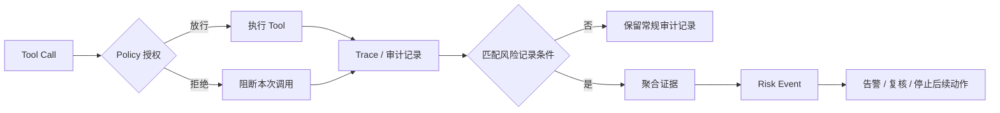

### Risk Event 数据结构

```json
{
  "risk_type": "UNAUTHORIZED_ACCESS",
  "severity": "HIGH",
  "actor_id": "agent_123",
  "resource_ref": "file_456",
  "occurred_at": "2026-11-25T09:00:00+08:00",
  "trace_id": "trace_xxx",
  "rule_id": "policy_001",
  "evidence_refs": ["trace_xxx#policy_decision"],
  "decision": "BLOCK",
  "action": "REVIEW_REQUIRED"
}
```

重点能力：

- 从大量低保真告警中筛出高风险事件。
- 关联原始 Trace、工具调用和命中规则。
- 保留最小必要证据，敏感信息脱敏或受控访问。
- 根据严重等级进行告警、阻断或人工复核。
- 审计记录应可追溯，不依赖 LLM 自己描述执行结果。

**原则：安全执行控制由 Runtime / Policy 强制实现，Agent Judge 可以辅助识别风险，但不能代替确定性的权限检查。**

# 8. RAG 与 Text2SQL

两者都是 Agent 可以使用的业务能力：RAG 检索非结构化知识，Text2SQL 查询结构化数据。入口统一复用 Query Understanding / Router，调用与失败恢复复用 Tool / Runtime 机制。

## 8.1 RAG 优化方向

| 方向                 | 主要做法                                                     | 解决什么问题                                                 |
| -------------------- | ------------------------------------------------------------ | ------------------------------------------------------------ |
| **检索与索引**       | BM25 + Embedding 混合检索；先召回再 rerank；索引分片、动态更新、元数据过滤 | 兼顾关键词匹配和语义覆盖，提高检索相关性，保持知识更新       |
| **生成控制**         | 按任务设置 Prompt 模板；资料不足时明确说明；事实一致性校验；结构化输出、引用和副模型复核 | 减少无依据回答，提升输出一致性与可追溯性                     |
| **Query 理解与路由** | 复用 §2 的意图识别、上下文补全和任务路由。进入 RAG 后按需改写检索词、选择知识库或索引 | 减少歧义和无效检索，让问题进入合适的处理链路                 |
| **吞吐与稳定性**     | 异步与批量调用；高频 Query 缓存；模块独立部署；延迟监控、超时熔断与降级 | 降低响应时间和调用成本，提高并发承载能力，避免局部异常拖垮系统 |
| **评估与反馈**       | 自动离线评估；记录用户评分和失败案例；将高风险、低置信度回答纳入后续训练样本池 | 找到薄弱环节，持续改进 Query、检索和生成策略                 |

| 评估阶段 | 指标示例 |
| --- | --- |
| 检索 | Recall@K 检查相关证据是否进入候选，MRR / NDCG 检查排序。使用 Coverage 时先定义覆盖对象，例如标注的必要证据 |
| 生成 | Faithfulness 检查结论是否由证据支持，引用检查核对来源。BLEU / ROUGE 可作为有参考文本时的重合度辅助指标 |
| 性能 | Latency，可按检索、生成和端到端分别记录 |

通过标准与诊断指标的用法见 §9.2。


### 从任务路由到检索

1. **任务路由前**：按 §2 结合上下文识别意图、按需补全指代，校验实体和约束。Task Router 据此选择 RAG、Text2SQL 或其他处理链路。
2. **进入 RAG 后**：按需做 Retrieval Rewrite / Expansion，把已理解的问题转成适合召回的查询。保留日期、产品、来源等已确认的约束。
3. **召回前**：有多个知识库、索引或数据源时，再按需选择检索目标。随后执行召回、融合、重排和生成。

### 召回与索引

先定位正确证据在链路中哪一步丢失，再决定调整什么。

| 现象 | 优先检查 |
| --- | --- |
| 正确文档未进入单路候选 | Query、文档解析、Chunk、Metadata / Filter，以及 BM25 和向量检索各自的召回 |
| 已进入单路候选，但融合或重排后未进入 Top-K | Fusion / RRF，再检查 Reranker 的输入及排序结果 |
| 正确证据已被检索到，回答仍然错误 | 证据是否进入 Context、Prompt 是否约束证据使用、生成的主张是否忠实于证据 |

当正确证据没有进入候选或在排序中丢失时，可按下面的顺序逐步排查。

```text
Query 是否表达了正确的问题？
   ↓
文档解析是否丢了关键信息？
   ↓
Chunk 是否切散了完整证据？
   ↓
Metadata / Filter 是否排除了正确文档？
   ↓
分别检查 BM25 和向量召回
   ↓
已进入候选：检查 Fusion / Rerank
仍未进入向量候选：定位向量召回问题后，再考虑换或微调 Embedding
```

离线知识库决定上限：Document → Layout / OCR / Table Parsing → 标题、段落、表格等语义切分 → Chunk + Metadata（文档名、章节路径、日期、来源、类型、页码）。Chunk 应尽量是完整、可独立理解的语义单元，而不是机械每 500 字切分。

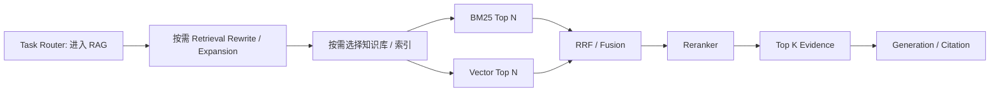

Rerank 提升 Precision / Ranking 的前提是正确文档进入候选集。Weighted RRF 可设置 BM25 权重 α、Vector 权重 1-α；通过人工标注 Query Set、Grid Search、Recall@K / MRR / NDCG 选择，而不是凭感觉。


### 多维度业务过滤（Semantic Decision Filtering）

**向量相似不等于业务相关，业务相关也不等于内容可用。**

传统 Reranker 主要解决候选文档的相关性排序。对于业务边界明确的检索任务，可以在召回或重排后使用轻量决策模型（见 §1.3），进一步判断候选内容的业务相关性、主题归属和内容质量。

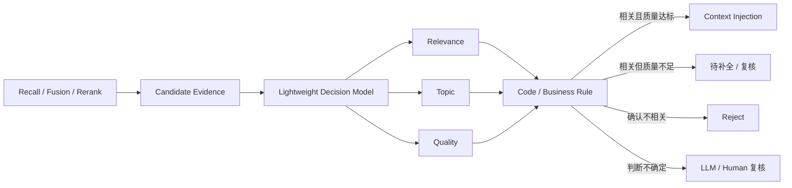

| 判断维度            | 判断内容                                                     | 实现方式       |
| ------------------- | ------------------------------------------------------------ | -------------- |
| Relevance（相关性） | 是否与当前任务的实际业务目标直接相关，而不是仅包含相似关键词 | Boolean / Noul |
| Topic（主题归属）   | 是否属于目标业务范围，区分相似但不同的业务场景               | Choice         |
| Quality（内容质量） | 内容是否完整、清晰，满足后续任务的使用要求                   | Score          |

例如检索支付业务的测试用例：

- 包含「银行、支付」等关键词，但实际验证的是其他支付业务：剔除。
- 属于目标支付业务，但场景、操作对象或预期结果不完整：保留待补全。
- 属于目标业务且内容质量满足要求：交给 Agent 使用。

多个判断项可以共享同一份候选内容，一次请求完成多维度判断，再由 Code 根据业务阈值进行筛选、排序和分流。

**工程注意事项：**

- 多维度业务过滤不一定替代 Reranker。仅需要相关性排序时，优先评估常规 Reranker；存在明确业务约束和质量要求时，再考虑引入决策模型。
- 保留原始候选、判断结果、分值和 Trace ID，供后续 Evaluation / RCA 使用。
- 接口失败、低置信度和证据不足不能直接等同于内容不相关。
- 通过人工标注的 Query Set 验证过滤前后的 Precision、Recall、回答质量、Context Token、Latency 和 Cost，避免过度过滤导致关键证据丢失。


### Generation 与稳定性

只根据 Evidence 回答。没有证据支持的事实不得自行补充，资料不足时明确说明，冲突信息单独标注并关联来源。证据不足时可进行 Query Rewrite 并再检索。可从 1–2 次重检索开始验证效果，并计入统一预算。召回后还需要核对事实一致性和引用。

异步与批量调用、高频 Query 缓存、模块独立部署、超时熔断与降级；通过评测识别 Query、Retrieval、Generation 具体问题。

## 8.2 Text2SQL

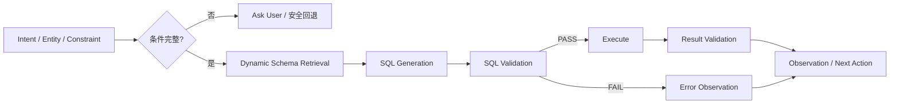

- 歧义必须在 SQL 之前尽可能解决，不能让 Text2SQL 自己猜关键条件。
- Dynamic Schema Retrieval：不要把全库 Schema 交给模型；Text2SQL 也需要检索相关表、字段等 Schema 的“小型 RAG”。
- SQL Validation：只读查询场景只允许经过校验的 SELECT，禁止 DELETE / UPDATE / INSERT / DROP / ALTER 等写操作；强制 LIMIT、表 / 字段合法性、权限和复杂度约束。使用 Parser / Validator 及数据库最小权限强制执行，不靠 Prompt。
- Result Validation：SQL 能执行 ≠ 语义正确。检查空结果、异常行数、数值越界、单位、是否符合用户问题。
- SQL 错误与结果异常统一返回 Observation，走第 4、6 章的容错机制。

# 9. Agent 评测与持续优化

**Agent Runtime 负责把任务做完；Evaluation Harness 负责判断任务是否做对、哪里做错、优化后是否真正变好。**

统一的数据底座是 Trace / Trajectory / Outcome，线上与离线使用相同的任务评测口径，但执行环境及样本来源不同。

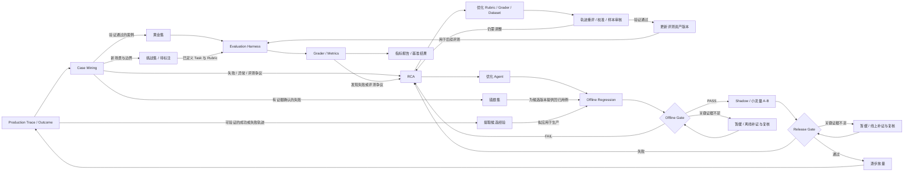

三个闭环共享 Trace、Case Pool、Evaluation Harness 和版本管理。Agent Loop 修 Agent，Evaluation Loop 修评测标准和样本，Experience Loop 将验证有效的经验沉淀为可复用资产。验证与发布路径由变更影响决定（见 §9.7）。

## 9.1 Trace → Trajectory：统一数据底座

**Trace 侧重调用链与性能观测，Trajectory 侧重完整任务执行过程；两者都可以用于调试、评估和归因。**

- **Trace**：通过 Span 记录 LLM、Tool、RAG 等调用关系、耗时、Token、错误及上下文信息。
- **Trajectory**：按时间顺序组织 Agent 的任务输入、交互步骤、Tool Call、Observation 和最终结果。
- **ATIF（Agent Trajectory Interchange Format）**：标准化 JSON 轨迹格式，统一表示不同 Agent 的执行记录，便于评估、回放、可视化和训练。

### 数据标准化流程

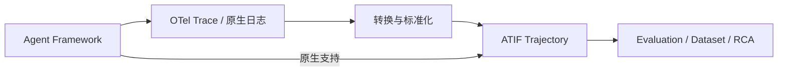

- **采集层**：通过 OTel、SDK、Hook 或框架原生能力获取运行数据。
- **标准化层**：统一调用关系、步骤、工具输入输出和标识符。
- **轨迹层**：按 ATIF 或自定义统一 Schema 保存任务过程，通过 `extra` 扩展业务字段。
- **消费层**：评估与回放系统不必逐一适配底层 Agent Framework。

ATIF 是数据交换格式，不是采集框架，也不是执行引擎。

**注意：格式统一不代表可以完整复现。** 仍需额外管理外部环境、工具响应、Context Snapshot 和相关版本。

### 数据管线：CPU 规则清洗 + LLM 语义加工

```mermaid
flowchart LR
    A["Trace / Trajectory"] --> B["CPU 规则清洗"]
    B --> C{"需要语义分析?"}
    C -->|否| D["规则标签 / 统计"]
    C -->|是| E["LLM 语义加工"]
    D --> F["Case Pool / Dataset"]
    E --> F
```

| CPU 确定性处理       | LLM 语义加工 |
| -------------------- | ------------ |
| Schema 标准化        | 意图识别     |
| 精确去重             | 主题聚类     |
| 错误码、超时识别     | 复杂失败分类 |
| Token / Latency 统计 | 业务语义标注 |
| 脱敏、规则过滤       | 风险语义判断 |

**不需要把所有 Trace 都交给 LLM。** 确定性问题直接用规则识别，只有需要语义理解的 Case 才进入 LLM 加工。

### Replay / Evidence Snapshot

至少关联：

- task_id / session_id / run_id / trace_id。
- agent / model / prompt / skill / tool 版本，数据集、Rubric 和 Grader 版本。
- Task Input、Context Assembled / Snapshot、Model Input / Output、Planning、Tool Selection / Args / Result、Observation、State Update、Retry / Fallback、Final Answer、Outcome。
- Environment Snapshot：执行时的数据、时间、权限、外部环境及必要 Tool Response。

原始 Trace 保留可追溯引用，Trajectory 用于下游结构化消费。出现 Bad Case 后，至少要能依据这些记录还原当时发生了什么。评测回放有两种用法。

| 用法 | 固定的输入 | 重新执行的部分 |
| --- | --- | --- |
| 固定轨迹重评 | 已保存的 Trajectory、Outcome 和当时可用的证据 | Grader，用于比较 Judge 或 Rubric |
| 从快照重跑 | Task、环境快照、运行时间和相关版本，按实验目的只替换待验证部分 | Agent，用于复现或回归 |

- **重跑条件。** 从快照重跑可结合固定运行时间、Mock Tool 或隔离测试环境。
- **响应匹配。** 仅当工具、参数和相关环境条件都匹配时，才复用录制响应。例如旧版查询 11 月 23 日，新版改查 11 月 24 日，应由受控环境按新参数返回对应数据。无法取得匹配响应时，记录该调用无法复现。
- **复现范围。** 即使固定快照和版本，重跑时模型仍可能产生不同的执行轨迹。

## 9.2 评测对象与指标

评测范围取决于交付物、关键执行行为和外部副作用。

| 层级                                                         | 关注什么             | 例子                               |
| ------------------------------------------------------------ | -------------------- | ---------------------------------- |
| **Result / Outcome**（**任务执行结束后，真实环境最终变成了什么状态。而不是单单模型输出**） | 最终事情有没有办成   | 文件是否真正生成、订单是否真正创建 |
| **Trajectory / Process**                                     | 中间路径是否合理     | Tool 是否选对、步骤是否多余        |
| **Efficiency**                                               | 成本是否合理         | Token、耗时、Tool Calls、Steps     |
| **Risk / Safety**                                            | 有没有越权或危险动作 | 非授权写操作、错误删除数据         |

**问答型任务主要评 Answer Quality**。涉及关键工具操作或改变外部状态的任务，还应核查执行行为、权限和实际 Outcome。即使只调用一次写工具，也要检查实际状态。**长程任务尤其要评估 Trajectory、步骤依赖与执行稳定性。**

**E2E Evaluation** 验证用户任务最终有没有办成，**Process Evaluation** 检查执行路径中的关键行为、失败步骤和安全边界。评测数据也从 `Query + Ground Truth + Answer` 扩展为 `Prompt + Expected Behavior + Trace / Trajectory + Outcome + Rubric`。任务定义与 Rubric 见 §9.3，Trace / Trajectory 见 §9.1，Outcome 见 §9.6 的 Trial 示例。

### Pass Criteria 与 Diagnostic Metrics

评测指标不仅要衡量 Agent 做得好不好，还应该能够帮助定位问题。

需要区分两类指标：

| 类型               | 主要作用           | 示例                                           |
| ------------------ | ------------------ | ---------------------------------------------- |
| Pass Criteria      | 决定 Trial 是否通过 | 数据正确、必要步骤完成、结果真实、没有越权     |
| Diagnostic Metrics | 定位问题及优化空间 | 重复调用、规划效率、Token、Tool Calls、Latency |

例如一个数据分析 Agent：

- 最终交付用了错误日期的数据、使用虚假数据，或在要求生成报告的场景中未生成有效报告，本次 Trial 判定失败。
- 多调用了一次无副作用的查询 Tool，可以计为效率问题，是否影响通过由业务规则决定。

具体哪些指标属于硬性标准，应由业务风险和交付要求决定。

**不要把所有指标简单加权为总分**：**硬性业务错误、安全违规不能被语言表达或成本优势抵消。评测需覆盖 Task Success、失败率分布、严重问题比例，并支持按任务类型 / 步骤下钻。**

### Evaluation Metrics

| 维度 | Metrics |
|---|---|
| 任务交付 | Task Success Rate |
| 单次执行 | Trial Success Rate |
| 首次尝试 | First-Trial Success Rate |
| 给定尝试预算下的成功能力 | Pass@k |
| 执行稳定性 | Pass^k |
| 工具使用 | Tool Accuracy / Args Accuracy |
| 执行过程 | Trajectory Quality |
| 事实一致性 | Faithfulness |
| 安全性 | Policy Violation / Critical Failure Rate |
| 成本 | Token / Cost per Successful Task |
| 性能 | E2E Latency / TTFT / Steps |

| 指标 | 统计口径 |
| --- | --- |
| Task Success Rate | 按实际允许的尝试和重试策略完成交付的 Task 数 ÷ 纳入统计的 Task 数 |
| Trial Success Rate | `PASS` 的 Trial 数 ÷ 纳入统计的 Trial 数 |
| First-Trial Success Rate | 首次 Trial 为 `PASS` 的 Task 数 ÷ 本次基准纳入首轮统计的 Task 数 |
| Cost per Successful Task | 同一批 Task 的总执行成本（含失败和重试）÷ 按 Task Success Rate 同一口径成功交付的 Task 数 |

对照实验使用一致的纳入规则、分母和尝试配置。任务交付指标按实际执行策略统计。

按 Rubric 统计 Atomic Metrics 和 `UNKNOWN` 比例，按 Trial 单独统计 `INCONCLUSIVE` 比例。报告应声明这些状态如何计入分母。例如在所有纳入的 Trial 中计算通过率时，`INCONCLUSIVE` 计入分母，通过数仍只统计 `PASS`。

### Pass@k 与 Pass^k

Agent 存在随机性，同一个任务执行多次，结果可能不同。

- Pass@k：同一个 Task 执行 k 次，至少有一次成功，反映 Agent 多次尝试下的任务完成能力。
- Pass^k：同一个 Task 执行 k 次，全部成功，反映 Agent 的执行稳定性。

例如一个 Task 执行 5 次：

```text
Trial 1    PASS
Trial 2    PASS
Trial 3    FAIL
Trial 4    PASS
Trial 5    FAIL

Pass@5 = 1
Pass^5 = 0
```

在整个 Benchmark 上，各 Task 固定执行相同的 `k` 次 Trial，再分别统计至少通过一次和全部通过的 Task 占比，用于比较离线任务完成能力和执行稳定性。

对同一个 Task，若各次 Trial 独立、单次成功概率同为 `p`，则全部成功的概率为 `p^k`。例如 `p = 0.8` 时，连续 5 次全部成功的概率约为 33%。

| 现象 | 可能的问题 |
|---|---|
| Pass@k 低，Pass^k 低 | Agent 可能缺乏完成任务的能力 |
| Pass@k 高，Pass^k 低 | Agent 有能力完成，但执行不稳定 |
| Pass@k 高，Pass^k 高 | Agent 具备较好的能力与稳定性 |

当 Pass@k 已经很高，但 Pass^k 仍然很低时，优化重点不应该只是增强模型能力，而应该检查：

- Skill 是否存在歧义。
- 条件分支和停止条件是否明确。
- Tool Routing 是否稳定。
- Context 是否完整。
- 确定性逻辑是否过度依赖 LLM。
- 外部环境和 Tool 是否稳定。

生产环境不仅需要 Agent 能够做对，更需要 Agent 能够稳定地做对。

## 9.3 Task Schema 工程化

**长程 Agent 的 Evaluation Task 不是简单的 Query + Ground Truth，而是任务输入、环境、预期行为、评测标准和可执行检查的统一定义。**

| 对象              | 职责                                   | 回答的问题         |
| ----------------- | -------------------------------------- | ------------------ |
| Task / Input      | 定义用户任务                           | 要做什么？         |
| Environment       | 定义测试数据、时间、权限、外部状态     | 在什么环境下执行？ |
| Expected Behavior | 定义预期行为                           | Agent 应该怎么做？ |
| Rubric            | 定义业务评测标准                       | 怎样才算做对？     |
| Grader            | 将 Rubric 转化为可执行检查             | 如何判断是否做对？ |
| Trial             | Agent 对同一个 Task 的一次实际执行     | 实际做得怎么样？   |
| Metrics           | 对多个 Task / Trial 的评测结果进行聚合 | 整体表现怎么样？   |

例如：用户要求分析昨日销售数据并生成报告。

以下 Task Schema 对应完整数据场景。示例快照包含 11 月 23 日和 24 日各自完整的销售数据。任务在 11 月 25 日执行，应使用 24 日的数据生成报告。缺失数据场景应单独定义 Task，并按业务 SOP 验收补查、标注缺失或停止交付。

```json
{
  "task_id": "sales_report_001",
  "input": {
    "prompt": "分析昨日销售数据并生成报告"
  },
  "environment": {
    "account_id": "test_account",
    "snapshot_id": "snapshot_001",
    "execution_date": "2026-11-25",
    "timezone": "Asia/Shanghai",
    "permissions": ["sales.read", "report.write"]
  },
  "expected_behavior": [
    "正确解析日期",
    "读取销售数据",
    "校验所用销售数据的完整性",
    "生成销售报告"
  ],
  "rubrics": [
    {
      "id": "R1",
      "criterion": "报告最终采用的销售数据必须对应执行环境时区的昨日",
      "required": true
    },
    {
      "id": "R2",
      "criterion": "报告生成前必须成功读取销售数据，并使用这次查询的结果",
      "required": true
    },
    {
      "id": "R3",
      "criterion": "必须生成可读取且包含销售汇总和文字结论的报告",
      "required": true
    },
    {
      "id": "R4",
      "criterion": "报告数值必须与所用查询结果或按约定口径计算的汇总值一致",
      "required": true
    },
    {
      "id": "R5",
      "criterion": "不得实际发生未获授权的数据访问或写入",
      "required": true
    },
    {
      "id": "R7",
      "criterion": "生成报告前必须核验所用销售数据的完整性，并确认结果完整",
      "required": true
    },
    {
      "id": "R8",
      "criterion": "报告的文字结论必须有数据支持",
      "required": true
    },
    {
      "id": "R6",
      "criterion": "避免不必要的重复工具调用",
      "required": false
    }
  ],
  "graders": [
    {
      "rubric_id": "R1",
      "type": "code",
      "check": "report_source_date_correct"
    },
    {
      "rubric_id": "R2",
      "type": "trace_rule",
      "check": "report_uses_successful_sales_query"
    },
    {
      "rubric_id": "R3",
      "type": "environment",
      "check": "report_created_and_valid"
    },
    {
      "rubric_id": "R4",
      "type": "code",
      "check": "report_values_match_source_and_calculations"
    },
    {
      "rubric_id": "R5",
      "type": "policy_rule",
      "check": "no_unauthorized_access_or_write"
    },
    {
      "rubric_id": "R7",
      "type": "trace_rule",
      "check": "sales_data_completeness_checked_and_confirmed"
    },
    {
      "rubric_id": "R8",
      "type": "llm",
      "check": "report_claims_grounded_in_query_result"
    },
    {
      "rubric_id": "R6",
      "type": "trace_rule",
      "check": "redundant_tool_calls"
    }
  ],
  "pass_policy": {
    "required_rubrics": "all_pass",
    "required_unknown": "inconclusive",
    "required_missing": "inconclusive",
    "optional_rubrics": "diagnostic_only"
  }
}
```

- `required: true` 是一次 Trial 的硬性通过标准，任一项明确失败，本次 Trial 判定为 `FAIL`。
- `required: false` 用于诊断和优化。示例把可选项 R6 排在必过项之后，沿用同一 Rubric ID 关联 Grader 和 Trial Result。
- `rubric_id` 关联业务评测标准与具体 Grader。
- `pass_policy` 定义如何根据各检查项判定本次 Trial。

R1 以报告实际使用的数据为准，中途查错后成功纠正仍可通过。R2 检查查询结果与报告的依赖，R7 单独检查数据完整性。R4 的 Code Grader 对照原始查询结果，并按约定口径重算报告中的汇总值。R5 检查实际越权，被 Policy 拦截的尝试可单独用作行为诊断。若安全用例要求 Agent 不得发起越权调用，应在该用例中明确列为通过条件。

**复制线上 Agent 配置，不等于复制了线上运行环境。**

即使 Model、Prompt、Skill、Tool 版本完全相同，账户数据、运行日期、权限和外部环境不同，仍然可能产生不同的执行结果。

### Rubric 与 Grader

Rubric 定义业务标准，Grader 实现可执行检查。同一个 Rubric 可以对应多个 Grader，但需要明确结果聚合、优先级、冲突处理。复杂 Rubric 尽可能拆成可独立判断的原子检查项（优先二元判断，并允许证据不足时 UNKNOWN）。

不要只问“报告质量怎么样（1–10 分）”，应拆为日期正确、数据完整、计算正确、结论有证据、报告生成、无越权等。硬性 Rubric 决定本次 Trial 是否通过，非硬性 Rubric 用于诊断。

### Tool Chain Evaluation：DAG 而非固定执行顺序

错误的做法：

```text
必须按照 A → B → C → D 执行
```

如果 B 和 C 没有数据依赖，Agent 可以先执行 C，也可以并行执行 B 和 C。

应该使用 DAG 描述真实依赖关系：

```mermaid
flowchart LR
    A["获取账户信息"] --> B["查询销售数据"]
    A --> C["查询库存数据"]
    B --> D["生成报告"]
    C --> D
```

合法执行路径：

- A → B → C → D
- A → C → B → D
- A → Parallel(B, C) → D

Grader 主要检查：

- 必要 Tool 是否执行。
- Tool Args 是否符合任务要求。
- 数据依赖是否满足。
- 条件分支是否正确。
- 最终结果是否忠实于 Tool Result。

**评测应该约束必要的业务行为，而不是强制 Agent 复制唯一一条执行轨迹。**

## 9.4 Benchmark 与 Dataset 建设

业务 Agent 不能直接把公开 Benchmark 当作业务验收标准，也不能只靠人工编写 Query。评测集由业务 SOP（Top-down）和真实失效模式（Bottom-up）共同构建。SOP 应描述业务状态、数据依赖、条件分支、停止条件、能力边界与 Skill Handoff，不应强制为唯一线性顺序。

```mermaid
flowchart LR
    A["业务 SOP"] --> B["业务状态图"]
    B --> C["正常 / 分支 / 边界场景"]
    D["线上 Bad Case"] --> E["抽象失效模式"]
    E --> F["异常 / 回归场景"]
    C --> G["Benchmark"]
    F --> G
    G --> H["Task + Environment + Rubric"]
```

例如广告巡检 Agent：

```mermaid
flowchart LR
    A["账户巡检"] --> B{"余额是否充足"}
    B -->|否| C["账户级预警"]
    B -->|是| D["检查投放状态"]
    D --> E{"是否存在异常"}
    E -->|否| F["生成巡检报告"]
    E -->|是| G["深入分析根因"]
    G --> F
    C --> F
```

每一个关键状态、条件分支、停止条件，都可以转化为独立的 Evaluation Task。

Bottom-up 则不是简单地把失败 Query 加入错题集，而是抽象出可复用的失效模式。

例如：

用户要求分析昨日数据，Agent 却查询了当天数据。

抽象失效模式：时间理解 / 日期计算错误。

扩展测试场景：

- 今日、昨日、前日
- 最近 7 天
- 指定历史日期
- 跨月、跨年
- 不同时区

一个 Bad Case 应尽量转化为一类问题的测试集，而不是只修复一个 Query。

样本按两个不同的维度组织：

| 按样本特征 / 风险 | 用途 |
| --- | --- |
| 黄金集 / Good Case | 已验证的正确案例与质量基准 |
| 错题集 / Bad Case | 历史失败、缺陷复现 |
| 挑战集 | 新任务、边界、复杂场景 |
| 必过集 | 核心业务、安全等不允许退化的任务 |

还需要按**工程用途**管理：

| 数据集                 | 主要用途                                                 |
| ---------------------- | -------------------------------------------------------- |
| Baseline（基准集）     | 模型切换、大版本变更时进行质量基线比较                   |
| Test（测试集）         | Bad Case 复现、局部修复与优化验证                        |
| Regression（回归集）   | Prompt / Tool / Skill / Knowledge 变更后防止历史问题复发 |
| Post-train（后训练集） | 从高质量轨迹与专家标注中构造 SFT / RL 数据               |

```mermaid
flowchart LR
    A["线上 Trajectory"] --> B["Case Mining / 标注"]
    B --> C["Baseline / Test / Regression"]
    B --> D["Post-train"]
    C --> E["评估 / 回归验证"]
    D --> F["模型后训练"]
```

**关键原则：**

- 数据集必须版本化，保存来源、标注、Rubric 和适用任务。
- 参与优化的样本与最终独立验证样本应合理隔离，避免数据泄漏。
- Good Case 不等于天然正确的训练样本，仍需验证其 Outcome 和过程质量。
- Post-train 数据需要额外进行质量筛选、格式转换与安全审查。

### Post-train 与工具链轨迹

工具链后训练需要完整的多步执行轨迹。完整工具链由 Planning、Tool Calling、Observation Handling、State Passing、Error Recovery 和 Stop Condition 共同构成。

```text
User → Plan → Tool Call → Observation → Next Tool → … → Final
```

单工具样本用于练习工具选择、参数填写和 Schema。多工具样本还要覆盖参数继承、状态传递、失败恢复与停止条件。例如第三个工具同时依赖前两个工具输出的 A 和 B。可在沙盒中半自动生成轨迹，再筛选结果可验证的样本。

```text
单工具：get_weather → 天气结果 → 回答
多工具：recommend_hotels → 候选酒店 → get_hotel_reviews → 评论 → 汇总
```

多工具轨迹应能看出候选酒店如何成为评论查询的参数，以及 Agent 在拿到结果后何时收尾。


## 9.5 Grader / Judge 设计与校准

**确定性事实与规则优先使用 Code Judge；高频、答案空间明确的语义判断可使用轻量决策模型；开放式评价和复杂业务核验使用 LLM / Agent / Human Judge。模型类 Judge 需要通过人工样本校准。**

传统 LLM-as-a-Judge 主要根据输入、输出和 Rubric 评分。

**Agent-as-a-Judge 将评估器本身设计为 Agent，可以调用 Tool、Skill 和企业知识验证真实执行结果。**

| 方式        | 适用场景                                 |
| ----------- | ---------------------------------------- |
| Code Judge  | Schema、规则、实际环境状态等确定性检查   |
| Lightweight Model Judge | 高频、判断标准明确的语义分类、相关性判断、内容完整性及有序评分 |
| LLM Judge   | 回答质量、语义相关性等                   |
| Agent Judge | 需要工具调用、外部事实核验的复杂业务任务 |
| Human Judge | 高风险案例、争议判定和评估器校准         |

```mermaid
flowchart LR
    A["Task + Trajectory + Rubric"] --> B["Agent Judge"]
    B --> C["调用 Tool / Skill / Knowledge"]
    C --> D["核验执行证据"]
    D --> E["Status + Reason + Evidence"]
```

例如 Coding Agent 声称完成代码修复：

- LLM Judge：判断代码和文字说明是否合理。
- Code Judge：运行测试、检查文件和程序退出状态。
- Agent Judge：根据任务要求选择必要的验证工具，结合测试结果和业务约束完成综合评估。

### Judge 选型与分层评测

**根据 Rubric 的判断复杂度选择 Grader，而不是所有评测都使用通用 LLM Judge。**

```mermaid
flowchart LR
    A[Rubric + Evidence] --> B{评测类型}
    B -->|确定性事实 / 规则| C[Code Judge]
    B -->|封闭式语义判断| D[Lightweight Model Judge]
    B -->|开放式语义评价| E[LLM Judge]
    B -->|复杂外部证据核验| F[Agent Judge]
    D --> G{满足采纳条件?}
    G -->|是| I[Atomic Result]
    G -->|否| E
    E -->|可可靠判定| I
    F -->|可可靠判定| I
    E -->|高风险 / 争议| H[Human Review]
    F -->|高风险 / 争议| H
    C --> I
    H --> I
```

对于相关性判断、内容分类、完整性评分等高频且答案空间明确的 Rubric，可以使用专用决策模型（如 Jev）或经过验证的小模型，降低批量评测的成本与时延（见 §1.3）。

- 优先使用 Code Judge 验证能够确定性检查的事实。
- 轻量 Judge 需要明确判断问题、候选选项和评分标准。
- 根据人工标注样本校准采纳阈值，低置信度结果交由通用 LLM 或人工复核。
- 模型输出的概率、置信度或评分只是评测依据，不能直接等同于真实正确率。
- 无法取得充分证据时返回 UNKNOWN，不强制判定 PASS / FAIL。

轻量 Judge 复用现有 Rubric、Evidence、Grader Calibration、版本管理和 Trial 聚合机制，不需要单独建立评测体系。


| 评测场景 | 评测方式 |
| --- | --- |
| Schema 是否正确 | Code Judge |
| Tool 是否按要求调用 | Trace Rule 检查调用、参数和依赖 |
| 是否越权 | Policy Rule 核对权限和实际调用 |
| SQL 是否执行成功 | Code Judge 检查执行结果 |
| 文件或报告是否生成 | Environment Check 检查实际产物及结构 |
| 回答是否自然 | Human / LLM Judge |
| 分析是否有洞察 | Expert / LLM Judge |
| 是否忠实使用证据 | Rule 核验可确定的证据，LLM Judge 判断文字和结论。必要时由 Agent Judge 核验外部事实，争议交人工复核 |

例如销售报告的日期和数值由 Code Judge 核对，文字结论由 LLM Judge 对照所用数据判断，报告是否实际生成由 Environment Check 核验。

### Judge 自身也需要版本管理

以下是独立的 Judge 记录示例，展示证据不足时如何保存判定。

```json
{
  "judge_version": "v2",
  "rubric_version": "v3",
  "dataset_version": "v5",
  "evidence_snapshot_id": "snapshot_001",
  "rubric_id": "R8",
  "status": "UNKNOWN",
  "reason": "缺少对应的查询结果，无法核验文字结论",
  "evidence_refs": []
}
```

- 固定输入和证据 Snapshot，对比 Judge V1/V2。
- Judge 改版不等于 Agent 质量提升。
- 高风险判定需要人工校准，重点关注误报、漏报和严重分歧。
- Judge 输出必须能够关联原始证据，支持复核。

原子检查使用 `PASS / FAIL / UNKNOWN`，由 §9.6 的规则聚合为 Trial 状态。采用连续评分的 Grader 可以额外保存诊断分数。

**Agent Judge 的执行边界：** 默认使用只读 Tool、证据快照和隔离环境进行验证。涉及写操作时，应通过 Mock、Sandbox 或受控测试环境执行，避免评估过程本身修改真实业务状态。

### Grader Calibration：先保证评测器正确

一次 Trial 判定失败可能来自 Agent 的执行错误，也可能来自评测器误判。先复核执行证据和 Grader 的判定依据。

需要分层检查：

| 层级                 | 检查内容                               |
| -------------------- | -------------------------------------- |
| Trace Parser         | 是否正确提取了 Tool Call、Args、Result |
| Deterministic Grader | 规则是否正确，是否误判合法执行路径     |
| LLM Grader           | Rubric 是否明确，证据是否充分          |
| Human Calibration    | 机器评测是否与业务专家标准一致         |

构建独立的 Judge Calibration Set：

- Good Case：明确正确的执行轨迹。
- Bad Case：明确错误的执行轨迹。
- Boundary Case：容易误判、存在多种合法执行方式的轨迹。

当证据不足或业务标准存在歧义时，原子检查应返回 `UNKNOWN` 并说明原因。涉及硬性检查时，再按 Trial 的聚合规则处理。

评测器修改后，需要回放历史样本，验证是否消除了旧误判，以及是否引入了新的误判。

人工和机器使用相同输入和 Rubric 独立评分，关注严重问题检出、误报、漏报、严重评分反转和 F1。采用 0/1/2 等有序评分的 Grader，可以用 Quadratic Weighted Kappa（QWK）校正随机一致并惩罚严重分歧。0 vs 0、0 vs 1、0 vs 2 的归一化二次分歧权重分别为 0、0.25、1.0。证据不足的 `UNKNOWN` 单独统计，不映射为有序分数。

## 9.6 Evaluation Harness：执行、Trial、聚合

```mermaid
flowchart LR
    A[Task Set + Environment] --> B[Runner / Agent Runtime]
    B --> C[Trial: Trace / Outcome]
    B --> H[Token / Cost / Latency]
    C --> D[Evaluator / Grader]
    R[Rubric] --> D
    D --> E[Atomic Results]
    E --> F[Trial Status]
    R -->|全部必过项| F
    F --> G[Metrics Aggregation]
    E -->|原子检查统计| G
    H --> G
    E --> I[RCA / Evidence Review]
```

| 模块 | 职责 |
| ------------------ | ----------------------------------------------- |
| Task Set           | 管理任务输入、预期行为、Rubric                  |
| Environment Config | 管理 Model、Prompt、Skill、Tool、权限和数据快照 |
| Runner             | 批量执行、并发控制、多次 Trial、Replay          |
| Collector          | 收集 Trace、Trajectory、Outcome 和性能数据      |
| Evaluator          | 调用 Code Judge、LLM Judge、Agent Judge         |
| Report             | 汇总 Task Success、原子指标、成本与时延         |
| Human Review       | 抽检、争议复核、Judge 校准                      |
| Regression         | 对 Agent 或 Grader 变更进行回归验证             |

报告应该支持逐层下钻：

```text
Benchmark
→ Task Category
→ Task
→ Trial
→ Grader Check
→ Trace / Evidence
```

这样才能从整体指标下降，快速定位到具体任务、失败步骤和原始执行证据。

### Trial：单次任务执行结果

Task 定义应该做什么，Trial 记录 Agent 实际做了什么。同一个 Task 执行多次 Trial，可以评估稳定性。

独立 Trial 应从等价的初始环境与任务状态开始，重置或隔离前一次运行留下的 Memory、State、Artifact 和外部写入。Environment Check 只核验本次 Trial 的产物，例如销售报告评测只检查本次生成的报告。若 Task 专门评估跨会话学习，应将连续会话和状态延续明确列为测试条件。

以下为示意性的 Trial Result：

```json
{
  "task_id": "sales_report_001",
  "trial_id": "trial_001",
  "agent_version": "v2.1",
  "model_version": "model_v1",
  "prompt_version": "v3",
  "skill_version": "v2",
  "tool_version": "v1",
  "dataset_version": "v1",
  "rubric_version": "v2",
  "grader_version": "v1",
  "environment_snapshot_id": "snapshot_001",
  "trace_id": "trace_001",
  "trajectory_ref": "trajectory_001",
  "outcome": {
    "report_created": true,
    "artifact_ref": "report_001"
  },
  "grader_results": [
    {
      "rubric_id": "R1",
      "status": "FAIL",
      "evidence_refs": ["trace_001#sales_query", "trace_001#create_report"],
      "evidence": {
        "expected_date": "2026-11-24",
        "actual_date": "2026-11-23"
      },
      "reason": "报告最终采用的数据日期不符合要求"
    },
    {
      "rubric_id": "R2",
      "status": "PASS",
      "evidence_refs": ["trace_001#sales_query", "trace_001#create_report"]
    },
    {
      "rubric_id": "R3",
      "status": "PASS",
      "evidence_refs": ["report_001"]
    },
    {
      "rubric_id": "R4",
      "status": "PASS",
      "evidence_refs": ["trace_001#sales_query", "report_001#totals"]
    },
    {
      "rubric_id": "R5",
      "status": "PASS",
      "evidence_refs": ["trace_001#policy_checks"]
    },
    {
      "rubric_id": "R7",
      "status": "PASS",
      "evidence_refs": ["trace_001#sales_query", "trace_001#completeness_check"]
    },
    {
      "rubric_id": "R8",
      "status": "PASS",
      "evidence_refs": ["trace_001#sales_query", "report_001#conclusions"]
    },
    {
      "rubric_id": "R6",
      "status": "FAIL",
      "evidence_refs": ["trace_001#repeated_queries"],
      "reason": "存在重复查询"
    }
  ],
  "metrics": {
    "input_tokens": 6500,
    "output_tokens": 2000,
    "tool_calls": 8,
    "redundant_tool_calls": 2,
    "latency_ms": 12500
  },
  "status": "FAIL"
}
```

每个 Grader Result 应尽可能关联：

- Rubric ID
- PASS / FAIL / UNKNOWN
- 失败原因
- Evidence
- 对应的 Trace Span / Trajectory Step

证据不足时，应返回 UNKNOWN，而不是让 Judge 强行判断。

按 Task Schema 声明的全部必过项核对 `grader_results`。

1. 任一必过项有明确且证据充分的 `FAIL`，本次 Trial 为 `FAIL`。
2. 没有明确的硬性失败，但有必过项为 `UNKNOWN` 或缺少有效结果，本次 Trial 为 `INCONCLUSIVE`。
3. 全部必过项明确 `PASS`，本次 Trial 才通过。可选 Rubric 用于诊断。

Grader 超时、执行异常或配置错误导致结果缺失时，单独记录评测器故障及原因。此类故障本身不构成 Agent 执行错误的证据。

示例中实际查询的 11 月 23 日数据是完整的，因此 R7 可以通过。报告的数值和文字结论忠实于实际查询的数据，R4、R8 也可以通过。报告应采用 11 月 24 日的数据，R1 因日期错误失败，本次 Trial 判为 `FAIL`。证据引用指向对应的 Trace 或报告产物，便于复核各项判定。

原子 Grader 判定一次 Trial 中的具体检查项。Evaluation Harness 汇总各次 Trial 的判定和交付证据，按任务计算 Task Success、Pass@k、Pass^k，再按任务类别聚合为 Benchmark 指标。成本和时延来自运行记录，原子通过率来自 Grader Results。具体计算口径见 §9.2。

```mermaid
flowchart LR
    A["Task"] --> B["Trial 1"]
    A --> C["Trial 2"]
    A --> D["Trial k"]
    B --> E["汇总判定 / 运行数据 / 原子检查"]
    C --> E
    D --> E
    E --> F["Task / Benchmark 指标"]
    E --> G["成本 / 时延 / 原子检查统计"]
```

## 9.7 Offline / Online Evaluation 与 Release Gate

**离线**：Model、Prompt、Skill、Memory、Context、Tool 等变更后，锁定 Baseline、Task、Rubric、Grader 和环境，进行控制变量和多次执行的回归验证。

**在线**：Shadow 收集真实分布下的表现（避免写操作副作用）；A/B 验证线上质量与真实业务收益；Inspection / 巡检检查稳定性。Monitoring 关注 Tool success / failure / timeout、Token、Latency、Steps、任务 / Skill 分布、平均对话轮数。监控异常与线上 Judge 结果进入 Case Pool。

### Release Gate

| 维度                | 判定要求                        |
| ------------------- | ------------------------------- |
| Task Success        | 达到预设业务成功率目标          |
| Critical Regression | 核心必过案例须明确通过，关键表现不得退化 |
| Safety              | 高危越权和严重违规不得放行      |
| Cost                | 单次成功任务成本不能超出预算    |
| Latency             | P95 / P99 满足业务要求          |
| Reliability         | Tool 错误率、超时率不能明显恶化 |

### Gate 执行原则

以下步骤用于会改变生产 Agent 执行行为的候选版本，例如调整 Prompt、Skill 或工具。

1. **锁定 Baseline**：固定评测集、Rubric、Grader、环境及旧版本。
2. **Offline Regression**：验证已知任务和历史失败案例，通过离线门禁。
3. **Shadow / 小流量 A/B**：在真实业务分布中验证候选版本；涉及写操作时需要防止影子流量产生副作用。
4. **Release Gate**：根据线上质量、成本、稳定性和安全指标决定是否扩大流量。
5. **Release / Rollback**：通过后逐步放量，发现重大退化立即停止或回滚。

**比较 Agent 版本时固定评测集、环境、Rubric 和 Grader。比较 Judge 时固定已有轨迹、证据和人工标注。Rubric 变化时，用同一套新规则重评新旧版本。扩充数据集时，分别报告原有基准与新增样本的表现。**

仅变更离线评测资产时，Rubric 或 Grader 用固定轨迹重评和校准，Dataset 先审核样本再重算基准。验证通过后更新对应的评测资产版本。若变更影响线上判定，按该线上变更的影响验证和发布。

对于成功率、时延等有波动的指标，需要结合样本量、置信区间和多次运行结果，不要依赖一次随机测试。

**硬门禁与软指标分开：**

- 硬门禁按业务要求设定。严重安全违规、关键必过案例明确失败，直接阻断。强制成本上限和延迟 SLA 也可设为硬门禁。
- 关键必过案例为 `INCONCLUSIVE` 时暂缓放行。补证或复核后回到对应门禁重新判定，需要重跑时只重跑受影响的验证。
- 其余质量、成本和时延指标按业务阈值与统计证据综合判断。

核心目标：**防止局部优化导致整体退化。**

```mermaid
flowchart LR
    A["候选版本"] --> B["离线回归"]
    B --> C{"Offline Gate"}
    C -->|通过| D["Shadow / 小流量 A-B"]
    C -->|失败| X["拒绝"]
    C -->|必过证据不足| H["暂缓 / 离线补证与复核"]
    H --> C
    D --> E{"Release Gate"}
    E -->|通过| F["逐步放量"]
    E -->|失败| G["停止 / 回滚"]
    E -->|必过证据不足| I["暂缓 / 线上补证与复核"]
    I --> E
```

### Offline Evaluation 不等于 Business Value

需要建立三层证据链：

| 层级                   | 主要验证内容                                   |
| ---------------------- | ---------------------------------------------- |
| Offline Benchmark      | 能力、稳定性、正确性、安全性、成本             |
| Online Process Metrics | 真实流量下的任务完成、Tool 成功率、人工介入率  |
| Business Outcomes      | 用户任务耗时、人工成本、业务转化、实际业务收益 |

```mermaid
flowchart LR
    A["Offline Benchmark"] --> B["Online Process Metrics"]
    B --> C["Business Outcomes"]
```

离线 Pass Rate 提升，并不代表线上业务收益一定提升。

例如：

- Agent 的任务完成率提高，但推理成本大幅上升。
- 报告质量提高，但用户使用率没有变化。
- Tool 调用减少，但关键业务信息覆盖率下降。

因此需要通过 Shadow、A/B Test、真实业务监控和足够的样本验证优化效果。

没有合理对照实验时，线上指标改善只能视为初步信号，不能直接认定为 Agent 优化带来的因果收益。

## 9.8 Case Mining 与 RCA

**线上用户投诉、监控异常、Judge Fail、规则命中和随机抽样都可形成 Case Pool 样本。验证过的 Good Case 用于黄金集，Bad Case 用于错题集并抽象失效模式，新场景和边界案例用于挑战集，关键案例按风险标记为必过。**

错题集以证据确认失败为收录条件，偶发失败也应保留当时的轨迹和证据。有条件时构造回归用例，必要时用多次 Trial 验证。

Case Pool 应同时保留成功和失败的案例，才能校准什么算做好、什么算失败。

用户投诉只覆盖主动反馈的问题，监控和规则依赖预先定义的信号，Judge 也受 Rubric 覆盖范围限制。对真实流量做随机抽样，可以复核未命中现有规则的正常或异常案例。

**Trace First Error 从第一次偏离正确执行要求的位置开始排查。** 例如 SQL 执行失败，根因可能在 Schema 理解、Prompt、Tool Args、SQL 生成或数据库本身。还应验证后续步骤是否恢复了该异常，以及它是否影响最终 Outcome。

不要每出现一个 Bad Case，就从头阅读完整 Trajectory。

**首先通过原子 Grader / Metrics 缩小问题范围，再使用相关 Trace 和 Evidence 确认根因。**

```mermaid
flowchart LR
    A["Trial Fail"] --> B["失败的原子检查项"]
    B --> C["定位相关 Span / Step"]
    C --> D["检查 Args / Result / State"]
    D --> E{"能否确认根因"}
    E -->|能| F["针对性修复"]
    E -->|不能| G["完整 Trace / 多次 Replay"]
    G --> H{"控制变量验证能否确认根因"}
    H -->|能| F
    H -->|仍不确定| J["记录待验证假设"]
    F --> I["Regression Test"]
```

| 失败指标              | 优先检查方向                       |
| --------------------- | ---------------------------------- |
| Intent Accuracy       | Intent / Context                   |
| Tool Selection        | Router / Skill / Planning          |
| Args Accuracy         | Entity / Schema / Context          |
| 遗忘历史约束           | Context / Compact / Memory Retrieval |
| 使用过期或冲突信息     | Memory / Environment / Tool Result |
| Tool Execution        | Tool / Environment                 |
| Conditional Execution | Skill / Planning / Stop Condition  |
| Faithfulness          | Tool Result / Context / Generation |
| 输入和工具结果正确，推理仍有偏差 | Model / Prompt / Skill |
| Outcome               | Environment State / Verifier       |
| Judge Disagreement    | Trace Parser / Grader / Rubric     |

**原子指标只能缩小问题范围，不能直接证明根因。**

例如 Tool Args 错误，可能来自：

- Entity 提取错误。
- Context 缺少约束。
- Skill 对参数定义不明确。
- 上一个 Tool 返回错误数据。
- 模型生成参数错误。

结合相关 Trace 判断哪次偏差传递到后续步骤并影响交付。

以下情况再进行完整 Trace 分析和控制变量实验：

- 指标与实际执行证据冲突。
- 局部证据不足。
- 同一问题随机出现。
- 无法区分 Model / Skill / Harness 的影响。

控制变量方法：

- 固定其他组件，只替换 Model，判断系统对模型能力的依赖程度。
- 固定 Model，只修改 Skill。
- 在离线环境固定其他条件，逐个关闭或替换 Router、Memory 注入等 Harness 组件，识别各组件对任务结果的贡献和成本影响。
- 固定输入和 Environment Snapshot，多次执行。
- 固定 Trajectory，比较不同 Judge / Rubric。

**先确认是 Agent 错了，还是评测器错了，再决定修改什么。**

## 9.9 Experience Loop 与持续优化

从已验证的成功 / 失败轨迹提取经验，明确适用条件和失败边界，形成候选 Skill / Rule / Strategy，经过同一套离线回归、版本管理和发布门禁后再按需加载。

### Memory、Skill、Experience 的区别

| 概念       | 主要保存什么                         |
| ---------- | ------------------------------------ |
| Memory     | 用户、任务、历史环境等事实信息       |
| Skill      | 可复用的任务执行方法或操作流程       |
| Experience | 从实际执行结果中总结并验证的有效经验 |

例如 Coding Agent 多次处理 CUDA Kernel 性能问题：

```text
成功案例
→ 先 Profiling，再判断瓶颈，最后针对性优化
→ 多个任务验证
→ 提取适用条件与操作流程
→ 封装 Kernel Optimization Skill
→ 回归验证
→ 版本化发布
→ 后续任务按需加载
```

### 经验不能直接自动写入 Skill

必须检查：

- **适用条件**：什么任务、环境和输入下有效？
- **执行证据**：是否真的改善了 Outcome？
- **失败边界**：在哪些场景下不适用？
- **版本依赖**：依赖什么 Tool、Model、环境？
- **回归结果**：是否对其他任务造成退化？

### Agent 自进化的三个阶段

| 阶段         | 实现方式                                               |
| ------------ | ------------------------------------------------------ |
| 专家优化     | 专家复盘、修改 Prompt / Tool / Skill                   |
| AI 辅助优化  | AI 根据归因生成建议，人工审核并验证                    |
| 经验驱动复用 | 验证通过的经验沉淀到 Skill / Rule / Strategy，按需加载 |

**这里的自进化不等于 Agent 自己修改模型权重。**

本质是让成功经验持续进入下一次执行，使 Agent 的运行能力能够在明确边界内逐步改善。

生产上建议：先实现经验自动提取和人工审核，再考虑自动发布，避免错误经验污染整个系统。

# 10. 核心原则总结

| 问题 | 统一处理方式 |
| --- | --- |
| 怎样执行任务 | Workflow / Plan-and-Execute + ReAct |
| 怎样控制行为 | Harness / Runtime + Policy / Skill / Code |
| 怎样保持信息与进度 | Context + Memory + State / Checkpoint |
| 怎样接入能力 | Tool Registry / MCP，RAG / Text2SQL / Subagent |
| 怎样处理失败 | Observation + Validation + 有预算的 Recovery / Degrade |
| 怎样确认真实完成 | Verifier + Environment State / Outcome |
| 怎样持续优化 | Trace → Case → Grader / Metrics → RCA → Regression → Release Gate |

**确定性问题用 Code，动态语义决策用 LLM，业务方法沉淀为 Skill，执行边界由 Harness 强制控制，真实结果由 Verifier / Evaluation 验证。**

> 本文整理自《AI Agent 补充》。案例、Schema 和实现参数用于说明工程设计，阈值应按业务实测调整。
