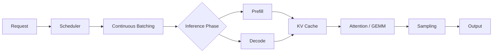

vLLM V1 更像“统一、模块化、生态型的 LLM inference engine”；SGLang 更像“围绕 cache/scheduler/communication/kernel 做激进联合优化的 serving runtime”。两者功能已经高度重叠，当前真正最有辨识度的差异主要在 Prefix Cache 数据结构、Scheduler/Runtime 优化哲学，以及 SGLang 对 MoE/DPA/PD/模型专项 kernel 的激进程度。


| 维度              | vLLM V1                                              | SGLang                                           |
| ----------------- | ---------------------------------------------------- | ------------------------------------------------ |
| 定位              | 通用、高性能推理/Serving Engine                      | 高性能 Serving Runtime + LLM 应用前端            |
| 核心设计倾向      | **统一、模块化 Engine**                              | **性能优先、模型/硬件专项优化**                  |
| 调度核心          | Unified token scheduler                              | Continuous batching + 高性能/overlap scheduler   |
| Prefill/Decode    | Unified scheduler + Chunked Prefill                  | Unified serving + Chunked Prefill，也积极做 PD   |
| KV 物理存储       | **Paged KV / PagedAttention**                        | **Paged KV / PagedAttention**                    |
| Prefix Cache      | **Hash-based APC**                                   | **Radix Tree / Radix Cache**                     |
| Agent/多轮 KV     | APC 可复用公共 prefix                                | **Radix + Session-aware Radix Cache 更突出**     |
| Cache 淘汰        | block cache / LRU 等                                 | LRU / LFU / SLRU / Priority + Session reference  |
| 多级 KV           | KV connector / offload / LMCache/FlexKV 等           | **HiCache / host+device、多级缓存体系**          |
| Spec Decode       | EAGLE/MTP/NGram/Suffix/Draft 等                      | **EAGLE2/3、MTP、UNO、DFlash、NGram 等**         |
| PD 分离           | ✅，当前文档仍标 experimental                         | ✅，同时已有 **EPD**                              |
| MoE               | EP、Fused MoE、多 backend                            | **DPA + EP + DeepEP/DeepGEMM 等很突出**          |
| Attention Backend | 多 backend + compiler abstraction                    | **非常多 backend，并支持 Prefill/Decode 分别选** |
| Quantization      | FP8/FP4/INT8/INT4 等；**Online Quantization 很完整** | FP4/FP8/INT4/AWQ/GPTQ 等                         |
| Compile           | **torch.compile + 自己的 compile/IR/pass 体系**      | torch.compile + CUDA Graph + kernel backend      |
| CUDA Graph        | ✅                                                    | ✅，还有 Breakable/Piecewise CUDA Graph           |
| LoRA              | ✅                                                    | ✅ multi-LoRA batching                            |
| Structured Output | ✅                                                    | ✅                                                |
| Reasoning / Tool  | ✅                                                    | ✅，Parser 体系很突出                             |
| API               | Offline + OpenAI compatible                          | OpenAI / Anthropic / Ollama / Native / Offline   |
| Router            | 通常配外部 Serving/K8s/Ray 等                        | **SGLang Model Gateway 自带得更深**              |
| 典型印象          | “LLM inference OS / 通用引擎”                        | “性能激进的 serving stack”                       |

# 差不多的大框架




pd 分离

```
             Request
                │
                ▼
         Continuous Batching
                │
                ▼
       ┌────────┴────────┐
       │                 │
    Prefill            Decode
   compute-heavy     memory-heavy
       │                 │
       └────────┬────────┘
                ▼
          KV Cache Pool
                │
                ▼
        Attention Backend
                │
                ▼
        GPU Kernels / GEMM
```

> Prefill：偏 Compute Bound
> Decode：通常更偏 Memory / KV / Weight Bandwidth Bound

吞吐+TTFT+ITL （ *Token 间延迟(ITL) 是在序列中生成连续token 之间的平均时间*）+显存利用率

# 最大区别之一Scheduler

外部Scheduler (请求应该去哪)：路由，负载均衡，优先级，多租户 

- GPU 是否忙

- KV cache 剩余多少/prefix cache hit rate/Session-aware Routing

- 当前 batch 大小

- request 长短隔离

内部Scheduler(如何在这一张 GPU 上执行)：


## vLLM V1 ： **简单、模块化、低 CPU overhead**

**Prefill token 和 Decode token 在 scheduler 看来不再是完全两种独立对象。**

scheduler 本质上给每个 request 分配本轮可以计算多少 token，在一个固定 token budget 下统一调度

```
Chunked Prefill
Prefix Caching
Speculative Decode
普通 Decode
```

可以进入同一套 scheduler。prompt/output tokens 用统一 token budget 管理，不再要求严格区分 prefill/decode


## SGLang：**更强调调度与执行 overlap**

```
CPU scheduling
      ↓
GPU 当前 batch 在执行

CPU 同时准备下一 batch
      ↓
尽量隐藏 CPU scheduling overhead
```


# Continuous batching

**传统 batch_size 是静态批处理，一次 forward 固定处理 N 个请求，适合输入输出长度一致的任务。但 LLM 推理具有 autoregressive 特性，不同请求生命周期不同，静态 batch 会产生 padding 和 GPU 空洞。**

**Continuous batching 将调度粒度从 request 降低到 token，在每轮 decode 重新选择活跃请求，并结合 KV Cache 动态管理，使 GPU 始终保持高利用率。**

**vLLM V1 通过 unified token scheduler 和 paged KV cache 实现动态调度；SGLang 在类似机制基础上进一步优化 scheduler-runtime overlap，并针对模型和 kernel 做更激进优化。**


batch 增大： 显存增加，  latency增加 ， 排队增加  吞吐量和延迟

Continuous batchin, 每轮重新调度，**GPU利用率提高**。**每一步 decode 重新决定当前 GPU batch 里面有哪些 token**。

```
Iteration 1

A B C


Iteration 2

A B D


Iteration 3

B D E
```

传统：

```
batch_size
=
同时处理多少 request
```

Continuous batching：

```
scheduler
决定每一步处理多少 token
```

## vLLM Continuous Batching

```
Request
 |
 v
Scheduler
 |
 v
Token budget （token 超过就下一轮）
 |
 v
Batch
 |
 v
Model Forward
 |
 v
KV Cache

```

Unified Scheduler: 统一调度（request ： prefill tokens ，decode tokens ，chunked prefill ，spec decode）


SGLang 更强调调度与执行 overlap。CPU scheduling 和 GPU 当前 batch 执行并行，尽量隐藏 CPU scheduling overhead。


|                 | vLLM V1                 | SGLang                            |
| --------------- | ----------------------- | --------------------------------- |
| 核心目标        | 通用推理 Engine         | 性能优化 Runtime                  |
| Batch单位       | token budget            | token batch                       |
| Scheduler       | Unified token scheduler | 高性能 scheduler                  |
| Prefill/Decode  | 统一管理                | 统一+更激进优化                   |
| Chunked Prefill | 支持                    | 支持                              |
| KV Cache        | Paged KV                | Paged KV                          |
| 执行优化        | 模块化                  | scheduler/runtime/kernel 联合优化 |


# PagedAttention

显存= weights + KV Cache +  activation 

KV Cache从静态连续内存变成分页管理


解决的是PagedAttention , KV 怎么放的问题。

[vllm blog](https://blog.vllm.ai/2023/06/20/vllm.html)

[PagedAttention  ariv](https://arxiv.org/abs/2309.06180)

[图解大模型计算加速系列：vLLM](https://mp.weixin.qq.com/s/bAY4OGqQlEeBaITIwxQEuw)

支持PagedAttention ，张量并行


KVCache的弱点

autoregressive decoding 过程中, 使用到所有输入的输入token产生KV cache，保留在GPU显存，生成一个token

- 大：对于LLaMA-13B中的单个序列，需要高达1.7GB的内存。

- 动态性：其大小取决于序列长度，而序列长度具有高度可变和不可预测的特性。因此，有效地管理KV缓存是一个巨大的挑战。我们发现，现有系统由于**碎片化和过度预留而浪费了60%至80%的内存。**

为了解决这个问题，我们引入了PagedAttention，这是一个灵感来自操作系统中**虚拟内存和分页的经典思想的注意力算法。**与传统的注意力算法不同，PagedAttention**允许在非连续的内存空间中存储连续的K和V**。具体而言，PagedAttention将每个序列的KV缓存分成块，每个块包含一定数量的token的K和V。在注意力计算过程中，PagedAttention内核能够高效地识别和提取这些块。


PagedAttention：KV缓存被分成了块。这些块在内存空间中不需要连续。

由于这些块在内存中不需要连续，我们可以像操作系统的虚拟内存那样更加灵活地管理键和值：可以将这些blocks看作pages，token看作byte，sequences看作processes。序列的连续逻辑块通过块表映射到非连续的物理块。随着生成新的标记，物理块会按需进行分配。


在 PagedAttention 中，内存浪费仅发生在序列的最后一个块中。内存效率的提高非常有益：它允许系统将更多序列一起批处理，提高 GPU 利用率，从而显着提高吞吐量

**PagedAttention 还有另一个关键优势：高效的内存共享。例如，在*并行采样*中，从同一提示生成多个输出序列。**


**PagedAttention 自然地通过其块表实现内存共享。与进程共享物理页的方式类似，PagedAttention 中的不同序列可以通过将其逻辑块映射到同一物理块来共享块。为了确保安全共享，PagedAttention 跟踪物理块的引用计数并实现*Copy-on-Write*机制。**


# Prefix Cache区别

## vllm : Hash-based Prefix Cache

```
System Prompt + context + User Question

被切成 block   B0,B1,B2,B3

hash(
    parent_hash,
    current_tokens,
    extra metadata
)

B0,B1,B2 ,B7  miss  ， 计算B7 onwards
```

vLLM 当前 APC 明确采用 **hash-based block cache**；block pool 可通过 hash lookup 查找公共 prefix。

所以核心数据结构更像：

```
HashMap

hash_ABC → KV block
hash_DEF → KV block
hash_XYZ → KV block
```


## SGlang Radix Tree index

PagedAttention , KV 怎么放。**RadixAttention解决的是哪些 KV 值得复用，以及如何找到它。**

让不同请求、不同轮对话、不同 Agent 分支之间，能够**自动发现公共 token prefix，并直接复用已经算过的 KV Cache**。

SGLang 不把上一轮请求结束后的 KV Cache 全部直接扔掉

而是把：

```
Token Prefix
        ↓
对应的 KV Cache 位置   

ROOT
 │
 └── System + Repo + Q1 + A1
                 │
                 └── 对应 KV Cache
```

保存起来，并利用 **Radix Tree（压缩前缀树）**组织。

当`System + Repo + Q1 + A1 + Q2`,  命中这个cache，就只需要新计算Q2

**现实中的请求，这些请求有大量不同长度的公共 prefix。**

                       ROOT
                         │
                System Prompt
                         │
                    Repo Context
                         │
                ┌────────┴────────┐
                │                 │
             User A            User B
                │                 │
           Assistant A        Assistant B
                │
          ┌─────┴─────┐
          │           │
        Tool A       Tool B
          │           │
       Answer A     Answer B

- 显存满了，会从叶子开始删
- 优先处理 cache matched prefix 更长的请求。属于同一 prefix subtree 的请求倾向于一起调度。
- 不止缓存prompt，而会把 prompt 与生成结果都保留进 radix tree


# Prefill / Decode 分离

LLM：

```
Prefill
→ 大 GEMM
→ Compute Bound （TTFT）

Decode
→ 每次 1 token
→ 大量读 Weight/KV
→ Memory Bound  (ITL)
```

如果同一个 GPU 同时处理：prefill 可能干扰 decode，ITL P99 会变差。分开后，可以分别优化 TTFT / ITL


# Speculative Decoding

之前都是逐个token decode

现在都是

```
Draft Model
↓
猜：
A B C D

       ↓

Target Model
一次验证
↓
A ✓
B ✓
C ✓
D ✗

一次 forward
接受多个 token
```

大模型（Target Model）逐个生成词元（Token）时速度较慢。投测解码采用**“小模型草拟 + 大模型验收”**的策略：

1. **草拟（Draft）**：使用一个速度快、体量小的草稿模型（或辅助结构、N-gram匹配）连续预测并生成多个候选词元 K 个。
2. **验证（Verify）**：将这批候选词元一次性输入大模型进行并行前向计算。
3. **接受与回退**：大模型并行评估这些候选词元的概率分布。如果符合要求则批量接受；一旦遇到不一致的分歧点，则在该点停止并由大模型重新采样纠正

**减少 Target Model decode 次数**

# Attention Backend

SGLang更喜欢显式“选最好的 kernel” ， 根据实际环境，什么 kernel 快 就用什么。

vLLM 像 Compiler Runtime， 统一 compiler/runtime abstraction


# TP/DP 分布式推理

计算 +显存 + 通信

|              | TP（Tensor Parallel）         | DP（Data Parallel）           |
| ------------ | ----------------------------- | ----------------------------- |
| 模型权重     | **拆分**到多卡 （单卡放不下） | **复制**多份 （可以单卡部署） |
| 一个请求     | 多张 GPU 协同计算             | 通常只进一个 replica          |
| 主要解决     | 单卡放不下 / 单请求算力不足   | 并发、吞吐扩展                |
| 单请求延迟   | 可能下降，也有通信开销        | 基本不会因为 DP 降低          |
| 总吞吐       | 有提升但不一定线性            | 通常更适合水平扩吞吐          |
| GPU 间通信   | **很多**，如 AllReduce        | Replica 间很少                |
| KV Cache     | 分布在 TP group 内            | 每个 DP replica 独立          |
| Prefix Cache | 一个 TP replica 内共享        | DP replica 间通常不共享       |

对延迟和吞吐的影响  

TP

- Single Request Latency + 单 replica 能放多大的模型

- 每 GPU 的矩阵计算减少  但是GPU 通信增加
- 增加TP 速度不一定线性增加

DP

- Aggregate Throughput : 比 TP 更接近水平扩容
- 但是单个请求时间不变

```
模型放不下？
    │
    ├─ Yes → 先加 TP
    │
    └─ No
         ↓
并发/吞吐不够？
         │
         └─ Yes → 加 DP
```


