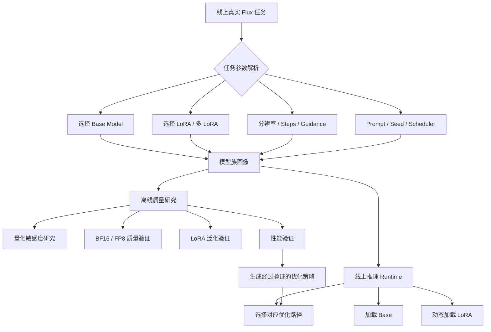
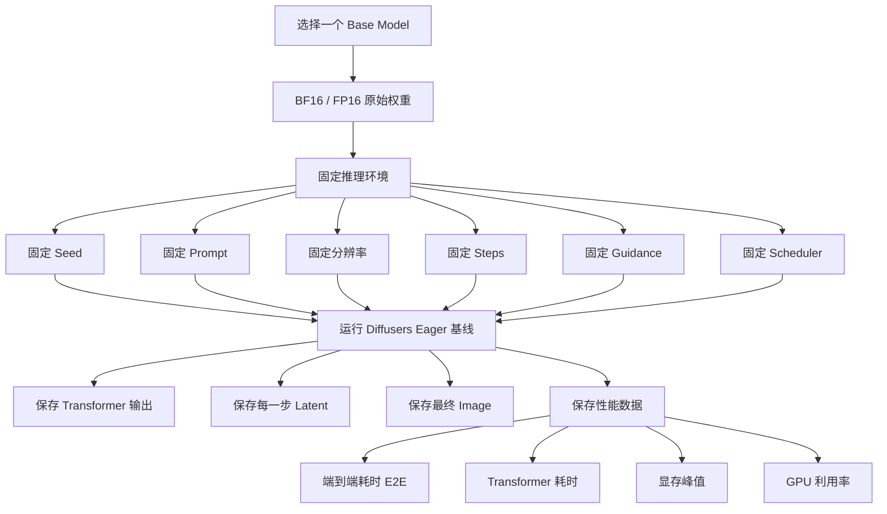
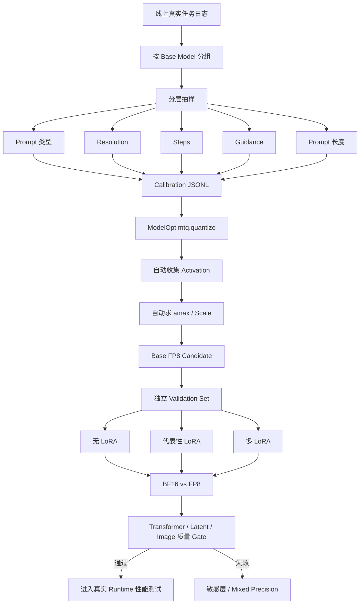

# DiT

**DiT**，在扩散模型领域一般指的是 **Diffusion Transformer**

- 传统扩散模型（比如 Stable Diffusion）里的 U-Net 主干是 **卷积网络 (CNN)**。
- **DiT** 则是把主干替换成了 **Transformer** 架构，用自注意力机制来处理扩散过程中的特征。

为什么要用 Transformer？

- **全局感受野**：CNN 善于处理局部特征，而 Transformer 可以直接建模图像中任意两个位置的关系，更利于捕捉长程依赖。
- **可扩展性**：Transformer 在大规模训练（比如 GPT-类模型）里已经证明了很强的 scaling law，扩散模型也想利用这个优势。
- **统一架构**：有研究希望文本、图像、视频都用类似的 Transformer 主干，更方便多模态统一。


# FBCache

原版满血Flux推理很慢，调研了下目前比较流行的denoising caching算法[Teacache](https://github.com/ali-vilab/TeaCache) 和 [WeaveSpeed](https://github.com/chengzeyi/ParaAttention) ,主要原理

- **计算首块残差**：在每个推理步骤（timestep）中，正常计算第一个 Transformer 模块的输出。记录这个输出（或其与输入的残差）。
- **比较残差变化**：将当前步骤计算得到的首块残差与上一个步骤缓存的首块残差进行比较。
  - 如果两个步骤间的首块残差差异**足够小**（低于阈值），则认为当前步骤的输入与上一步骤足够相似，可以直接**重用上一个步骤计算得到的最终输出（或最终残差）**，并**跳过所有后续 Transformer 模块**（从第二个模块开始）的计算。
  - 如果差异较大（高于阈值），则认为输入变化显著，需要**完整执行所有 Transformer 模块**的计算，得到新的最终输出，并更新缓存中的首块残差和最终输出（或最终残差），供下一个步骤使用。

直接用[FLux底模](https://hf-mirror.com/black-forest-labs/FLUX.1-dev) + diffusers 看，对比有无使用denoising caching的情况，发现确实比没有应用前**有明显加速**。

参考

- https://github.com/chengzeyi/Comfy-WaveSpeed

- https://github.com/welltop-cn/ComfyUI-TeaCache  

在测试调参时候肉眼可见有差距就淘汰了，**业务代码**不能直接使用diffusers进行推理，所以参考纯Flux的推理实现，主要是修改FLux的forward方法。实现后让业务对比纯flux推理结果（脱离后处理）。**相同pipeline，prompt, seed等参数一样情况下**，对比是否使用WaveSpeed生成图存在的差异。


ComfyUI 插件原理：根据模型名，[通过`unittest.mock.patch.object`替代模型的`forward_orig`方法。](https://github.com/chengzeyi/Comfy-WaveSpeed/blob/8253745127785d820cff0a9621d1537a5aae5424/first_block_cache.py#L586)


# Diffusers

- 对于FBCache + 适配最新版的diffusers PR [fix FluxSingleTransformerBlock missing encoder_hidden_states when use Flux-Kontext ](https://github.com/chengzeyi/ParaAttention/pull/52)

- 使用compile，加速`transformer`

  ```python
  def _compile(self):
      if hasattr(self.pipe, "transformer") and self.pipe.transformer is not None:
          # 仅编译模型中较小且频繁重复的模块（通常是转换层）来缩短冷启动延迟，并支持在后续每次执行时重用已编译的构件，将编译时间缩短
          self.pipe.transformer.compile_repeated_blocks(fullgraph=True, dynamic=True)
  ```


# nunchaku

**扩散模型 (Diffusion Models)**生成图像效果特别好，但模型越来越大，需要更多的显存，推理速度也变慢。量化（quantization），就是把模型的权重和激活从 16/32 位浮点数压缩到更低的精度（比如 4 位），以减少内存和计算量。

**权重 (weights)** 和 **激活 (activations)** 对量化非常敏感，传统方法（比如 LLM 常用的 smoothing，把**异常值均摊到权重/激活**里）不够用了，会导致生成质量下降。

**SVDQuant**：不用把所有东西都硬塞进 4 位，而是给“异常值”开一个低秩、高精度的“**旁路（branch）**”去专门处理

- 把激活里的异常值转移到权重里。

- 对权重里这些异常值，用 **SVD（奇异值分解）** 搞一个低秩分支（low-rank branch），保持高精度。

- 这样就“吸收”了异常值，使主干部分更适合 4 位量化。

如果直接让低秩分支单独跑，会增加额外的内存访问（需要额外搬运数据），结果推理反而变慢，抵消了量化带来的加速。

所以使用**Nunchaku 推理引擎**，把低秩分支和低比特分支的运算**融合**起来

- 避免重复的数据搬运。
- 保持速度优势。
- 还能直接兼容 **LoRA**，不用再重新量化

[量化工具 deepcompressor](https://github.com/nunchaku-tech/deepcompressor)


兼具压缩显存，快速推理 cpu offload + set attention + fbcache

```python
from nunchaku import NunchakuFluxTransformer2dModel
from nunchaku.utils import get_precision
from nunchaku.caching.diffusers_adapters import apply_cache_on_pipe

transformer = NunchakuFluxTransformer2dModel.from_pretrained(
  f"{self.model_dir}/nunchaku-flux.1-kontext-dev/svdq-{get_precision()}_r32-flux.1-kontext-dev.safetensors",
  offload=True
)
transformer.set_attention_impl("nunchaku-fp16")
pipe = FluxKontextPipeline.from_pretrained(konext_model_dir, transformer=transformer,
                                           torch_dtype=torch.bfloat16)
apply_cache_on_pipe(pipe, residual_diff_threshold=0.06)
pipe.enable_model_cpu_offload()
```


- 替换**FluxSingleTransformerBlock**的proj_out（block 最后一层线性层）为ConcatLinear（大Linear，输入向量会被 **切分 (split)** 成多个子块，然后每个子块单独过一个 nn.Linear，最后再把结果加起来）
- 替换Unet


# flux 量化

背景





## 建立F16baseline




数据采集和性能数据要区分两次测试


```shell
baseline/
└── run_000001/
    ├── metadata.json
    ├── transformer_outputs.safetensors # 单步
    ├── latents.safetensors  # 累计
    └── image.png
```

一个 `safetensors` 文件可以放所有 step，例子

```
from safetensors.torch import save_file

data = {
    "step_000": tensor0,
    "step_001": tensor1,
    "step_002": tensor2,
}

save_file(data, "latents.safetensors")
```


保存每一步

```
latent_in
= 进入 Transformer / Scheduler 前的 latent

transformer_out
= Flux Transformer 本次预测结果

latent_out
= scheduler.step() 更新后的 latent
```


具体

```
transformer_outputs.safetensors
├── step_000
├── step_001
├── step_002
...
└── step_049


latents.safetensors
├── input_000
├── output_000
├── input_001
├── output_001
...
```


## 对比complie

使用

```python
import torch
import torch.nn.functional as F


@torch.no_grad()
def compare_tensor(ref: torch.Tensor, test: torch.Tensor):
    ref = ref.detach().float().cpu()
    test = test.detach().float().cpu()

    diff = test - ref

    max_abs = diff.abs().max().item()
    mean_abs = diff.abs().mean().item()
    # 相对 L2 误差（Relative L2 Error）把误差归一化
    relative_l2 = (
        torch.linalg.vector_norm(diff)
        / (torch.linalg.vector_norm(ref) + 1e-12)
    ).item()

    cosine = F.cosine_similarity(
        ref.reshape(1, -1),
        test.reshape(1, -1),
    ).item()

    return {
        "max_abs": max_abs,
        "mean_abs": mean_abs,
        "relative_l2": relative_l2,
        "cosine_similarity": cosine,
    }
```


对比 BF16 compile,  Transformer， Latent 结果

- 正常的话，误差小 （怎样才算小， 可以baselineA vs baseline B   baseline vs compile 不同参数  这样就知道大概范围 ）
- 某个 timestep 开始发生异常数值放大，那就可疑

```
Step     Transformer rel-L2     Latent output rel-L2

0        2.1e-4                 0/xxx
1        2.2e-4                 8e-5/xx
2        2.0e-4                 1.4e-4/xx
3        2.3e-4                 2.1e-4/xx
...
30       2.5e-4                 8.2e-4/xx
40       2.4e-4                 1.8e-3/xx
49       2.6e-4                 2.9e-3/xx
```

最好画成曲线

```
Relative L2
 ^
 |
 |                         Latent
 |                       /
 |                    __/
 |                 __/
 |              __/
 |             /
 |------------/-------------- Transformer
 |
 +--------------------------------> timestep
```

图片就对比PSNR，SSIM，LPIPS


## ModelOpt 做基础 FP8 Calibration





- 准备线上数据Calibration、Validation数据
- 修改好ModelOpt fp8 脚本，获得fp8模型
- 对比 baseline / fp8  和 lora 配列组合的结果


数据不同的base model，用户自己的数据不要混淆，不同尺寸/steps的数据，按比例凑够128

| 线上字段              | Calibration 要不要 | 原因                                                      |
| --------------------- | ------------------ | --------------------------------------------------------- |
| `base_model`          | **必须**           | 不同 Base 必须分开 calibration                            |
| `prompt`              | **必须**           | 影响 text condition / activation                          |
| `height`              | **必须**           | 改变 latent/token shape                                   |
| `width`               | **必须**           | 同上                                                      |
| `steps`               | **必须覆盖分布**   | 决定 timestep trajectory                                  |
| `guidance_scale`      | **建议**           | FLUX-dev 会进入 Transformer guidance                      |
| `seed`                | 建议               | 改变初始 latent                                           |
| `max_sequence_length` | 建议               | 长 Prompt workload                                        |
| LoRA                  | **特殊处理**       | Dataset 最好同时保留 LoRA 字段，但 calibration 暂时不使用 |
| output                | 不要               |                                                           |


参考：https://github.com/NVIDIA/Model-Optimizer/tree/main/examples/diffusers

根据线上任务参数，搞成jsonl文件，自己改造py脚本， 放到 `Model-Optimizer/examples/diffusers/quantization/`

复用`FP8_DEFAULT_CONFIG` 和 `filter_func_flux_dev`

```python
import copy
import json
from pathlib import Path

import torch
from diffusers import FluxPipeline

import modelopt.torch.opt as mto
import modelopt.torch.quantization as mtq

# 直接复用 NVIDIA 官方 Diffusers FP8 recipe
from config import FP8_DEFAULT_CONFIG
from utils import filter_func_flux_dev


MODEL_PATH = "/models/FLUX.1-dev"

CALIBRATION_FILE = "./calibration_tasks.jsonl"

OUTPUT_FILE = "./output/flux_fp8/transformer.pt"

MAX_CALIBRATION_SAMPLES = 128


def load_tasks(path: str):
    tasks = []

    with open(path, "r", encoding="utf-8") as f:
        for line in f:
            line = line.strip()

            if not line:
                continue

            task = json.loads(line)

            # 基础合法性检查
            if not task.get("prompt"):
                continue

            tasks.append(task)

    return tasks


# ------------------------------------------------------
# 1. 读取生产 Calibration Set
# ------------------------------------------------------

tasks = load_tasks(CALIBRATION_FILE)

tasks = tasks[:MAX_CALIBRATION_SAMPLES]

print(f"Calibration samples: {len(tasks)}")


# ------------------------------------------------------
# 2. 加载 BF16 FLUX Pipeline
# ------------------------------------------------------

pipe = FluxPipeline.from_pretrained(
    MODEL_PATH,
    torch_dtype=torch.bfloat16,
)

pipe = pipe.to("cuda")

pipe.set_progress_bar_config(disable=True)

transformer = pipe.transformer

transformer.eval()


# ------------------------------------------------------
# 3. NVIDIA 官方 Diffusion FP8 Recipe
# ------------------------------------------------------

quant_config = copy.deepcopy(FP8_DEFAULT_CONFIG)


# ------------------------------------------------------
# 4. Calibration Forward Loop
# ------------------------------------------------------

def calibration_forward_loop(_model):
    """
    ModelOpt 会在 Quantizer 已经插入后调用这里。

    不需要直接调用 _model()。
    调完整 Pipeline，保证 Transformer 经历真实
    denoising trajectory。
    """

    with torch.inference_mode():

        for i, task in enumerate(tasks):

            generator = torch.Generator(
                device="cuda"
            ).manual_seed(
                int(task.get("seed", i))
            )

            kwargs = {
                "prompt": task["prompt"],

                "height": int(
                    task.get("height", 1024)
                ),

                "width": int(
                    task.get("width", 1024)
                ),

                "num_inference_steps": int(
                    task.get("steps", 30)
                ),

                "guidance_scale": float(
                    task.get("guidance_scale", 3.5)
                ),

                "max_sequence_length": int(
                    task.get("max_sequence_length", 512)
                ),

                "generator": generator,

                # Calibration 只需要 Transformer forward，
                # 不需要最终 VAE decode。
                "output_type": "latent",
            }

            print(
                f"[{i + 1}/{len(tasks)}] "
                f"{kwargs['width']}x{kwargs['height']} "
                f"steps={kwargs['num_inference_steps']} "
                f"guidance={kwargs['guidance_scale']}"
            )

            pipe(**kwargs)


# ------------------------------------------------------
# 5. 自动 Calibration + FP8 Quantization
# ------------------------------------------------------

mtq.quantize(
    transformer,
    quant_config,
    calibration_forward_loop,
)


# ------------------------------------------------------
# 6. 应用 NVIDIA 为 FLUX-dev 定义的高精度排除规则
# ------------------------------------------------------

mtq.disable_quantizer(
    transformer,
    filter_func_flux_dev,
)


# ------------------------------------------------------
# 7. 保存 ModelOpt Quantized Checkpoint
# ------------------------------------------------------

output_path = Path(OUTPUT_FILE)

output_path.parent.mkdir(
    parents=True,
    exist_ok=True,
)

mto.save(
    transformer,
    str(output_path),
)

print(
    f"Saved quantized Transformer to: {output_path}"
)
```


## 敏感层测试


```
逐个 Transformer Block 测试

Block 0 = FP8，其余 BF16
Block 1 = FP8，其余 BF16
Block 2 = FP8，其余 BF16
...
↓
和当前 BF16 Reference 对比
Transformer Drift
Latent Drift
最终图片 LPIPS / SSIM
↓
敏感 Block → BF16
不敏感 Block → FP8
↓
得到 Mixed Precision Recipe


P95
P99
Max / Worst-case
```


伪代码

```python
from torchao.quantization import (
    quantize_,
    Float8DynamicActivationFloat8WeightConfig,
)

fp8_config = Float8DynamicActivationFloat8WeightConfig()


def quantize_only_block(transformer, block_prefix):
    def filter_fn(module, fqn):
        return (
            isinstance(module, torch.nn.Linear)
            and fqn.startswith(block_prefix)
        )

    quantize_(
        transformer,
        fp8_config,
        filter_fn=filter_fn,
    )
    
    
for block in all_blocks:
    transformer = load_clean_bf16_transformer()

    quantize_only_block(
        transformer,
        block,
    )

    metrics = compare_with_bf16(
        transformer,
        reference_inputs,
    )

    save(block, metrics)
```


如果 BF16 eager VS  BF16 compile 的  Transformer Rel-L2 P95 大概 3e-4

```
Block FP8 P95 ≤ 2 × baseline
→ 低敏感

2～5 × baseline
→ 中间区，继续验证

> 5 × baseline
→ 高敏感候选
```

大概规则

```
低敏感：
Transformer drift 小
+
Latent 不异常累计
+
最终图片通过
→ FP8


高敏感：
Transformer P95 明显异常
或
Latent 出现明显累计放大
或
LPIPS / SSIM 明显恶化
或
Worst-case 肉眼出现结构变化
→ BF16
```

最后还要再验证一次：**单 Block 都安全，不代表多个 FP8 Block 叠加以后一定安全**。这一步才是最终 Mixed Precision Recipe 的验收。

```
所有低敏感 Block 同时 FP8
+
敏感 Block BF16
```

得到敏感层名单  ， 使用TorchAO （**ModelOpt 的 FP8 主要还是 Q/DQ fake-quant 数值模拟，不应该默认认为它已经在 L20 上用真正的 FP8 Tensor Core 加速**）

```python
import torch

from diffusers import (
    FluxPipeline,
    FluxTransformer2DModel,
    TorchAoConfig,
)

from torchao.quantization import (
    Float8DynamicActivationFloat8WeightConfig,
)


model_id = "black-forest-labs/FLUX.1-dev"


quant_config = TorchAoConfig(
    quant_type=Float8DynamicActivationFloat8WeightConfig(),

    # 敏感层不量化
    modules_to_not_convert=[
        "transformer_blocks.2",
        "transformer_blocks.5",
        "single_transformer_blocks.17",

        # 你还可以加入 NVIDIA 官方原本就建议保留的层
        "proj_out",
        "norm_out",
        "context_embedder",
        "x_embedder",
    ],
)


transformer = FluxTransformer2DModel.from_pretrained(
    model_id,
    subfolder="transformer",
    quantization_config=quant_config,
    torch_dtype=torch.bfloat16,
)


transformer = torch.compile(
    transformer,
    mode="max-autotune",
    fullgraph=True,
)


pipe = FluxPipeline.from_pretrained(
    model_id,
    transformer=transformer,
    torch_dtype=torch.bfloat16,
)

pipe.to("cuda")
```


## SDNQ  Nunchaku SVDQuant

| 维度                        | SDNQ                          | Nunchaku + SVDQuant                             |
| --------------------------- | ----------------------------- | ----------------------------------------------- |
| 定位                        | 通用 PyTorch 量化框架         | Diffusion 专用低比特推理方案                    |
| 主要目标                    | FP8 / INT8 / INT4 等灵活量化  | **W4A4 极低精度高性能**                         |
| L20 / Ada 推荐路径          | **FP8 W8A8**                  | **INT4 W4A4**                                   |
| Weight                      | 可 FP8/INT8/更低 bit          | INT4                                            |
| Activation                  | 可运行时动态 FP8              | INT4                                            |
| 输出                        | 通常回 BF16/FP16              | BF16/FP16                                       |
| 需要 calibration 样例？     | **FP8 Dynamic 可不需要**      | **需要，DeepCompressor 官方流程有 calibration** |
| QAT 必需？                  | 否                            | 否，主线是 PTQ                                  |
| 自动找难量化层              | ✅ Weight reconstruction error | 不是“找整层”                                    |
| Mixed Precision             | ✅ 自动逐层提高精度/跳过       | 不是传统 layer-wise mixed precision             |
| SVD                         | ✅ 可选 `use_svd=True`         | **核心算法**                                    |
| SVD 粒度                    | Weight low-rank correction    | 更完整的 SVDQuant                               |
| Activation outlier 专门处理 | 相对简单，dynamic scaling     | **有，先迁移 outlier 再 SVD**                   |
| 量化后的真实低精度 GEMM     | ✅ `use_quantized_matmul=True` | ✅ 专用 fused CUDA kernel                        |
| torch.compile               | ✅ 非常适合                    | 主要靠自己的 kernel/runtime                     |
| Diffusers                   | **原生集成**                  | ✅ 替换 Transformer 后继续用 FluxPipeline        |
| 动态 LoRA                   | 理论/实现兼容，需你实测       | **官方强项，支持 Runtime LoRA**                 |
| Base + LoRA 是否要重新量化  | 通常不用，别 fuse             | **不用重新量化 Base**                           |
| 保存量化模型                | `save_pretrained()`           | DeepCompressor → Nunchaku checkpoint            |
| 对 BF16 一致性              | **通常更好**                  | 通常偏差更大                                    |
| 显存收益                    | 中等                          | **很大**                                        |
| 性能潜力                    | 中高                          | **高**                                          |
| 工程侵入性                  | **低**                        | 中等                                            |
| 适合你当前优先级            | **★★★★★**                     | ★★★★                                            |

## 细节对比

### SDNQ

SDNQ自动逐层精度选择 + 低精度 kernel

```
SDNQConfig(
    weights_dtype="float8_e4m3fn",
    use_dynamic_quantization=True,  
    use_quantized_matmul=True,  W8A8 true/ W8A16 false 更省显存
)

Base BF16
   ↓
逐层检查 Weight 是否适合 FP8  
   ↓
适合
→ FP8

不适合
→ 更高精度 / 不量化
```

原始 Weight VS 量化 → 反量化后的 Weight ， 直接从 Weight 本身计算量化误差， 可以不需要样例

Activation：Dynamic Activation Quantization

```
当前 Activation X
↓
运行时现场算 scale
↓
FP8
```

### SVD

很多模型权重的重要信息集中在少量方向。

4096 × 32 × 32 × 4096 : Rank 32 Low-Rank Component

$$W=Wresidual+Wimportant$$   有点像lora


SDNQ 也支持 SVD

```
SDNQConfig(
    weights_dtype="float8_e4m3fn",
    use_svd=True,
    svd_rank=32,
    use_dynamic_quantization=True,
    use_quantized_matmul=True,
)
```

$$ W=Wresidual+L1L2 $$

```
L1 × L2
→ 高精度 Low-Rank (重要低秩部分保高精度)

W_residual ()
→ FP8
```

Nunchaku 的完整 SVDQuant

$$Y=XW$$  ----->   $$Y≈XQ4(Wresidual)+XL1L2$$   

```
             Input X
                │
        ┌───────┴────────┐
        ↓                ↓
      INT4             Low Rank
    W4A4 GEMM          BF16/FP16
        │                │
        └───────┬────────┘
                ↓
              Output

Nunchaku 把两条路径 kernel fusion，否则 low-rank correction 的额外 memory traffic 会把收益吃掉。
```


先解决： Outlier = 少数特别大的异常值, **Outlier 把量化范围撑得太大，导致绝大多数普通值的分辨率被浪费。**

```
Activation outlier
+
Weight outlier
```

Weight 是静态的，Activation 是动态的。Activation 每次推理都在变（prompt 不同 seed 不同 step 不同 LoRA 不同），所以它的 outlier 很难提前稳定处理。


过程：

```
Activation Outlier
        ↓
迁移到 Weight
        ↓
Activation 更容易 4bit
Weight 更难 4bit
        ↓
SVD 抽出 Weight 难量化部分
        ↓
Low Rank → 16bit
Residual → 4bit
```

这就是为什么 SVDQuant 能敢做 **W4A4**。


# 算子

生产 kernel 优化

```
Total GPU Time = 单次耗时 × 调用次数
```


```
E2E
↓
TTFT / TPOT
↓
Prefill / Decode
↓
Layer
↓
Operator
↓
CUDA Kernel
```

判断

可以，生产里通常先用 **Nsight Systems 看时间线**，再用 **Nsight Compute 看单 kernel 指标**。最核心判断逻辑可以压成这张表：

| Bound 类型              | 典型现象                       | 关键指标                                          | 常用优化手段                                                 |
| ----------------------- | ------------------------------ | ------------------------------------------------- | ------------------------------------------------------------ |
| **Compute bound**       | GPU 算力吃满，算术单元忙       | SM/Tensor Core 利用率高，DRAM 带宽没满            | 更快 GEMM、FP8/INT8、Tensor Core、减少 FLOPs（Speculative Decoding、稀疏）、提高 occupancy |
| **Memory bound**        | 大量读写显存，算得不多（常见） | DRAM bandwidth 接近峰值，SM 算力利用低            | Fusion、减少中间 Tensor、量化、KV 压缩、改善访存/coalescing  |
| **Communication bound** | 多卡在等 NCCL/网络             | NCCL/AllReduce 时间占比高，GPU 算子之间有通信等待 | TP/EP 拓扑优化、减少通信量、overlap(计算和通信)、NVLink/IB、换并行策略（减少TP换成DP） |
| **Launch bound**        | 一堆很小 kernel，GPU 经常空    | kernel 太碎、launch gap 很多、CPU launch 时间明显 | Fusion、CUDA Graph、torch.compile、persistent kernel、减少 Python/dispatch |


## 修改点

`bench_one_batch` 会直接调用 `ModelRunner`，绕开 HTTP 和 scheduler，并分别跑 prefill / decode，很适合做 kernel profiling

```
python -m sglang.bench_one_batch \
  --model-path MODEL \
  --batch 32 \
  --input-len 1024 \
  --output-len 10 \
  --profile
```

或者

```
python -m sglang.bench_serving \
  --backend sglang \
  --model MODEL \
  --num-prompts 100 \
  --profile
  
PyTorch Profiler
↓
Perfetto

或者

Nsight Systems
↓
Nsight Compute
```


vLLM 也有正式 profiling 支持，现在推荐：

```
Nsight Systems
→ 低 overhead、看整体 timeline

PyTorch Profiler
→ 看 stack / shape / memory / kernel
```

vLLM 已经提供 `--profiler-config` 来 profile worker


更常见的价值区域：

| 类型          | 典型优化                                                     |
| ------------- | ------------------------------------------------------------ |
| Attention     | Paged Attention / MLA / sparse attention   (大模块通常不要做 CustomOp) |
| Norm          | RMSNorm + residual fusion                                    |
| Activation    | SiLU + Mul / GELU + Mul                                      |
| Quant         | RMSNorm + FP8 quant                                          |
| KV            | RoPE + quant + KV cache write                                |
| MoE           | Routing / permute / grouped GEMM                             |
| Communication | fused AllReduce / ReduceScatter                              |
| Sampling      | TopK / TopP / speculative verify                             |
| 小算子串      | 多个 memory-bound op fusion                                  |

vLLM 现在自己就已经有 `silu_and_mul`、`rms_norm`、`quant_fp8`、`rotary_embedding` 等 `CustomOp`，并且编译阶段还有 RMS+Quant、RoPE+KV cache、QKNorm+RoPE 等 fusion pass。

这其实已经告诉你：

> **现在高手优化重点越来越不是“单个数学算子”，而是减少 operator boundary 和 HBM traffic。**


## patch custom op


```
from vllm.model_executor.custom_op import CustomOp


@CustomOp.register("my_op")
class MyOp(CustomOp):

    def forward_native(self, x):
        # correctness fallback
        return torch_native_impl(x)

    def forward_cuda(self, x):
        # 你的自研 kernel
        return my_kernels.fast_op(x)
```


vLLM 当前会根据平台

```
MyOp.forward()
     ↓
current_platform == CUDA
     ↓
forward_cuda()
     ↓
my_kernels.fast_op()
```


```shell
# 其他 CustomOp 不强制使用 只 enable my_op
vllm serve MODEL \
  --compilation-config \
  '{"custom_ops":["none","+my_op"]}'

# 全部开启 ,唯独 op1 不开
all,-op1  
```


如果公司真的有自己的 kernel，我会做成：

```
repo 1
my-kernels
│
├── Triton
├── CUDA/C++
├── tests
├── benchmark
└── wheel
        │
        ▼
my_kernels-1.4.2.whl


repo 2
llm-runtime-adapter
│
├── vllm_adapter
│   ├── attention.py
│   └── ops.py
│
└── sglang_adapter
    ├── attention.py
    └── moe.py
```

部署：

```
Docker
│
├── CUDA 12.x
├── PyTorch X
├── vLLM / SGLang fixed commit/version
├── my-kernels.whl
└── runtime adapter
```

这样：

```
Kernel
≠
Framework fork
```

两边升级可以分开。

## 总结

我会按下面这一条走，而不是直接改代码：

1. **固定真实 workload**：分别固定 prefill/decode、batch、context length、TP/DP、dtype、quantization。
2. **E2E profile**：先找 TTFT/TPOT 真正热点，再下钻到 kernel。
3. **microbenchmark**：把候选算子单独拿出来，对比 framework baseline、你的 kernel，并覆盖真实 shape 分布。
4. **正确性验证**：BF16/FP8 对比 max error、cosine、KL/PPL/业务 benchmark；不能只测速度。
5. **通过 framework extension point 接入**：Attention 用 backend，MoE 用 runner，局部算子用 CustomOp/fused op，尽量不 monkey patch。
6. **E2E 回归**：重新测 TTFT、TPOT、throughput、VRAM、CUDA Graph、torch.compile、TP/DP、多 shape；确认不是“单 kernel 快、全局反而慢”。

这基本就是生产 kernel engineering 的闭环。


# 图片标准

| 指标  | 在问什么         | 趋势 | 主要缺点             |
| ----- | ---------------- | ---- | -------------------- |
| PSNR  | 像素差多少？     | ↑ 好 | 对微小位移很敏感     |
| SSIM  | 局部结构像不像？ | ↑ 好 | 不能很好理解高级语义 |
| LPIPS | 人眼感知像不像？ | ↓ 好 | 依赖神经网络和实现   |

## PSNR

Peak Signal-to-Noise Ratio ，两张图片**逐像素到底差多少**。


PSNR 最大缺点：太关心像素位置，适合 **same prompt + same seed，验证 compile 是否让输出轨迹发生漂移**

| PSNR       | 大概含义                     |
| ---------- | ---------------------------- |
| `∞`        | 像素完全一致                 |
| `> 60 dB`  | 几乎只有极小数值误差         |
| `50–60 dB` | 极其接近，通常肉眼完全不可辨 |
| `40–50 dB` | 很接近，存在少量像素差       |
| `30–40 dB` | 可测差异，肉眼可能仍很像     |
| `20–30 dB` | 差异比较明显                 |
| `< 20 dB`  | 差异很大                     |

## SSIM

Structural Similarity Index ，结构看起来一样吗？通常越接近 1 越相似


| SSIM         | 大概含义                   |
| ------------ | -------------------------- |
| `1.000`      | 完全一致                   |
| `> 0.999`    | 极其接近                   |
| `0.99–0.999` | 非常相似                   |
| `0.95–0.99`  | 有轻微到可见差异           |
| `0.90–0.95`  | 已有明显结构差异           |
| `0.80–0.90`  | 差异比较明显               |
| `< 0.80`     | 通常已经不能叫近似同一输出 |

## LPIPS

人眼感知上，两张图片到底有多不像？通过模型

| LPIPS        | 大概含义                   |
| ------------ | -------------------------- |
| `0`          | 完全一致                   |
| `< 0.001`    | 感知上几乎完全一致         |
| `0.001–0.01` | 极其相似                   |
| `0.01–0.03`  | 很接近，但存在一些感知差异 |
| `0.03–0.10`  | 差异开始比较明显           |
| `0.10–0.20`  | 明显不同                   |
| `> 0.20`     | 感知差异很大               |


## latent 级别

```python
diff = test.float() - ref.float()

mae = diff.abs().mean()
max_abs = diff.abs().max()
rmse = diff.square().mean().sqrt()

relative_l2 = torch.linalg.vector_norm(diff) / (
    torch.linalg.vector_norm(ref) + 1e-12
)

cosine = torch.nn.functional.cosine_similarity(
    ref.float().flatten(),
    test.float().flatten(),
    dim=0,
)
```

其中最值得看的排序是：

```
relative L2  (整个 latent 的误差，相对于 latent 自身能量有多大。)
    ↓
cosine similarity （< 0.99 对 same-seed equivalence 通常已经很大，> 0.999999极其接近）
    ↓
MAE / RMSE
    ↓
max_abs  （最坏的那个 latent 元素到底差多少。）
```


| Relative L2   | 粗略解释                                 |
| ------------- | ---------------------------------------- |
| `0`           | 完全一致                                 |
| `< 1e-6`      | 极其接近，接近纯浮点噪声                 |
| `1e-6 ~ 1e-5` | 非常小的数值漂移                         |
| `1e-5 ~ 1e-4` | 通常仍可视作很强的 numerical equivalence |
| `1e-4 ~ 1e-3` | 有可测漂移，需要继续看最终图             |
| `1e-3 ~ 1e-2` | 明显漂移                                 |
| `> 1e-2`      | 通常已经不能叫“compile 级微小差异”       |


最好再加一个 Percentile Error：绝大部分都很准 只有极少数 outlier  or  整个 latent 都在漂

```python
abs_diff = diff.abs().flatten()

p50 = torch.quantile(abs_diff, 0.50)
p95 = torch.quantile(abs_diff, 0.95)
p99 = torch.quantile(abs_diff, 0.99)
p999 = torch.quantile(abs_diff, 0.999)
```


