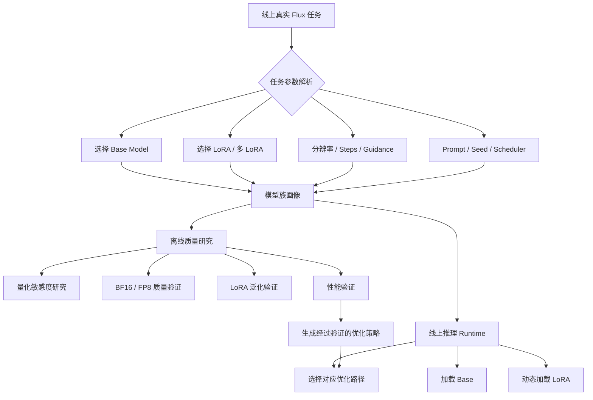
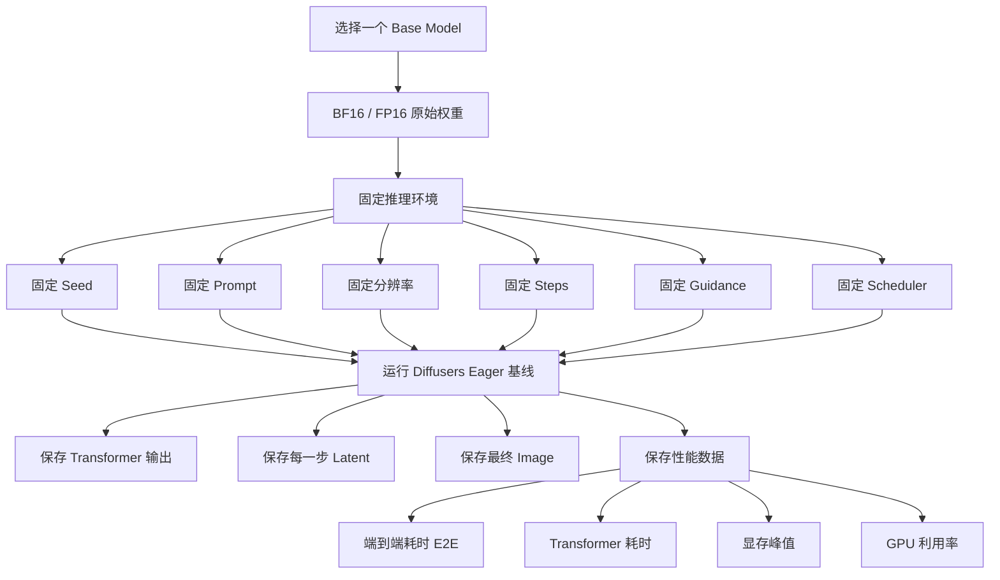
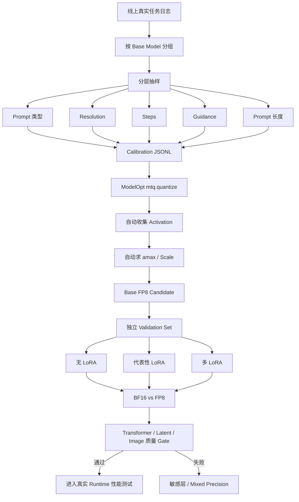

参考

- [克服 LLM 推理中的不确定性](https://thinkingmachines.ai/blog/defeating-nondeterminism-in-llm-inference/)
- [不同硬件和推理引擎模型输出的精度差异](https://github.com/ninehills/blog/issues/137)

# 不同硬件和推理引擎模型输出的精度差异

在不同硬件和推理引擎上，同一个深度学习模型输出存在精度差异是一个常见且正常的现象。这种差异源于多个层面因素的叠加，从底层的硬件算术逻辑到上层的软件优化策略，每一个环节都可能引入微小的数值变化。

## CPU vs. GPU 的不同算术逻辑 

 例如torch.cuda 和 cpu 相同运算，结果不一样

- 一些CPU（如x86架构）在执行浮点计算时，会使用80位的扩展精度寄存器进行中间计算，最后再将结果截断为32位（FP32）或64位（FP64），而GPU则严格按照32位或16位进行计算，这种不同的中间精度会导致最终结果出现微小偏差。

- **并行计算顺序**: GPU是高度并行的处理器。浮点数的加法和乘法不满足严格的结合律（即 $$(a+b)+c$$ 不完全等于$$ a+(b+c)$$）。在GPU上，一个大规模的求和运算会被拆分成数千个并行任务，其求和顺序是不确定的，每次运行都可能不同，从而导致最终结果的微小波动

  ```python
  (0.1 + 1e20) - 1e20
  >>> 0
  0.1 + (1e20 - 1e20)
  >>> 0.1
  
  ```

  

- **专用计算单元**: 现代GPU（如NVIDIA GPU）包含专门用于AI计算的Tensor Cores，而CPU则使用AVX等指令集。这些专用单元在执行矩阵乘法等操作时，为了效率可能会采用与通用计算单元不同的算法或数值表示，从而引入差异

## 算子（Kernel）实现的差异

即使是实现同一个数学公式，不同硬件和框架的底层算子（Kernel）实现也大相径庭。

- **硬件层面**:
  - **NVIDIA GPU** 依赖于其 cuBLAS 和 cuDNN 库。
  - **华为 Ascend NPU** 依赖于其 CANN (Compute Architecture for Neural Networks) 库。
  - 这些库是厂商针对自家硬件深度优化的“黑盒”，其内部的算法选择、分块策略、内存使用方式和精度处理都有差异，导致计算路径不同。
- **框架层面**:
  - 像 **vLLM** 和 **MindIE** 这样的高性能推理框架，为了极致的优化（例如处理 PagedAttention），会实现高度定制化的算子。这些自定义算子的算法逻辑和数值稳定性可能与 PyTorch 的原生实现不同，从而引入差异。
- **“批次不变性”的缺失 (Lack of Batch Invariance)**:
  - 这是一个更深层次、但至关重要的原因。理想情况下，对一个样本进行推理的结果，不应该受到同时处理的其他样本（即批次大小）的影响。
  - 然而，许多高性能算子（如矩阵乘法）为了在不同批次大小下都达到最优性能，会选择不同的内部算法或分块策略。例如，处理小批量时可能不使用 Tensor Cores，而处理大批量时则会使用。
  - **这导致了 模型(输入[0]) 的结果不等于 模型(输入)[0]**。
  - 在一个推理服务中，服务器的负载是动态变化的，这意味着你的请求被处理时的批次大小是“随机”的。**不确定的批次大小 + 缺乏批次不变性的算子 = 用户层面不确定的输出结果**。这完美解释了为什么即使在同一台机器上，连续两次相同的请求也可能得到不同的结果。

## 解码策略的放大效应（Amplification via Decoding）

计算层面产生的微小数值差异，会在语言模型的生成（解码）过程中被急剧放大。

- **贪心解码 (Greedy Decoding, temperature = 0)**:
  - 即使采用确定性的贪心解码，当两个候选 Token 的 logits 值非常接近时（例如 Token_A: 10.001 vs Token_B: 10.002），硬件或算子引入的微小计算误差足以改变它们的排序，导致 argmax 选择了另一个 Token。
- **采样解码 (Sampling, temperature > 0)**:
  - 在采样解码中，微小的 logits 差异会改变整个词表的概率分布。即使排序不变，概率的微小变化也可能导致在随机采样时选出完全不同的 Token。
- **蝴蝶效应**: 一旦在某个生成步骤中选择了不同的 Token，这个 Token 就会成为下一步生成的输入，导致后续的整个文本序列走向完全不同的方向，从而产生巨大的差异。

# 如何系统性地诊断和定位问题

当遇到不同环境导致模型效果差异巨大时，可以按照以下步骤进行排查。

## 建立一个可控的比较基准

首先要排除掉所有**已知变量**，确保是在对等的比较。

1. **统一模型和精度**: 确保使用完全相同的模型权重，并且使用相同的数值精度（例如，统一使用 BF16，避免 FP16 和 BF16 混用）。不使用或使用相同的量化策略。
2. **固定解码策略**: 采用**贪心解码** (temperature = 0, top_p = 1) 来消除解码过程中的随机性。
3. **固定随机种子**: 为所有相关库（PyTorch, NumPy, etc.）设置固定的随机种子。
4. **关闭动态优化**: 禁用 Prefix Cache、NTP 等可能影响精度的动态优化选项。
5. **（可选，用于调试）强制确定性算法**: 在 PyTorch 中，可以设置 torch.use_deterministic_algorithms(True)。这会强制 PyTorch 使用确定性的（但通常更慢的）算法实现，有助于定位问题是否源于 cuDNN 的非确定性选择。
6. **验证输入**: 确保经过 Chat Template 渲染后的输入 Tokens ID 序列是完全一致的。

## 定位差异来源

1. **检查 Logits 分布**: 开启 logprobs 选项，获取每个生成 Token 的 logits 或 log probabilities。逐个 Token 对比两个平台的输出，找到第一个出现差异的 Token，并检查其 logits 值的差异程度。

2. **进行算子级差异检查**: 这是最深入的调试方法。

   - 修改模型的前向传播函数，逐层（或逐个算子）保存其输出的隐藏状态（hidden states）。

   - 在两个平台上分别运行并保存这些张量。
   - 计算每层输出张量的**相对误差** $$(||A - B||₂ / ||A||₂)$$ 或**余弦相似度**。
   - 定位误差突然增大的层。例如，如果前几层的余弦相似度都是 0.99999，但某一层突然降到了 0.99，那么问题很可能出在这一层或其紧邻的上一层。

## 进行统计学意义的评估

在生产环境中，我们更关心模型的宏观表现而非微观的数值一致性。

- **使用评测框架**: 利用 OpenCompass、lm-eval-harness 等框架，在标准的学术评测集（如 GSM8k, MMLU, C-Eval）上运行模型。
- **分析结果**: 比较两个平台上的评测分数。一般来说，如果核心指标（如准确率）的差异在 **3% - 5%** 以内，通常可以认为是可接受的范围。如果差异过大，则说明存在显著的性能衰退，需要深入排查。

# 解决方案与延伸思考

1. **调试时**: 严格遵循上述诊断步骤，特别是使用贪心解码和确定性算法来定位问题。
2. **生产中**:
   - **接受并评估**: 认识到一定程度的差异是正常的性能权衡。重点是通过评测框架来确保模型的宏观能力没有显著下降。
   - **保持环境一致**: 尽量在开发、测试和生产环境中使用相同的硬件、驱动和软件栈。
   - **重新进行提示词工程**: 当切换到新的硬件或推理框架后，模型的“偏好”可能发生微小变化。重新进行一轮提示词（Prompt）调优可能是必要的。

## 延伸问题

- **量化后的模型一定比量化前差吗？**
  - 不一定。量化引入的噪声有时可以起到类似 Dropout 的**正则化**作用，可能打破模型对某些特征的“过拟合”，反而提升其泛化能力，在某些场景下效果会更好。
- **大模型天然就是不稳定的吗？**
  - 是的。从根本上说，大语言模型是概率模型。在实际应用中，为了生成内容的多样性和创造性，几乎都会使用 temperature > 0 的采样解码，这使其输出天然具有随机性。因此，所有的评测结果都只有统计学意义。
- **效果不一致一定是硬件或算子差异吗？**
  - 不一定。很多时候，这可能是由推理框架本身的 **Bug** 引起的。在定位问题时，不能排除软件缺陷的可能性。


# flux 量化

背景





## 建立F16baseline




数据采集和性能数据要区分两次测试


```shell
baseline/
└── run_000001/
    ├── metadata.json
    ├── transformer_outputs.safetensors # 单步
    ├── latents.safetensors  # 累计
    └── image.png
```

一个 `safetensors` 文件可以放所有 step，例子

```
from safetensors.torch import save_file

data = {
    "step_000": tensor0,
    "step_001": tensor1,
    "step_002": tensor2,
}

save_file(data, "latents.safetensors")
```


保存每一步

```
latent_in
= 进入 Transformer / Scheduler 前的 latent

transformer_out
= Flux Transformer 本次预测结果

latent_out
= scheduler.step() 更新后的 latent
```


具体 

```
transformer_outputs.safetensors
├── step_000
├── step_001
├── step_002
...
└── step_049


latents.safetensors
├── input_000
├── output_000
├── input_001
├── output_001
...
```


## 对比complie

使用

```python
import torch
import torch.nn.functional as F


@torch.no_grad()
def compare_tensor(ref: torch.Tensor, test: torch.Tensor):
    ref = ref.detach().float().cpu()
    test = test.detach().float().cpu()

    diff = test - ref

    max_abs = diff.abs().max().item()
    mean_abs = diff.abs().mean().item()
    # 相对 L2 误差（Relative L2 Error）把误差归一化
    relative_l2 = (
        torch.linalg.vector_norm(diff)
        / (torch.linalg.vector_norm(ref) + 1e-12)
    ).item()

    cosine = F.cosine_similarity(
        ref.reshape(1, -1),
        test.reshape(1, -1),
    ).item()

    return {
        "max_abs": max_abs,
        "mean_abs": mean_abs,
        "relative_l2": relative_l2,
        "cosine_similarity": cosine,
    }
```


对比 BF16 compile,  Transformer， Latent 结果

- 正常的话，误差小 （怎样才算小， 可以baselineA vs baseline B   baseline vs compile 不同参数  这样就知道大概范围 ）
- 某个 timestep 开始发生异常数值放大，那就可疑

```
Step     Transformer rel-L2     Latent output rel-L2

0        2.1e-4                 0/xxx
1        2.2e-4                 8e-5/xx
2        2.0e-4                 1.4e-4/xx
3        2.3e-4                 2.1e-4/xx
...
30       2.5e-4                 8.2e-4/xx
40       2.4e-4                 1.8e-3/xx
49       2.6e-4                 2.9e-3/xx
```

最好画成曲线

```
Relative L2
 ^
 |
 |                         Latent
 |                       /
 |                    __/
 |                 __/
 |              __/
 |             /
 |------------/-------------- Transformer
 |
 +--------------------------------> timestep
```

图片就对比PSNR，SSIM，LPIPS


## ModelOpt 做基础 FP8 Calibration





- 准备线上数据Calibration、Validation数据
- 修改好ModelOpt fp8 脚本，获得fp8模型
- 对比 baseline / fp8  和 lora 配列组合的结果


数据不同的base model，用户自己的数据不要混淆，不同尺寸/steps的数据，按比例凑够128

| 线上字段              | Calibration 要不要 | 原因                                                      |
| --------------------- | ------------------ | --------------------------------------------------------- |
| `base_model`          | **必须**           | 不同 Base 必须分开 calibration                            |
| `prompt`              | **必须**           | 影响 text condition / activation                          |
| `height`              | **必须**           | 改变 latent/token shape                                   |
| `width`               | **必须**           | 同上                                                      |
| `steps`               | **必须覆盖分布**   | 决定 timestep trajectory                                  |
| `guidance_scale`      | **建议**           | FLUX-dev 会进入 Transformer guidance                      |
| `seed`                | 建议               | 改变初始 latent                                           |
| `max_sequence_length` | 建议               | 长 Prompt workload                                        |
| LoRA                  | **特殊处理**       | Dataset 最好同时保留 LoRA 字段，但 calibration 暂时不使用 |
| output                | 不要               |                                                           |


参考：https://github.com/NVIDIA/Model-Optimizer/tree/main/examples/diffusers

根据线上任务参数，搞成jsonl文件，自己改造py脚本， 放到 `Model-Optimizer/examples/diffusers/quantization/` 

复用`FP8_DEFAULT_CONFIG` 和 `filter_func_flux_dev`

```python
import copy
import json
from pathlib import Path

import torch
from diffusers import FluxPipeline

import modelopt.torch.opt as mto
import modelopt.torch.quantization as mtq

# 直接复用 NVIDIA 官方 Diffusers FP8 recipe
from config import FP8_DEFAULT_CONFIG
from utils import filter_func_flux_dev


MODEL_PATH = "/models/FLUX.1-dev"

CALIBRATION_FILE = "./calibration_tasks.jsonl"

OUTPUT_FILE = "./output/flux_fp8/transformer.pt"

MAX_CALIBRATION_SAMPLES = 128


def load_tasks(path: str):
    tasks = []

    with open(path, "r", encoding="utf-8") as f:
        for line in f:
            line = line.strip()

            if not line:
                continue

            task = json.loads(line)

            # 基础合法性检查
            if not task.get("prompt"):
                continue

            tasks.append(task)

    return tasks


# ------------------------------------------------------
# 1. 读取生产 Calibration Set
# ------------------------------------------------------

tasks = load_tasks(CALIBRATION_FILE)

tasks = tasks[:MAX_CALIBRATION_SAMPLES]

print(f"Calibration samples: {len(tasks)}")


# ------------------------------------------------------
# 2. 加载 BF16 FLUX Pipeline
# ------------------------------------------------------

pipe = FluxPipeline.from_pretrained(
    MODEL_PATH,
    torch_dtype=torch.bfloat16,
)

pipe = pipe.to("cuda")

pipe.set_progress_bar_config(disable=True)

transformer = pipe.transformer

transformer.eval()


# ------------------------------------------------------
# 3. NVIDIA 官方 Diffusion FP8 Recipe
# ------------------------------------------------------

quant_config = copy.deepcopy(FP8_DEFAULT_CONFIG)


# ------------------------------------------------------
# 4. Calibration Forward Loop
# ------------------------------------------------------

def calibration_forward_loop(_model):
    """
    ModelOpt 会在 Quantizer 已经插入后调用这里。

    不需要直接调用 _model()。
    调完整 Pipeline，保证 Transformer 经历真实
    denoising trajectory。
    """

    with torch.inference_mode():

        for i, task in enumerate(tasks):

            generator = torch.Generator(
                device="cuda"
            ).manual_seed(
                int(task.get("seed", i))
            )

            kwargs = {
                "prompt": task["prompt"],

                "height": int(
                    task.get("height", 1024)
                ),

                "width": int(
                    task.get("width", 1024)
                ),

                "num_inference_steps": int(
                    task.get("steps", 30)
                ),

                "guidance_scale": float(
                    task.get("guidance_scale", 3.5)
                ),

                "max_sequence_length": int(
                    task.get("max_sequence_length", 512)
                ),

                "generator": generator,

                # Calibration 只需要 Transformer forward，
                # 不需要最终 VAE decode。
                "output_type": "latent",
            }

            print(
                f"[{i + 1}/{len(tasks)}] "
                f"{kwargs['width']}x{kwargs['height']} "
                f"steps={kwargs['num_inference_steps']} "
                f"guidance={kwargs['guidance_scale']}"
            )

            pipe(**kwargs)


# ------------------------------------------------------
# 5. 自动 Calibration + FP8 Quantization
# ------------------------------------------------------

mtq.quantize(
    transformer,
    quant_config,
    calibration_forward_loop,
)


# ------------------------------------------------------
# 6. 应用 NVIDIA 为 FLUX-dev 定义的高精度排除规则
# ------------------------------------------------------

mtq.disable_quantizer(
    transformer,
    filter_func_flux_dev,
)


# ------------------------------------------------------
# 7. 保存 ModelOpt Quantized Checkpoint
# ------------------------------------------------------

output_path = Path(OUTPUT_FILE)

output_path.parent.mkdir(
    parents=True,
    exist_ok=True,
)

mto.save(
    transformer,
    str(output_path),
)

print(
    f"Saved quantized Transformer to: {output_path}"
)
```


## 敏感层测试


```
逐个 Transformer Block 测试

Block 0 = FP8，其余 BF16
Block 1 = FP8，其余 BF16
Block 2 = FP8，其余 BF16
...
↓
和当前 BF16 Reference 对比
Transformer Drift
Latent Drift
最终图片 LPIPS / SSIM
↓
敏感 Block → BF16
不敏感 Block → FP8
↓
得到 Mixed Precision Recipe


P95
P99
Max / Worst-case
```


伪代码

```python
from torchao.quantization import (
    quantize_,
    Float8DynamicActivationFloat8WeightConfig,
)

fp8_config = Float8DynamicActivationFloat8WeightConfig()


def quantize_only_block(transformer, block_prefix):
    def filter_fn(module, fqn):
        return (
            isinstance(module, torch.nn.Linear)
            and fqn.startswith(block_prefix)
        )

    quantize_(
        transformer,
        fp8_config,
        filter_fn=filter_fn,
    )
    
    
for block in all_blocks:
    transformer = load_clean_bf16_transformer()

    quantize_only_block(
        transformer,
        block,
    )

    metrics = compare_with_bf16(
        transformer,
        reference_inputs,
    )

    save(block, metrics)
```


如果 BF16 eager VS  BF16 compile 的  Transformer Rel-L2 P95 大概 3e-4

```
Block FP8 P95 ≤ 2 × baseline
→ 低敏感

2～5 × baseline
→ 中间区，继续验证

> 5 × baseline
→ 高敏感候选
```

大概规则

```
低敏感：
Transformer drift 小
+
Latent 不异常累计
+
最终图片通过
→ FP8


高敏感：
Transformer P95 明显异常
或
Latent 出现明显累计放大
或
LPIPS / SSIM 明显恶化
或
Worst-case 肉眼出现结构变化
→ BF16
```

最后还要再验证一次：**单 Block 都安全，不代表多个 FP8 Block 叠加以后一定安全**。这一步才是最终 Mixed Precision Recipe 的验收。

```
所有低敏感 Block 同时 FP8
+
敏感 Block BF16
```

得到敏感层名单  ， 使用TorchAO （**ModelOpt 的 FP8 主要还是 Q/DQ fake-quant 数值模拟，不应该默认认为它已经在 L20 上用真正的 FP8 Tensor Core 加速**）

```python
import torch

from diffusers import (
    FluxPipeline,
    FluxTransformer2DModel,
    TorchAoConfig,
)

from torchao.quantization import (
    Float8DynamicActivationFloat8WeightConfig,
)


model_id = "black-forest-labs/FLUX.1-dev"


quant_config = TorchAoConfig(
    quant_type=Float8DynamicActivationFloat8WeightConfig(),

    # 敏感层不量化
    modules_to_not_convert=[
        "transformer_blocks.2",
        "transformer_blocks.5",
        "single_transformer_blocks.17",

        # 你还可以加入 NVIDIA 官方原本就建议保留的层
        "proj_out",
        "norm_out",
        "context_embedder",
        "x_embedder",
    ],
)


transformer = FluxTransformer2DModel.from_pretrained(
    model_id,
    subfolder="transformer",
    quantization_config=quant_config,
    torch_dtype=torch.bfloat16,
)


transformer = torch.compile(
    transformer,
    mode="max-autotune",
    fullgraph=True,
)


pipe = FluxPipeline.from_pretrained(
    model_id,
    transformer=transformer,
    torch_dtype=torch.bfloat16,
)

pipe.to("cuda")
```


# 图片标准

| 指标  | 在问什么         | 趋势 | 主要缺点             |
| ----- | ---------------- | ---- | -------------------- |
| PSNR  | 像素差多少？     | ↑ 好 | 对微小位移很敏感     |
| SSIM  | 局部结构像不像？ | ↑ 好 | 不能很好理解高级语义 |
| LPIPS | 人眼感知像不像？ | ↓ 好 | 依赖神经网络和实现   |

## PSNR

Peak Signal-to-Noise Ratio ，两张图片**逐像素到底差多少**。


PSNR 最大缺点：太关心像素位置，适合 **same prompt + same seed，验证 compile 是否让输出轨迹发生漂移**

| PSNR       | 大概含义                     |
| ---------- | ---------------------------- |
| `∞`        | 像素完全一致                 |
| `> 60 dB`  | 几乎只有极小数值误差         |
| `50–60 dB` | 极其接近，通常肉眼完全不可辨 |
| `40–50 dB` | 很接近，存在少量像素差       |
| `30–40 dB` | 可测差异，肉眼可能仍很像     |
| `20–30 dB` | 差异比较明显                 |
| `< 20 dB`  | 差异很大                     |

## SSIM

Structural Similarity Index ，结构看起来一样吗？通常越接近 1 越相似


| SSIM         | 大概含义                   |
| ------------ | -------------------------- |
| `1.000`      | 完全一致                   |
| `> 0.999`    | 极其接近                   |
| `0.99–0.999` | 非常相似                   |
| `0.95–0.99`  | 有轻微到可见差异           |
| `0.90–0.95`  | 已有明显结构差异           |
| `0.80–0.90`  | 差异比较明显               |
| `< 0.80`     | 通常已经不能叫近似同一输出 |

## LPIPS

人眼感知上，两张图片到底有多不像？通过模型

| LPIPS        | 大概含义                   |
| ------------ | -------------------------- |
| `0`          | 完全一致                   |
| `< 0.001`    | 感知上几乎完全一致         |
| `0.001–0.01` | 极其相似                   |
| `0.01–0.03`  | 很接近，但存在一些感知差异 |
| `0.03–0.10`  | 差异开始比较明显           |
| `0.10–0.20`  | 明显不同                   |
| `> 0.20`     | 感知差异很大               |


## latent 级别

```python
diff = test.float() - ref.float()

mae = diff.abs().mean()
max_abs = diff.abs().max()
rmse = diff.square().mean().sqrt()

relative_l2 = torch.linalg.vector_norm(diff) / (
    torch.linalg.vector_norm(ref) + 1e-12
)

cosine = torch.nn.functional.cosine_similarity(
    ref.float().flatten(),
    test.float().flatten(),
    dim=0,
)
```

其中最值得看的排序是：

```
relative L2  (整个 latent 的误差，相对于 latent 自身能量有多大。)
    ↓
cosine similarity （< 0.99 对 same-seed equivalence 通常已经很大，> 0.999999极其接近）
    ↓
MAE / RMSE
    ↓
max_abs  （最坏的那个 latent 元素到底差多少。）
```


| Relative L2   | 粗略解释                                 |
| ------------- | ---------------------------------------- |
| `0`           | 完全一致                                 |
| `< 1e-6`      | 极其接近，接近纯浮点噪声                 |
| `1e-6 ~ 1e-5` | 非常小的数值漂移                         |
| `1e-5 ~ 1e-4` | 通常仍可视作很强的 numerical equivalence |
| `1e-4 ~ 1e-3` | 有可测漂移，需要继续看最终图             |
| `1e-3 ~ 1e-2` | 明显漂移                                 |
| `> 1e-2`      | 通常已经不能叫“compile 级微小差异”       |


最好再加一个 Percentile Error：绝大部分都很准 只有极少数 outlier  or  整个 latent 都在漂

```python
abs_diff = diff.abs().flatten()

p50 = torch.quantile(abs_diff, 0.50)
p95 = torch.quantile(abs_diff, 0.95)
p99 = torch.quantile(abs_diff, 0.99)
p999 = torch.quantile(abs_diff, 0.999)
```


