# 优化目标

**核心思想：从数学原理到硬件执行，逐层优化计算效率。**

| 优化层次           | 核心关注点                         | 典型技术                                           |
| ------------------ | ---------------------------------- | -------------------------------------------------- |
| **1. 数学优化**    | 数学等价变换，降低计算复杂度       | Winograd、Online Softmax                           |
| **2. 计算图优化**  | 简化计算图，减少冗余计算与数据搬运 | Operator Fusion、Constant Folding、Transpose 消除  |
| **3. 算法优化**    | 优化计算流程与数据访问模式         | FlashAttention、Sparse Attention、Linear Attention |
| **4. Kernel 优化** | 提高 GPU 并行效率与内存利用率      | Tiling、Shared Memory、Double Buffer、Warp Shuffle |
| **5. 硬件优化**    | 充分利用硬件计算单元及存储层级     | Tensor Core、SRAM、HBM、SM、Warp、CTA              |

**数学优化减少运算，计算图优化消除冗余，算法优化改进计算流程，Kernel 优化提升执行效率，硬件优化挖掘设备性能**


## 图优化

> 从编译器角度看，**图优化（Graph Optimization）本质上就是代码优化（Code Optimization）**。


在保持模型计算语义不变（或数值误差可接受）的前提下，**优化计算图，减少计算量、显存访问、内存占用及 Kernel Launch 开销**，从而提高推理性能和硬件利用率。

| 优化类型                  | 优化前                       | 优化后      | 核心思想                   |
| ------------------------- | ---------------------------- | ----------- | -------------------------- |
| **融合（Fusion）**        | Conv → BN → ReLU             | FusedConv   | 合并算子，减少中间数据读写 |
| **替换（Substitution）**  | MatMul → Add                 | Gemm        | 使用更高效的等价算子       |
| **删除（Elimination）**   | Conv → Identity → ReLU       | Conv → ReLU | 删除无实际作用的算子       |
| **调整（Restructuring）** | Transpose → Conv → Transpose | Conv        | 调整数据布局，消除冗余转换 |
| **折叠（Folding）**       | Const(2) + Const(3)          | Const(5)    | 提前计算常量表达式         |

**融合减少访存，替换提高效率，删除消除冗余，调整优化布局，折叠减少运行时计算。**


## kernel优化

**核心思想：** 在数学公式和算子语义不变的前提下，优化 GPU 并行执行、数据访问和资源利用，提高计算效率。

### Kernel 优化的四个层级

| 优化层级                    | 核心目标               | 典型优化技术                                                 |
| --------------------------- | ---------------------- | ------------------------------------------------------------ |
| **Thread Level**（线程级）  | 单线程更快执行         | 指令选择（FFMA/MAD）、寄存器复用、指令级并行（ILP）、循环展开、向量化加载 |
| **Warp Level**（线程束级）  | Warp 内高效协作        | Warp Reduce、Scan、Select/TopK、Sort、Broadcast              |
| **Block Level**（线程块级） | 数据复用与局部计算优化 | Tiling、Shared Memory、Bank Conflict Avoidance、Block Reduce、Block Sparse、Cooperative Load |
| **Grid Level**（跨 Block）  | 全局任务均衡与调度     | Load Balancing、Scheduling、MoE Dispatch、Dynamic Batching、Work Redistribution |

**Thread 优化指令，Warp 优化线程协作，Block 优化数据复用，Grid 优化任务分配。**

| 层级   | 优化时主要思考什么？                                       |
| ------ | ---------------------------------------------------------- |
| Thread | 如何减少指令开销，提高 ILP，控制寄存器压力？               |
| Warp   | 如何利用 Shuffle 等操作高效交换数据，减少分支发散？        |
| Block  | 如何利用 Shared Memory 复用数据，减少 Global Memory 访问？ |
| Grid   | 如何分配任务、减少负载不均，提高 GPU 整体利用率？          |


### Kernel 分类


**矩阵计算重点优化 Tensor Core 与数据复用；逐元素和数据搬运重点优化访存；归约、扫描、排序重点优化线程协作；稀疏计算重点优化负载均衡。**


**实际优化时重点关注什么？**


| Kernel 类型    | 重点瓶颈                     | 优先关注                        |
| -------------- | ---------------------------- | ------------------------------- |
| GEMM           | Tensor Core 利用率、数据搬运 | Tile 大小、计算访存比、流水线   |
| Attention      | 中间矩阵 IO、Softmax 归约    | FlashAttention、Online Softmax  |
| Reduction      | 跨线程数据归约、同步开销     | Warp Shuffle、Block Reduce      |
| Select / Sort  | 比较、选择、数据交换         | Warp Select、Bitonic/Radix Sort |
| Elementwise    | 显存带宽、Kernel Launch      | Fusion、Vectorized Load         |
| Scatter/Gather | 不规则访存、缓存命中率       | 访问合并、数据布局、L2 Cache    |
| Sparse         | 稀疏索引、线程负载不均       | Block Sparse、Load Balancing    |
| Scan           | 前缀依赖、线程通信           | Warp Scan、Block Scan           |

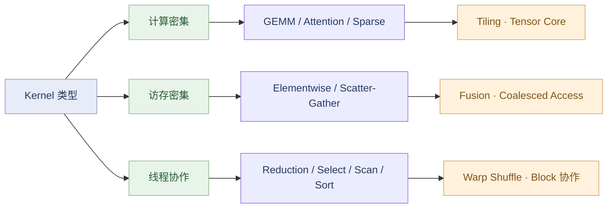


### 算子性能上限建模

**算子性能不仅取决于计算量（FLOPs），还取决于显存访问量（HBM Bytes）、Kernel 启动开销（Launch）和同步等待（Sync）**

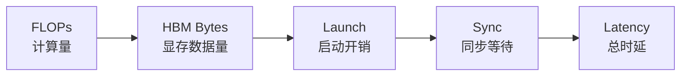

**算子优化首先关注什么？**

| 分析维度      | 关键问题                               | 优化方向                        |
| ------------- | -------------------------------------- | ------------------------------- |
| **FLOPs**     | 计算量是否过大？计算单元是否充分利用？ | 减少冗余计算、Tensor Core       |
| **HBM Bytes** | 显存数据搬运是否过多？                 | Tiling、数据复用、Fusion        |
| **访问模式**  | 访存能否合并？能否在片上复用？         | Coalesced Access、Shared Memory |
| **Launch**    | Kernel 启动次数是否过多？              | Kernel Fusion、CUDA Graph       |
| **Sync**      | 线程同步及等待是否过多？               | 减少同步、异步流水线            |

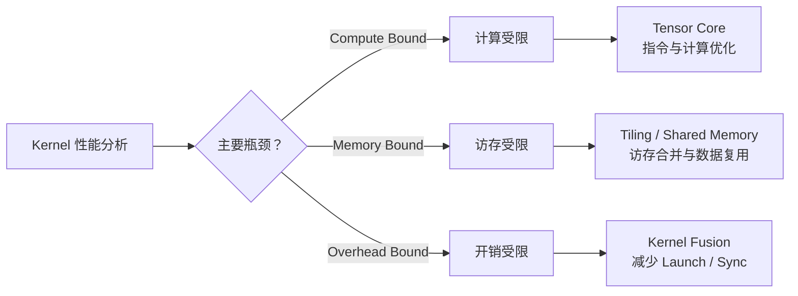

#### Roofline

它主要考虑三个指标：**Nsight Compute（NCU）就能自动生成 Roofline 分析图**

| 指标                       | 含义                           | 单位      |
| -------------------------- | ------------------------------ | --------- |
| FLOPs                      | Kernel 总计算量                | FLOP      |
| HBM Bytes                  | 从显存读取、写入的数据量       | Byte      |
| Arithmetic Intensity（AI） | 每搬运 1 Byte 数据执行多少计算 | FLOP/Byte |

 $$AI=\frac{FLOPs}{Bytes}   ,     P_{\max}=\min(P_{\text{compute}},AI\times BW)$$  


| 参数                 | 含义                                 |
| -------------------- | ------------------------------------ |
| $P_{\text{compute}}$ | 硬件计算峰值性能                     |
| AI\                  | 算术强度，每 Byte 数据对应多少 FLOPs |
| BW                   | 参考内存带宽                         |
| $ P_{\max} $         | Roofline 模型给出的性能上限          |

**主要用于判断：**

- Compute Bound：优化计算指令、Tensor Core、计算流水线。
- Memory Bound：优化数据复用、Tiling、Fusion、访存布局。

Roofline 主要描述计算吞吐与数据搬运的性能上界，**并不能独立判断 Kernel Launch、同步开销等问题**。小 Kernel 的时延可能主要被这些开销主导。


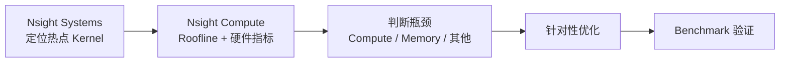


| 性能模型 | 重点关注             | NVIDIA 分析手段                           |
| -------- | -------------------- | ----------------------------------------- |
| Roofline | 算力或带宽瓶颈       | NCU Roofline、Compute / Memory Throughput |
| Little   | 并发与延迟隐藏       | NCU Occupancy、Eligible Warps、Warp Stall |
| Kingman  | 排队、负载波动、延迟 | NSYS Timeline、服务端队列指标、P95 / P99  |

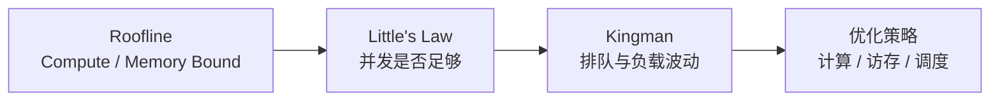


# torch profiler

## 整网运行生成 Kernel 文件和 profiler 追踪文件


```
TORCHINDUCTOR_UNIQUE_KERNEL_NAMES=1 TORCHINDUCTOR_BENCHMARK_KERNEL=1 python -u \
benchmarks/dynamo/torchbench.py --backend inductor --float16 --performance --only \
BERT_pytorch --training --export-profiler-trace
```

- 生成整网 Kernel 文件：通过 `--training` 指定训练模式时，输出日志中包含两行编译模块存储路径，一行为前向图，一行为反向图；通过 `--inference` 指定推理模式时，输出日志中包含一行编译模块存储路径。
- 生成 profiler 追踪文件：运行模型整网的基准测试时，可以通过添加 `--export-profiler-trace` 选项导出 profiler 的追踪文件。
- 整网基准测试信息查看：可以通过 `--output-directory="xxx"` 将输出日志中的基准测试数据保存为 CSV 文件，还可以通过 `tag` 控制输出内容。

其中：

- `TORCHINDUCTOR_UNIQUE_KERNEL_NAMES=1`：尽可能生成更有意义的 Kernel 名字。
- `TORCHINDUCTOR_BENCHMARK_KERNEL=1`：启用 Inductor 的单 Kernel 基准测试代码生成机制。
- `TORCH_COMPILE_DEBUG=1`：帮助查看编译和生成产物。


任何正常调用 `torch.compile(..., backend="inductor")` 并实际执行模型的 PyTorch 脚本，都有机会生成 TorchInductor 编译文件

> 生成编译文件：普通 PyTorch 脚本就可以。
>
> 生成能够独立运行、支持 `-p` 性能分析的编译模块：需要对应的 Inductor 生成代码和 benchmark 支持，不是所有脚本生成的文件都能直接这样运行

TorchInductor 的编译缓存目录

```sh
# export TORCHINDUCTOR_CACHE_DIR=/tmp/my_inductor_cache
/tmp/torchinductor_<用户名>/
```

这个目录是示意，实际文件类型和目录结构会随着 PyTorch 版本及编译后端变化。**`torch.compile(model)` 通常只是创建编译包装，第一次实际调用模型才触发编译。如果命中缓存，也不一定会重新生成文件**

```sh
你的 Python 脚本
    │
    ├── 定义模型
    ├── torch.compile(model)
    └── compiled_model(input)  ← 首次执行触发编译
             │
             ▼
       TorchDynamo 捕获计算图
             │
             ▼
       AOTAutograd（按需处理）
             │
             ▼
       TorchInductor 优化计算图
             │
             ├── 算子融合
             ├── Kernel 生成
             ├── Triton / C++ 编译
             └── 编译缓存
                      │
                      ▼
          /tmp/torchinductor_root/...

/tmp/torchinductor_root/
├── wx/
│   └── cxxxxxxxx.py       # Python 编译模块
├── ab/
│   └── cxxxxxxxx.so       # 编译后的二进制模块
└── ...
```


## 单独研究每个编译模块的性能


```sh
cp /tmp/torchinductor_root/wx/xxx.py  BERT_pytorch.py

# -p 是 Profile 分析整个编译模块 ，-k 是逐 Kernel Benchmark ,Benchmark 各个 Kernel
python BERT_pytorch.py -p
```

- 时间及内存占用
- profiler 追踪文件
- 算子执行信息：打印占用前十的算子，统计其 CPU 和 GPU 的时间及占用等信息。
- 各类别 Kernel 信息：包含 pointwise、reduction、persistent_reduction 以及 cutlass/cudnn 等各个类别算子在 GPU 上的执行时间、调用次数以及时间占比。
- GPU 总繁忙时间占比

## 查看追踪文件

```
# 生产.json 文件
python BERT_pytorch.py -p
```

**可以通过生成JSON格式的追踪文件，在谷歌浏览器中用可视化分析工具(chrome://tracing)进行查看**


- CPU端事件：前缀为 `triton_`，该事件仅包含 Kernel 名称和启动，信息少于其他 aten 算子的 Kernel 启动，不包含输入 shape、类型等信息。

- Kernel启动：triton 算子为 `cuLaunchKernel`，区别于 aten 算子的 `cudaLaunchKernel`。

- GPU端事件：显示名称取决于 `unique_kernel_names` 的 inductor 配置。

- 流事件：GPU 上每个 kernel 都是在 CPU 上运行的代码启动后发生的，可以查看 GPU 和 CPU 事件之间的连接。

- 可视化地查看算子执行序列

- 观察 GPU 利用情况

- 查看算子并行、启动开销等情况


# NVIDIA Nsight

使用 Nsight Systems可以了解应用程序的**执行流程、确定性能瓶颈以及发现并行化的机会，针对单个程序，生产profile性能分析；而Nsight Compute与Nsight Systems不同，其是一款针对 CUDA 应用程序的**内核（Kernel）级**性能分析和调试工具，它专注于 GPU 上的计算性能，提供了详细的性能指标、诊断和指导，帮助开发者优化 CUDA Kernel 的性能。[DCGM](https://developer.nvidia.com/dcgm)用于管理和监控集群环境中的 NVIDIA 数据中心 GPU 的工具。它包括主动健康监控、全面诊断、系统警报和治理策略（包括电源和时钟管理）。它可以由基础设施团队独立使用，并可轻松集成到 NVIDIA 合作伙伴的集群管理工具、资源调度和监控产品中。


[NVIDIA性能分析工具Nsight Systems/Compute 的使用介绍](https://www.bilibili.com/video/BV15P4y1R7VG/?vd_source=d591262dc9ce1bba22682d1cba1ca930)

[【CUDA进阶】深入理解 Nsight System 和 Nsight Compute](https://www.bilibili.com/video/BV13w411o7cu/?vd_source=d591262dc9ce1bba22682d1cba1ca930)


## Nsight Systems

[Nsight Systems](https://developer.nvidia.com/nsight-systems/get-started#documentation)


[界面介绍](https://www.bilibili.com/video/BV1X94y157CV/?spm_id_from=333.788.recommend_more_video.-1&vd_source=d591262dc9ce1bba22682d1cba1ca930)


Get an overview of each theads activities

- Which core the thread isrunning and the utilization  线程正在运行的核心以及它的利用率
- CPU state and transition  CPU的状态及其转换情况
- OS runtime libraries usage: pthread, file l/0, etc  操作系统运行时库的使用情况，比如pthread和文件I/O等
- API usage: CUDA, CUDNN，CuBLAS, TensorRT, ..  API的使用情况，比如CUDA、CUDNN、CuBLAS和TensorRT等


**CPU线程上的发生的CUDA runntime API调用**


- **cudaMalloc** 为输入输出数据配GPU显存
- **CUDAmemcpy** 将输入数据从 CPU 复制到 GPU 显存 或者 显存到CPU
- **cudaFree**  CUDA冻结调用，以清理之前分配的所有 GPU 资源

**GPU运行的情况**


[从 CLI 进行分析](https://docs.nvidia.com/nsight-systems/UserGuide/index.html#profiling-from-the-cli)

```shell
# 直接跑
nsys profile --force-overwrite=true -o baseline_refiner --trace=cuda,cudnn,cublas,osrt,nvtx [cmd]

# launch

# shell A
nsys start --stop-on-exit=false
nsys launch --trace=cuda,cudnn,cublas,osrt,nvtx [cmd]

# shellB
nsys stop
nsys shutdown --kill sigkill

# 生成.nsys.rep文件，使用GUI分析

```


- [osrt](https://docs.nvidia.com/nsight-systems/UserGuide/index.html#os-runtime-libraries-trace)  OS runtime libraries

  这会跟踪 C 运行时和 POSIX 线程 (pthread) 库公开的系统调用包装器和线程同步接口。这不会执行完整的运行时库 API 跟踪，而是专注于可能需要f很长时间才能执行的函数，或者在等待事件完成时可能导致线程从 CPU 中取消调度的函数。

- [nvtx ](https://docs.nvidia.com/nsight-systems/UserGuide/index.html#nvtx-trace)

  允许用户手动检测其应用程序。然后，Nsight Systems 可以收集信息并将其显示在时间线上。

  通常，即使应用程序不是为分析目的而构建的，对 **NVTX 函数的调用也可以保留在源代码中**，因为当未连接分析器时，**开销非常低。**

  **NVTX 不适用于注释非常频繁调用的非常小的代码片段。**一个好的经验法则是：如果注释的代码通常需要不到 1 微秒的执行时间，则应谨慎地在此代码周围添加 NVTX 范围。

  **加入nvtx 注释**

  

  

  

- [cuda 和相关配置项](https://docs.nvidia.com/nsight-systems/UserGuide/index.html#cuda-trace)

  Nsight Systems 能够捕获有关分析过程中 CUDA 执行的信息。

  可以收集以下信息并将其显示在报告的时间线上：

    - CUDA API 跟踪 — 应用程序进行的 CUDA 运行时和 CUDA 驱动程序调用的跟踪。
        - CUDA 运行时调用通常以`cuda`前缀开头（例如`cudaLaunch`）。
        - CUDA 驱动程序调用通常以`cu`前缀开头（例如`cuDeviceGetCount`）。
    - CUDA 工作负载跟踪 — GPU 上发生的活动跟踪，包括内存操作（例如主机到设备的内存复制）和内核执行。在使用 CUDA API 的线程中，时间线树中会出现额外的子行。
    - 在 Nsight Systems Workstation Edition 上，cuDNN 和 cuBLAS API 跟踪以及 OpenACC 跟踪

  `cudaMemcpyAsync` 是 CUDA 中用于在主机（Host）和设备（Device）之间**异步复制数据**的函数。`HtoD` 和 `DtoH` 分别表示从主机到设备（Host to Device）和从设备到主机（Device to Host）的数据传输。

  

- [GPU 指标](https://docs.nvidia.com/nsight-systems/UserGuide/index.html#gpu-hardware-profiling)

  **GPU 上下文**切换  `--gpuctxsw`  , 所有进程的上下文记录。这些记录具有有效的上下文 ID 和进程 ID，并具有全精度时间戳。

  **GPU 指标功能**  `--gpu-metrics-device=[all, none, <index>]` 旨在识别使用 GPU 进行计算和图形处理的应用程序的性能限制因素。它使用定期采样来收集与不同 GPU 硬件单元相关的性能指标和详细时间统计信息，并利用专用硬件以最小的开销一次性捕获这些数据。

  这些指标概述了 GPU 在计算、图形和输入/输出 (IO) 活动中随时间变化的效率，例如：

    - **IO 吞吐量：** PCIe、NVLink 和 GPU 内存带宽
    - **SM 利用率：** SM 活动、张量核心活动、发出的指令、扭曲占用率和未分配的扭曲槽

  它旨在帮助用户回答常见问题：

    - 我的 GPU 空闲吗？
    - 我的 GPU 满了吗？内核网格大小和流够用吗？我的 SM 和 warp 槽满了吗？
    - 我正在使用 TensorCores 吗？
    - 我的指导率高吗？
    - 我可能被 I/O 或 Warp 数量等堵塞了吗？


大量内核操作


常用命令

```sh
# 直接获取profile 覆盖 -o 目录下的报告，用ctrl+c 停止 生成*.nsys-rep  有个很大的中间文件*.qdstrm
nsys profile --kill=sigterm --force-overwrite=true -o dir --trace=cuda,cudnn,cublas,osrt,nvtx [程序启动命令 python xx.py]


# 生成*.nsys-rep报错的话，可以通过QdstrmImporter转换 *.nsys-rep可以导入到UI界面查看
/opt/nvidia/nsight-systems-cli/2024.5.1/host-linux-x64/QdstrmImporter -i *.qdstrm


```

自定义监控点

[QdstrmImporter](https://forums.developer.nvidia.com/t/using-qdstrmimporter/65467)

[只能生成*.qdstrm，这个中间文件，生成*.nsys-rep 失败](https://forums.developer.nvidia.com/t/importer-error-status-an-unknown-error-occurred-without-any-reason/301602/2)

```shell
# 从头监控（可选）
nsys start --stop-on-exit=false

# 先启动
nsys launch  -e CUDA_VISIBLE_DEVICES=1  --trace=cuda,cudnn,cublas,osrt,nvtx [程序启动命令 python xx.py]


# 下面另外一个shell执行

# 启动采集（下面两个可以重复自定义需要监控的时间段）
nsys start

# 停止采集
nsys stop


# 查看session
nsys sessions list
nsys shutdown --kill sigkill
```


## Nsight Compute

[官网 Nsight Compute](https://docs.nvidia.com/nsight-compute/NsightCompute/index.html)

[下载Nsight Compute ](https://developer.nvidia.com/tools-overview/nsight-compute/get-started)

[CUDA C++ Programming Guide](https://docs.nvidia.com/cuda/cuda-c-programming-guide/index.html)


[how to connect  简单配置 ](https://www.bilibili.com/video/BV1Q84y1X7qe/?spm_id_from=333.788.recommend_more_video.0&vd_source=d591262dc9ce1bba22682d1cba1ca930)

[简单介绍引导分析功能 视频](https://www.bilibili.com/video/BV1Rg411A7CA/?vd_source=d591262dc9ce1bba22682d1cba1ca930)


```shell
ncu --set full --target-processes all -o my_report ./your_program

--set full	采集较全面的 Kernel 性能指标
--target-processes all	追踪目标程序及其子进程
-o my_report	输出报告，通常生成 my_report.ncu-rep
./your_program	需要分析的目标程序
```


| 分析模块                    | 主要观察指标                       |
| --------------------------- | ---------------------------------- |
| API Stream                  | CUDA API 调用记录与交互式分析      |
| GPU 利用率                  | SM、Memory 的吞吐利用情况          |
| Compute Workload Analysis   | 指令吞吐 IPC、计算 Pipeline 利用率 |
| Warp Scheduler / Warp State | Warp 调度效率、Stall 原因          |
| Memory Workload Analysis    | L1/L2/DRAM 流量及带宽              |
| Launch Statistics           | Grid、Block、寄存器、Shared Memory |
| Source Counters             | CUDA/PTX/SASS 源码与指令分析       |


**GPU speed of Light Throughput**


根据提示提高GPU利用率


**Warp State Statistics**

线程束状态统计数据部分中查看具有多个问题的内核


本部分提供了在内核执行期间，线程束在各状态下消耗的周期，对于每种状态，图表都显示了每个发出指令。一般来说，**在某种停滞状态中消耗的周期越多**，影响性能的可能性就越大。


这里可以获取更详细信息


baseline


## [性能指南](https://docs.nvidia.com/cuda/cuda-c-programming-guide/index.html#performance-guidelines)

- 最大化并行执行，实现最大利用率；

  **应用层**

    - Host的串行工作负载；Device的并行工作负载。需要线程间通信的计算尽可能在单个线程块内执行。

  **Device:**

    - 在较低层次上，应用程序应该最大化设备多处理器之间的并行执行。
    - [多个内核可以在一个设备上同时执行，因此也可以通过使用流来使足够多的内核同时执行（如异步并发执行](https://docs.nvidia.com/cuda/cuda-c-programming-guide/index.html#asynchronous-concurrent-execution)中所述），从而实现最大利用率。

  **多处理器级别**

    - GPU 多处理器主要依靠线程级并行来最大限度地提高其功能单元的利用率。因此，利用率与驻留 warp 的数量直接相关。每次发出指令时，warp 调度程序都会选择一条准备执行的指令。

- 优化内存使用情况，实现最大的内存吞吐量；

    - 尽量减少低带宽的数据传输
        - 尽量减少主机和设备之间的数据传输，因为它们的带宽比全局内存和设备之间的数据传输低得多。
            - 一次大传输总是比单独进行每次传输效果更好
        - 最大限度地利用片上内存来最大限度地减少全局内存和设备之间的数据传输：共享内存和缓存


- 优化指令使用，实现最大的指令吞吐量；

    - 尽量减少使用低吞吐量的算术指令；这包括在不影响最终结果的情况下用精度换取速度
    - 尽量减少由控制流指令引起的[Control Flow Instructions](https://docs.nvidia.com/cuda/cuda-c-programming-guide/index.html#control-flow-instructions)
    - 减少指令数量

- 尽量减少内存抖动。

    - 频繁分配和释放内存的应用程序可能会发现，分配调用会随着时间的推移而变慢，直至达到极限。
    - 不要尝试使用`cudaMalloc`/ `cudaMallocHost`/`cuMemCreate`分配所有可用内存，因为这会强制内存立即驻留并阻止其他应用程序使用该内存。这可能会给操作系统调度程序带来更多压力，或者只是阻止使用相同 GPU 的其他应用程序完全运行。
    - 尝试在应用程序早期分配适当大小的内存，并且仅在应用程序不需要时才进行分配。减少应用程序中的`cudaMalloc`+`cudaFree`调用次数，尤其是在性能关键区域。
    - 如果应用程序无法分配足够的设备内存，请考虑使用其他内存类型（如`cudaMallocHost`或）`cudaMallocManaged`，虽然性能可能不高，但可以让应用程序取得进展。
    - 对于支持该功能的平台，`cudaMallocManaged`允许超额认购，并`cudaMemAdvise`启用正确的策略，将允许应用程序保留大部分（如果不是全部）性能`cudaMalloc`。`cudaMallocManaged`也不会强制分配驻留，直到需要或预取为止，从而减少操作系统调度程序的总体压力并更好地支持多原则用例。


# triton  cuda 编程

```
应用 / 模型：PyTorch / 推理服务
    └── torch.compile / TorchInductor / 手写 CUDA 或 Triton
         └── Kernel：按 Grid → Block → Warp → Thread 执行（CUDA 视角）
              └── SM：warp scheduler / CUDA cores / Tensor Cores / registers / shared memory
                   └── L1 / L2 / HBM：访存路径
                        └── 性能：Memory / Compute / Latency / Launch-bound
                             └── Nsight Systems 定位 → Nsight Compute 诊断 → 对照基线验证
```


## grid block wrap thread sm


**Grid → Block → Warp → Thread：CUDA 软件定义的线程组织层级。**

**SM（Streaming Multiprocessor）：GPU 中真正负责执行这些线程的硬件单元。**

| 名称             | 含义                                     | 主要作用                                                     |
| ---------------- | ---------------------------------------- | ------------------------------------------------------------ |
| Grid（网格）     | 一次 Kernel 启动的所有 Block             | 划分整个计算任务。多个 Block 的集合，一个 Grid 包含本次 Kernel 启动的所有 Block。这些 Block 可以被调度到不同 SM 上，不要求同时开始执行。 |
| Block（线程块）  | 一组 Thread                              | 多个 Warp 的集合，通过 Shared Memory 交换数据，线程协作，通过 `__syncthreads()` 进行块内同步。一个 Block 会被分配到同一个 SM 上执行，不会拆分。 |
| Warp（线程束）   | **NVIDIA 的一个 Warp 固定为 32 Threads** | SM 的基本指令**调度**单位, 采用 SIMT 执行模型：这同一条指令由多个线程执行，每个线程有独立的寄存器和数据。（矩阵操作） |
| Thread（线程）   | 一个逻辑执行实例                         | 执行 Kernel 代码，处理数据，最小的**编程执行**单位，每个 CUDA Thread 都有自己的 `threadIdx`、寄存器状态及所处理的数据。 |
| SM（流多处理器） | GPU 的硬件计算单元                       | **真正执行计算的硬件**，执行 Block 中的 Warp。SM 内部有 Warp Scheduler、寄存器文件、Shared Memory、计算执行单元等。**一个 SM 可以同时驻留多个 Block 和多个 Warp**，具体数量由寄存器、Shared Memory、线程数和 GPU 架构限制。 |

例如，一个 Block 有 256 个线程，Warp：**32 个 Thread 组成一组（32 是 NVIDIA CUDA 的 Warp Size，不是所有 GPU 品牌通用的固定数值。）**，相当于8个wrap。


| 层级                    | 太少的影响                                                   | 太多的影响                                                   | 优化原则                  |
| ----------------------- | ------------------------------------------------------------ | ------------------------------------------------------------ | ------------------------- |
| **Grid（Block 总数）**  | **SM 吃不满，并行度不足**                                    | Block 过于细碎时，调度开销增大                               | 保证足够的 Block 覆盖 SM  |
| **Block（每块线程数）** | Warp 数少，资源利用不足                                      | **一个 Block 使用大量寄存器、线程或 Shared Memory，可能导致同一 SM 能驻留的 Block 变少：调整 Block Size，检查寄存器压力、Shared Memory 和 Occupancy。** | 常从 128/256 Threads 测试 |
| **Warp（活跃数量）**    | **无法充分隐藏访存延迟,没有其他就绪 Warp 执行，SM 计算单元可能闲置。** | 超过资源允许的驻留上限；继续增加不一定有收益                 | 足够隐藏延迟即可          |
| Thread（线程数量）      | 并行度不足                                                   | 每 Block 线程过多会占用资源；线程总量过大不一定更快          | 根据数据量和计算量划分    |
| SM（硬件数量）          | GPU 总计算能力受限                                           | 任务不足时更多 SM 闲置，或受内存带宽限制                     | 充分利用现有 SM           |

NVIDIA 的一个 Warp 固定为 32 Threads，不能随意增减 Warp Size。**能调整的是 Block 线程数、每个 Block 的 Warp 数以及总 Block 数。**

**Occupancy 是 SM 活跃驻留 Warp 数与硬件最大 Warp 数的比例**，主要影响 GPU 隐藏延迟的能力。它受寄存器、共享内存和 Block 配置限制，但并不是越高越好，需要结合实际计算吞吐和内存带宽判断。

- 太低：可能无法充分隐藏访存或指令延迟。

- 足够高：可能已经能够让计算单元充分工作。

- 继续提高：不一定加速，甚至可能因为寄存器溢出（Register Spill）而变慢。

### 和 Triton 的对应关系

| Triton 参数  | 太小                            | 太大                           |
| ------------ | ------------------------------- | ------------------------------ |
| `grid`       | Program 数不足，SM 利用率低     | Program 太细碎可能增加调度成本 |
| `BLOCK_SIZE` | 数据复用与每 Program 工作量不足 | 可能增加寄存器压力和资源消耗   |
| `num_warps`  | 并行执行能力不足                | 可能增加同步、资源和调度开销   |
| `num_stages` | 流水线不足，等待内存            | 额外缓存占用可能降低 Occupancy |

特别注意：`BLOCK_SIZE` 表示一个 Triton Program 处理的逻辑元素数量，不等于 GPU Thread 数。


## 内存层级

```
GPU
├── SM（片上资源）
│   ├── Register       ← Thread 私有，速度快
│   ├── Shared Memory  ← Block 共享 （同一 Block 内的线程）
│   └── L1 Cache   对应 SM 的线程
│
├── L2 Cache           ← 多个 SM 共享
│
└── Global Memory（HBM/GDDR）
    ├── Global 数据    ← 所有线程可访问
    └── Local Memory     ← 每个 Thread 私有  （block_size太大会造成Register Spill（寄存器溢出））
```

越往下容量越大，访问延迟越高，**Local Memory（局部内存）逻辑上属于 Thread 私有内存，但物理上通常存储在 GPU 的 Global Memory（HBM/GDDR）中**


**GPU 存储层级对比**

| 层级              | 典型用途               | 优势     | 主要约束                 |
| ----------------- | ---------------------- | -------- | ------------------------ |
| **HBM**           | 输入 / 输出 Tensor     | 容量大   | 带宽 + 延迟              |
| **L2**            | 跨 Block / Cache 复用  | 自动缓存 | 可控性有限               |
| **Shared Memory** | Block 内输入 Tile      | 显式复用 | 容量、布局、同步成本     |
| **Register**      | Accumulator / Fragment | 带宽最高 | Register Pressure、Spill |


Local Memory：线程私有的逻辑地址空间，数据实际通常存放在 HBM/GDDR。

L1 Cache：SM 内的高速硬件缓存，用来加速包括 Local Memory 在内的部分内存访问。

```
Thread 访问 Local Memory
          ↓
      L1 Cache
      ├── Hit  → 直接从 L1 读取
      └── Miss → 查询 L2 Cache
                      ↓
                仍未命中
                      ↓
                HBM / GDDR
```

**为什么不直接把 Local 数据存进 L1？**

因为 L1 Cache 有三个限制：

1. 容量有限：无法保证容纳所有线程的局部数据。
2. 自动替换：L1 由硬件管理，缓存行可能被其他数据替换。
3. 不是独立存储空间：程序通常不能像分配寄存器、Shared Memory 那样，将变量直接分配并固定在 L1 中。

所以编译器通常优先使用 Register；如果寄存器不够，或者局部数组不适合放进寄存器，就可能使用 Local Memory。Local Memory 的访问再由缓存系统加速。所以**即使 Local Memory 访问可能命中缓存，也通常不如直接使用寄存器高效。**


**GPU 算子经常不是计算不够快，而是数据搬运太慢。**

```


低效：
Global Memory → 反复读取相同数据 → 计算

优化：
Global Memory → Shared Memory / Register
                         ↓
                    多次复用数据
                         ↓
                       计算
```


## 访存优化和数据复用

1. **Memory Request（内存请求）**：Warp 执行一次访存指令所产生的请求。
2. **Wavefront（访存处理批次）**：L1TEX 内存单元内部处理请求的工作单位。
3. **Sector（内存扇区）**：通常为 32 Byte 的数据块。
4. **Cache Line（缓存行）**：在这里通常按 128 Byte 理解。

- Request：告诉内存系统，我要这些数据。
- Sector：具体涉及哪些 32B 数据块。
- Wavefront：内存系统分几批处理这个请求。


**访存方式 → Memory Request → Sector / Wavefront → 内存延迟与吞吐 → Warp Stall → 指令发射效率 → Kernel 耗时。**

| 指标                  | 表示什么                          | 指标升高可能意味着                           |
| --------------------- | --------------------------------- | -------------------------------------------- |
| **Memory Requests**   | 发出的内存请求数量                | 访存指令更多，内存系统工作量可能增加         |
| **Sectors / Req**     | 每个请求涉及多少个 32B Sector     | 在相同访存任务下，越高通常说明访存越分散     |
| **Wavefronts / Req**  | 每个请求需要多少个 L1TEX 处理批次 | 越高可能增加内存管线处理压力                 |
| **L1/L2 Hit Rate**    | 缓存命中率                        | 越高通常越能减少下层内存访问                 |
| **Memory Throughput** | 单位时间内的数据传输量            | 高可能代表带宽利用充分，也可能存在冗余流量   |
| **Warp Stall**        | Warp 暂时不能发射指令             | 等待依赖、同步或管线资源的情况增加           |
| **Eligible Warps**    | 可以立即发射指令的 Warp 数        | 越多通常越有利于隐藏延迟                     |
| **Issue Active**      | 指令发射槽利用率                  | 越高通常说明调度器更忙，但不一定有效工作更多 |
| **Occupancy**         | 活跃 Warp 占硬件最大容量的比例    | 提高可能改善延迟隐藏，但不是越高越好         |


### Memory Coalescing（合并访存）

**优化每次访存的效率，减少不必要的内存传输。**

**Coalescing 是指 Warp 内线程访问 Global Memory 时**，硬件将内存地址合并成尽量少的内存事务。**通常让同一个 Warp 的相邻线程，尽量访问相邻的内存地址，可以减少无效数据传输，提高有效带宽。**

**GPU 为了提高吞吐量，会成批访问数据；因此一个 Warp 的线程最好访问集中在少量 Sector 内的地址，而不是散落在很多 Sector 中。**

同一个 Warp 的 32 个线程访问 Global Memory 时，**如果地址连续且对齐**，GPU 就能用较少的内存事务完成访问。

> Sector 是内存系统中的访问粒度，通常为 32B。Coalescing 的核心目标是让一个 Warp 需要的数据集中在尽可能少的 Sector 中，从而减少内存事务和无效数据传输。


```c++
// 高效：连续访存

int idx = blockIdx.x * blockDim.x + threadIdx.x;
float x = A[idx];

// 跨步访存  每个线程访问的数据相隔 128 Bytes，容易导致大量内存事务
int idx = blockIdx.x * blockDim.x + threadIdx.x;
float x = A[idx * 32];
```


### 何时进行 Memory Coalescing（合并访存）优化

主要看两个方面：

1. 代码特征：同一个 Warp 的线程是不是在跨步、随机地访问 Global Memory？
2. 性能指标：Nsight Compute（NCU）中，读取少量有效数据是否产生了过多内存请求？

**先看代码特征**

| 访存方式     | 示例                    | 是否值得检查              |
| ------------ | ----------------------- | ------------------------- |
| 连续访问     | `A[idx]`                | 通常较好                  |
| 跨步访问     | `A[idx * 32]`           | 重点检查                  |
| 随机访问     | `A[indices[idx]]`       | 重点检查                  |
| 矩阵按列访问 | `A[col * stride + row]` | 取决于线程映射与内存布局  |
| 连续但不对齐 | `A[idx + 1]`            | 可能多访问 Sector，需测量 |

这里的 `idx` 假设是连续的线程全局编号。看到跨步、随机访问，不代表一定存在性能问题，但值得用 NCU 验证。

**NCU 重点看什么指标** ： **sector 数量， 带宽瓶颈**

打开 Nsight Compute，进入 Memory Workload Analysis → L1/TEX Cache，重点观察 Global Loads / Stores。

| 指标                      | 代表什么                    | 怎么判断                       |
| ------------------------- | --------------------------- | ------------------------------ |
| **Sectors/Req**           | 每次访存请求涉及多少 Sector | 核心指标，明显高于理想值要检查 |
| Global Load/Store Sectors | 实际涉及的 Sector 总数      | 与理想请求量对比               |
| Excessive Sectors         | 超出理想访存的部分          | 越多越值得调查                 |
| DRAM Throughput           | 显存实际传输带宽            | 判断是否存在带宽瓶颈           |

**其中最值得记的是 Sectors/Req。**


###  Shared Memory Bank Conflict（存储体冲突）

**同一个 Warp 的多个线程访问 Shared Memory 时，如果访问不同地址，但这些地址属于同一个 Bank，就可能发生冲突，导致访问被拆分、串行处理。**

 Shared Memory 通常

- 32 个 Bank，每个 Bank 每周期可提供 32-bit（4 Bytes）的数据带宽。
- 连续的 4B 数据依次映射到不同 Bank

对于 `float32`，可以简单理解为：

$$bankid = 索引   mod   32$$

| 访问方式   | Thread 0 | Thread 1 | Thread 2 | 结果                |
| ---------- | -------- | -------- | -------- | ------------------- |
| 连续读取   | A[0]     | A[1]     | A[2]     | 不同 Bank，无冲突   |
| 跨步 32    | A[0]     | A[32]    | A[64]    | 同一个 Bank，有冲突 |
| 同地址读取 | A[0]     | A[0]     | A[0]     | Broadcast，无冲突   |

例如 32 个线程执行：

```c++
__shared__ float data[1024];

int tid = threadIdx.x;

// 高效：访问不同 Bank
float a = data[tid];

// 低效：访问同一个 Bank 的不同地址  第二种情况下，32 个线程的地址全部映射到 Bank 0，形成典型的 32-way Bank Conflict
float b = data[tid * 32];
```


最经典的方式是 **Padding**（填充）：**改变数据的物理存储步长，使访问分散到不同 Bank。**

 因为原来每行间隔 32 个 float，刚好绕过完整的 32 个 Bank，下一行又回到 Bank 0。增加一列后，每行间隔 33 个 float，下一行就错开一个 Bank。

假设定义一个 32×32 的 Shared Memory 矩阵：

```
// 可能存在 Bank Conflict
__shared__ float tile[32][32];

// 优化：多增加一列
__shared__ float tile_opt[32][33];
```

当同一 Warp 的线程按列读取：

```
float a = tile[threadIdx.x][0];
float b = tile_opt[threadIdx.x][0];
```

|                  | 32×32               | 32×33                 |
| ---------------- | ------------------- | --------------------- |
| 相邻行首地址间隔 | 32 floats           | 33 floats             |
| Bank 映射        | `tid * 32 % 32 = 0` | `tid * 33 % 32 = tid` |
| 冲突情况         | 32-way Conflict     | 无 Bank Conflict      |

或者使用**Swizzle（地址重排）**：**通过 XOR 等映射改变数据在 Shared Memory 中的存放位置，让原本冲突的访问分散到不同 Bank。**

- padding 消耗存储空间
- swizzle 增加额外计算


### 知道需要进行 Bank Conflict 优化？


重点查看 Memory Workload Analysis → Shared Memory。

| NCU 指标                 | 含义                   | 怎样判断                     |
| ------------------------ | ---------------------- | ---------------------------- |
| Bank Conflicts           | Shared Memory 冲突次数 | 明显偏高，值得检查           |
| Wavefronts / Request     | 每次请求需要多少轮服务 | 相对理想值偏高，可能存在冲突 |
| Excessive Wavefronts     | 超出理想情况的额外工作 | 越多越值得调查               |
| Shared Memory Throughput | Shared Memory 吞吐情况 | 判断是否成为性能瓶颈         |

常见代码特征

| 代码特征                | 是否值得检查          |
| ----------------------- | --------------------- |
| Shared Memory 连续访问  | 通常较好              |
| `shared[tid * 32]`      | 重点检查              |
| `tile[32][32]` 按列访问 | 重点检查              |
| 多线程读取同一地址      | Broadcast，一般无冲突 |
| 矩阵转置 / Reduction    | 需要检查实际访问模式  |

### Shared Memory Tiling（分块与复用）

Tiling = 把大计算任务拆成小块（Tile），每次将数据分块加载到 Shared Memory重复使用，防止相同数据被反复从 Global Memory 读取

矩阵例子 ： Tiling 负责数据复用，Coalescing 优化 Global Memory 访存，Bank Conflict 优化 Shared Memory 访存，`__syncthreads()` 保证线程协作时的数据正确性。

```
① 一个 Block 负责 C 的一个 Tile
             ↓
② 线程协作加载 A、B 的 Tile
   Global Memory → Shared Memory
   ★ Coalescing：让 Global Load 尽量合并
   ★ Bank Conflict：避免 Shared Store 冲突
             ↓
③ __syncthreads()
   确保所有线程完成 Tile 加载
             ↓
④ 从 Shared Memory 读取数据并计算
   ★ Bank Conflict：避免 Shared Load 冲突
   ★ 数据复用：同一个 Tile 多次参与计算
   ★ 中间累加结果通常保存在 Register
             ↓
⑤ __syncthreads()
   确保所有线程已经使用完当前 Tile
   防止覆盖尚未读取的数据
             ↓
⑥ 沿 K 维移动，加载下一组 A、B Tile
   重复②～⑤
             ↓
⑦ 计算完成，写回 C 到 Global Memory
   ★ Coalescing：写回时也尽量合并访存
```

和前面一样，先分析再优化。

| 特征 / NCU 指标            | 说明                            |
| -------------------------- | ------------------------------- |
| 同一数据被多个线程重复读取 | 有数据复用机会                  |
| DRAM / L2 流量较大         | 可能存在重复搬运                |
| Memory Throughput 接近瓶颈 | 访存优化可能更有价值            |
| Arithmetic Intensity 低    | 每搬运一个 Byte，执行的计算较少 |
| Shared Memory 使用率过高   | Tile 可能太大，限制 Occupancy   |
| Register Spill 增加        | Tile 或中间计算状态可能过大     |

Tile 太小，复用不足；Tile 太大，又可能消耗过多 Shared Memory、寄存器，降低 Occupancy。还要考虑同步成本及额外的数据搬运。


## Register 

> Register Pressure 是 Kernel 对寄存器资源的需求。每个 Thread 使用过多寄存器，会限制 SM 可驻留的 Warp 数，降低 Occupancy；如果寄存器分配不足，还可能发生 Register Spill，导致额外的 Local Memory 访问。优化需要平衡寄存器用量、Occupancy 和 Spill，而不是单纯追求最低寄存器数量。


**Register Pressure（寄存器压力）**

**Kernel 对寄存器资源的需求程度。**:每个 Thread 都需要寄存器保存计算过程中的变量、中间结果。编译器通常会优先使用 Register 保存这些数据。但是 **每个 SM 的寄存器总量有限。**

每 Thread 使用的寄存器越多，SM 能同时驻留的 Warp 可能越少，Occupancy 下降。

**Register Spill （寄存器溢出）**

当编译器无法把需要保存的数据都安排在可用寄存器里时，可能将部分数据放到 Local Memory。

```
Kernel 中间数据太多
         ↓
Register Pressure 增加
         ↓
  ┌──────┴────────┐
  ↓               ↓
寄存器够用       寄存器分配不足
  ↓               ↓
Occupancy 可能降低  Register Spill
                  ↓
               Local Memory
                  ↓
            增加访存指令和延迟
```

Register Pressure 高不等于一定发生 Spill。 编译器可能通过使用更多寄存器、降低 Occupancy 来避免 Spill。


### 怎样优化？

怎样知道需要优化？（NCU）重点查看 Launch Statistics、Occupancy、Source、Memory Workload Analysis。

| 指标                      | 判断方法                   |
| ------------------------- | -------------------------- |
| `Registers Per Thread`    | 是否占用较多 SM 寄存器资源 |
| `Theoretical Occupancy`   | 是否因为寄存器使用量而受限 |
| `Spill Loads / Stores`    | 是否发生寄存器溢出         |
| Local Memory Load / Store | 是否存在额外的局部内存流量 |
| Kernel Duration           | 调整后是否真正加速         |

怎样优化

| 原因                   | 优化方法                               |
| ---------------------- | -------------------------------------- |
| 每线程保存过多中间变量 | 缩短变量生命周期、减少同时存活的临时值 |
| Tile 太大              | 适当减小 Tile Size                     |
| 复杂循环展开           | 减少不必要的 Unroll                    |
| Register Spill         | 调整计算方式、减少局部数组或变量       |
| Occupancy 过低         | 平衡寄存器数量与 Block Size            |

特别要注意：不能单纯强制减少寄存器数量，否则可能从 Occupancy 问题变成更严重的 Spill 问题。


## 线程协作与同步

多个 Thread 如何安全地交换数据、共同计算一个结果

> CUDA 线程协作主要通过 Shared Memory、同步原语和 Warp Shuffle 实现。
>
> `__syncthreads()` 保证 Block 内线程同步；Warp Shuffle 允许 Warp 内线程直接交换寄存器数据；Atomic 保证并发更新的原子性。
>
> 在 Reduction 优化中，通常先做线程局部累加，再使用 Warp Shuffle 完成 Warp 级规约，通过 Shared Memory 汇总多个 Warp，最后使用 Atomic 或第二个 Kernel 完成跨 Block 汇总。

| 技术              | 解决什么问题                     | 作用范围                                                     |
| ----------------- | -------------------------------- | ------------------------------------------------------------ |
| `__syncthreads()` | 等待整个 Block 完成写入，再读取  | 只能同步同一 Block 中的线程。<br />不能任意放进只有部分线程会进入的 `if` 分支。<br />同步有成本，不应该无条件增加。 |
| Warp Shuffle      | Warp 内线程直接交换寄存器数据    | Warp<br />不需要为了这些值的交换而写入 Shared Memory<br />减少 Shared Memory 访问和显式 Block 同步<br />很适合 Warp 内 Reduction |
| Atomic            | 多线程修改同一地址，防止数据竞争 | 取决于原子操作的 Scope，可以跨越block<br />大量线程同时更新同一个地址，会形成竞争，可能限制吞吐 |
| Reduction         | 多个数据归约成一个结果           | Warp / Block / Grid                                          |

前三种是协作机制，Reduction 是运用这些机制实现的计算算法。**Atomic 保证对应操作的原子性，不等于让所有线程同步，也不自动保证任意其他数据的顺序。**

分层规约的原因是：

- 一个 Warp 内优先使用 Shuffle，减少通信成本。
- 多个 Warp 之间使用 Shared Memory 交换部分结果。
- 不同 Block 不能直接依赖普通 `__syncthreads()` 同步，可以使用 Atomic 或分阶段 Kernel 汇总。


### 怎样判断同步与通信需要优化

| NCU 现象                    | 可能的问题                | 优化方向                    |
| --------------------------- | ------------------------- | --------------------------- |
| `Stall Barrier` 高          | 同步等待较多              | 减少不必要的 Barrier        |
| Shared Memory 访问量大      | 线程间通信成本高          | 考虑 Warp Shuffle           |
| Atomic 吞吐受限             | 大量线程竞争相同地址      | 先局部 Reduction，再 Atomic |
| Kernel 时间较长但计算量很小 | 通信/同步开销占比可能较高 | 融合或调整任务划分          |

这些只是排查线索，不应仅凭单个指标断言瓶颈。


## CUDA Stream / Event / CUDA Graph

多个 Kernel、数据传输和 CPU 如何协作，减少等待时间，提高端到端推理性能

> CUDA Stream 是有序的异步任务队列，可通过多个 Stream 实现计算与数据传输重叠；CUDA Event 用于跨 Stream 同步和计时；CUDA Graph 将重复执行的 Kernel 和依赖关系预先构建，降低 CPU 提交开销。
>
> 推理优化时，我会先使用 NSYS 判断瓶颈是 Kernel 执行慢、数据传输慢，还是 CPU Launch Gap 较大，再选择 Triton Kernel 优化、Multi-Stream 或 CUDA Graph，而不是直接盲目增加 Stream 数量。


| 技术                 | 解决什么问题                                                 | 核心作用                                                     |
| -------------------- | ------------------------------------------------------------ | ------------------------------------------------------------ |
| CUDA Stream（流）    | GPU 任务串行等待、无法充分并发                               | 异步提交任务，组织并发执行<br />**Stream 是一个有序的 GPU 操作队列。同一个 Stream 内操作按顺序执行；不同 Stream 的操作有机会并发执行。** |
| CUDA Event（事件）   | 不同 Stream 之间怎样同步                                     | 记录完成点、等待kernel之间依赖、测量时间<br />**优先选择满足正确性所需的最小同步范围** |
| CUDA Graph（计算图） | CPU 反复启动大量短 Kernel，在 GPU 时间线上产生 Launch Gap，开销较高 | 预先记录任务图，降低重复提交开销<br />**降低 CPU Launch Overhead 和重复工作流的提交开销，而不是直接加速单个 Kernel 的数学计算。** |

它们的区别可以记成：

- Stream：任务怎样排队执行？异步（Asynchronous）不等于一定并行（Concurrent）。多个 Stream 只是提供并发机会，是否真正重叠取决于 GPU 的计算资源、Copy Engine、任务依赖和同步操作。
- Event：任务之间怎样协调？
- CUDA Graph：能不能把整套任务一次提交？


**stream 并行，但需要满足一些条件：**

1. Host Memory 使用 Pinned Memory（页锁定内存，大量分配也会增加系统资源压力），才能可靠地支持所需的异步 H2D/D2H 与计算重叠。

2. 使用 `cudaMemcpyAsync()`，并正确指定 Stream。

3. GPU 支持相应 Copy/Compute 并发能力。

4. 不存在阻碍重叠的同步依赖，且操作使用的缓冲区不会互相覆盖。

   

**什么时候适合 CUDA Graph？**

| 场景                          | 预期价值                   |
| ----------------------------- | -------------------------- |
| 小 Batch、很多短 Kernel       | 通常比较有价值             |
| 重复执行、计算图稳定          | 很适合                     |
| 大量 Python / CPU Launch 开销 | 值得考虑                   |
| 单个 Kernel 已经运行很长时间  | 可能收益有限               |
| Shape、分支或缓冲区经常变化   | 需要特殊处理，复用难度增加 |


### 怎样判断需要优化？（NSYS）

这类问题应优先使用 Nsight Systems（NSYS），而不是首先使用 Nsight Compute。

| 时间线特征                | 可能的问题         | 优化方向                    |
| ------------------------- | ------------------ | --------------------------- |
| Kernel 之间存在大量空白   | CPU Launch Gap     | CUDA Graph                  |
| H2D、Kernel、D2H 完全串行 | 没有形成流水线     | Multi-Stream、Pinned Memory |
| CPU 频繁同步等待          | 同步范围过大       | Event、减少不必要的同步     |
| 多 Stream 没有重叠        | 资源不足或存在依赖 | 检查 GPU 资源和 Stream 关系 |
| 单个 Kernel 执行很慢      | Kernel 内部瓶颈    | 再用 NCU 分析               |


## CUDA GPU 性能瓶颈分析

我会先通过 Nsight Systems 分析端到端时间线，确认瓶颈是 CPU Launch、数据传输还是 GPU Kernel。

如果是 Kernel 内部慢，再用 Nsight Compute 查看 Roofline、SM/Memory Throughput、Occupancy 和 Warp Stall Reasons，判断是 Memory-bound、Compute-bound 还是 Latency-bound。

Memory-bound 主要考虑 Coalescing、Tiling 和 Fusion；Compute-bound 关注计算指令、Tensor Core 和算法；Latency-bound 则考虑 Occupancy、ILP 和流水线。

最后通过固定输入、Warmup、重复基准测试以及端到端回归验证优化收益，并检查数值正确性。


> NSYS 找到耗时 Kernel看
>
> CPU Launch、Kernel 时间线、Memcpy、Stream 依赖和 GPU 空闲时间。
>
>
> NCU 分析 Kernel
> 如果程序有很多 Kernel，实际使用时还应通过 Kernel 过滤器和 NVTX 范围缩小采样范围，避免报告过大。
>
> ### 
>
> 
>
>  第一步：计算和带宽都低。
>
> SM Throughput 18%，DRAM Throughput 12%，说明两者都没有接近峰值，但不能直接判断原因。
>
> 第二步：检查 Warp 状态。
>
> 如果发现 Eligible Warps 很少，Long Scoreboard 很高，说明大量 Warp 可能在等待内存操作结果。
>
> 第三步：结合 Occupancy。
>
> Achieved Occupancy 只有 25%，需要进一步判断是否因为寄存器、Shared Memory 或 Grid 太小，导致无法驻留足够多的 Warp。
>
> 第四步：选择优化方向。
>
> 优先尝试调整 `BLOCK_SIZE`、`num_warps`、数据复用或预取策略。然后重新跑 NCU，对比实际 Kernel Duration。
>
> 这种情况下，优先考虑延迟隐藏，而不是直接优化 Tensor Core 计算吞吐。


| 瓶颈                          | 本质问题                             | 典型优化方法                     |
| ----------------------------- | ------------------------------------ | -------------------------------- |
| Memory-bound（内存带宽受限）  | 数据搬运速度跟不上计算需求           | Coalescing、Tiling、Fusion       |
| Compute-bound（计算吞吐受限） | GPU 计算单元接近处理能力上限         | Tensor Core、精度优化、算法优化  |
| Latency-bound（延迟受限）     | GPU 经常等待，算力与带宽都没充分利用 | Occupancy、ILP、流水线、减少依赖 |


**Memory-bound**

| 指标              | 现象                         |
| ----------------- | ---------------------------- |
| DRAM Throughput   | 接近设备可持续带宽上限       |
| Memory Throughput | 某级内存系统接近饱和         |
| Sectors/Request   | 明显偏多，可能合并访存不佳   |
| L1 / L2 Hit Rate  | 结合数据复用模式判断缓存效果 |

优化方向： **减少传输的数据量、提高有效带宽、增加数据复用**。这里有一点很重要：**DRAM 带宽不高，不代表不存在内存问题，也可能是内存访问延迟过高，而不是带宽已经满了。**

**Compute-bound**

| 指标                    | 现象                     |
| ----------------------- | ------------------------ |
| Compute Throughput      | 接近相关计算流水线的上限 |
| Tensor Core Utilization | Tensor Core 活动水平较高 |
| FP32 / FP16 Pipeline    | 对应指令管线接近饱和     |
| Roofline                | 实测性能接近计算性能上界 |

优化方向： **使用合适的 Tensor Core 指令、调整 MatMul Tile、减少不必要的计算，或选择可接受的低精度算法。**

如果计算单元已经接近极限，单纯增加 Warp 数量往往不能带来明显收益。

**Latency-bound ：**真正限制性能的是等待时间没有被充分隐藏。

| 优化手段            | 为什么有效                         |
| ------------------- | ---------------------------------- |
| 提高有效 Occupancy  | 提供更多可调度 Warp，隐藏等待      |
| ILP（指令级并行）   | 同一个 Warp 执行更多相互独立的指令 |
| Prefetch / Pipeline | 提前加载后续需要的数据             |
| 优化数据局部性      | 尽量降低访问延迟                   |
| 减少同步            | 避免不必要的 Barrier 等待          |

注意：如果 Warp 数已经足够，继续增加 Occupancy 未必会加速。


1. **先看 Kernel Duration + Roofline**

   判断是计算吞吐、内存带宽，还是延迟方面的问题。

2. **看 Memory Workload Analysis**

   关注 `Sectors/Req`、Wavefronts、L1/L2 Hit Rate、DRAM Throughput，判断访问是否高效。

3. **看 Scheduler Statistics**

   关注 Eligible Warps、Issue Active，判断调度器是否经常缺少可执行的 Warp。

4. **再看 Warp Stall Reasons**

   结合 Long/Short Scoreboard、Throttle、Barrier 等指标定位具体等待原因。

5. **最后看 Occupancy / Register Usage**

   判断能否通过增加并行 Warp、减少寄存器压力、提高 ILP 等方式隐藏延迟。


| NCU 分析页面             | 关键指标                             | 解决什么问题               |
| ------------------------ | ------------------------------------ | -------------------------- |
| Speed Of Light           | SM / Memory / DRAM Throughput        | 计算和内存资源是否接近饱和 |
| Roofline                 | Arithmetic Intensity、Achieved FLOPS | 理论性能上界在哪里         |
| Scheduler Statistics     | Active / Eligible / Issued Warps     | Warp 是否经常无法发射指令  |
| Warp State Statistics    | Long/Short Scoreboard、Barrier       | Warp 在等待什么            |
| Memory Workload Analysis | Sectors、Bank Conflicts、Cache Hit   | 访存是否高效               |
| Occupancy                | Theoretical / Achieved Occupancy     | 驻留 Warp 是否受资源限制   |
| Launch Statistics        | Registers、Shared Memory、Grid/Block | Kernel 配置与资源开销      |


Warp Stall Reasons ： Stall（停顿 / 等待）指 GPU 的 Warp 暂时无法发射下一条指令，因为它正在等待数据、计算结果或某种硬件资源。

| Stall 原因           | 可能意味着                                  | 优化方向                          |
| -------------------- | ------------------------------------------- | --------------------------------- |
| `Long Scoreboard`    | 等待 Global/Local 等 L1TEX 相关内存操作结果 | ILP、缓存复用、预取、Coalescing   |
| `Short Scoreboard`   | 等待 Shared Memory 等 MIO 相关操作          | 检查 Shared Memory、Bank Conflict |
| `Barrier`            | 等待其他 Warp 到达同步点                    | 减少不必要的同步、平衡任务        |
| `Math Pipe Throttle` | 数学指令流水线资源紧张                      | 分析计算指令组成                  |
| `LG Throttle`        | Local/Global Memory 指令队列拥塞            | 减少冗余访存和 Spill              |

Stall 高不一定是坏事。 如果 SM 已经在持续发射指令、计算吞吐接近上限，那么部分 Warp 等待是正常的。应该先看是否存在大量没有指令发射的周期，再检查 Stall


# Tensor Core 

Tensor Core 是 NVIDIA GPU 中专门加速矩阵乘加运算（Matrix Multiply-Accumulate，MMA）的硬件计算单元。

| 对比     | CUDA Core             | Tensor Core               |
| -------- | --------------------- | ------------------------- |
| 主要计算 | 普通标量算术运算      | 矩阵块乘加运算            |
| 典型操作 | `a * b + c`           | `D = A × B + C`           |
| 编程方式 | CUDA 普通算术指令     | WMMA / MMA / WGMMA 等     |
| 适用场景 | Elementwise、通用计算 | MatMul、Attention、卷积等 |
| 优势     | 通用灵活              | 矩阵计算吞吐量高          |

两者通常都位于 SM 内，但使用不同的计算执行资源。

**Tensor Core 比 CUDA Core 快?**

> Tensor Core 是专用的矩阵乘加计算单元，能够以矩阵 Tile 为单位执行大量乘加运算，获得更高的矩阵计算吞吐量。但它需要满足相应的数据类型、布局和指令条件。

使用 Tensor Core 之后，还需要 Tiling 吗？

> 需要。Tensor Core 解决矩阵计算吞吐问题，Tiling 解决数据搬运和复用问题。实际高性能 MatMul 还需要平衡 Shared Memory、寄存器、Occupancy 和 Tensor Core 利用率。

为什么 Triton MatMul 可能比 cuBLAS 慢？

> cuBLAS / cuBLASLt 针对大量硬件架构和矩阵形状做了深度优化。普通 Triton 实现可能在 Tile 选择、数据布局、流水线和 Tensor Core 利用率上不如成熟库；但特殊 Shape、Fusion 或业务场景可能提供定制优化机会。


Tensor Core 不是让单次乘法没有延迟，而是通过专用硬件，在一条矩阵指令中完成大量乘加运算，**获得更高计算吞吐量**。

MMA = Matrix Multiply-Accumulate（矩阵乘加），允许**一组线程**协作执行一个矩阵块的乘加。是 Warp 级协作操作。


| 精度 | 存储大小                    | 特点                                                         | 常见场景                 |
| ---- | --------------------------- | ------------------------------------------------------------ | ------------------------ |
| FP32 | 32-bit                      | 精度高，动态范围较大                                         | 高精度计算、数值参考     |
| TF32 | 通常保留 FP32 输入/输出存储 | Tensor Core 内部降低乘法有效精度，TF32 是 Tensor Core 内部的一种计算格式，可以在不改变 FP32 Tensor 存储类型的情况下加速矩阵乘法。 | FP32 MatMul 加速         |
| FP16 | 16-bit                      | 有效精度较高于 BF16，但动态范围较小                          | 推理、训练               |
| BF16 | 16-bit                      | 动态范围接近 FP32，有效精度较低                              | 大模型训练、推理         |
| FP8  | 8-bit                       | 更低精度，通常需要 Scale                                     | 支持相应硬件的低精度计算 |

**FP16 输入是否意味着 FP16 累加？**

> FP32 累加通常可以降低求和过程中的精度损失。

它们可能改变舍入误差、溢出行为或数值精度。因此必须做数值正确性验证，不能把“Tensor Core 更快”理解成“完全无损

**MatMul 的 Tile 越大越好?**

这和前面讲的 Occupancy、Register Pressure、Shared Memory 有直接关系。

| Tile 配置    | 优势                         | 可能的问题                        |
| ------------ | ---------------------------- | --------------------------------- |
| Tile 较小    | 更多并行 Program，适合小矩阵 | 数据复用不足、调度开销相对较大    |
| Tile 较大    | 数据复用更充分               | Register / Shared Memory 压力增加 |
| BLOCK_K 较大 | K 循环次数减少               | 片上资源需求和加载成本增加        |
| BLOCK_K 较小 | 资源占用较低                 | 循环及同步开销可能增加            |

Tile Quantization（分块量化效应）：矩阵维度不能被 Tile Size 整除，最后的 Tile 可能只有少量有效元素，造成计算浪费。

Wave Quantization（波次量化效应）：Tile 数不能很好地填满 GPU 的 SM 调度波次，最后一波可能只使用少量 SM。

例如有 80 个 SM，假设每个 SM 同时执行一个这样的 Tile：

- 80 个 Tile：一波正好完成。
- 81 个 Tile：需要第二波，但第二波只有一个 Tile，GPU 大部分 SM 会闲置。


## 通过 NCU 判断 Tensor Core 是否高效

| NCU 观察项                     | 要回答的问题                    |
| ------------------------------ | ------------------------------- |
| Tensor Core 指令 / Tensor Pipe | 是否真正调用 Tensor Core？      |
| Tensor Core Throughput         | 计算单元是否接近吞吐上限？      |
| Tensor Roofline                | 是否接近 Tensor Core 性能上界？ |
| Registers Per Thread           | 累加结果是否造成寄存器压力？    |
| Shared Memory Usage            | Tile 是否占用过多资源？         |
| Occupancy / Eligible Warps     | 是否有足够的并行工作？          |
| Kernel Duration                | 优化后是否真正变快？            |

可以通过 SASS 中的 `HMMA`、`MMA` 等相关指令（具体名称随架构变化）和 Tensor Pipe 统计，确认是否走了 Tensor Core 路径。不要仅凭 Kernel 使用 `tl.dot()` 就认定它一定利用了 Tensor Core


# Triton

Trtion编译器流程

- Fontend （前端）： Triton 内核首先遍历被装饰的 Python 函数的抽象语法树 (AST)转换成Triton-IR（未经优化的、与机器无关的中间表示）
- Optimizer（优化器）：Triton 编译器对 Triton-IR 进行优化(各种pass 转换)，并将其转换为 Triton-GPUIR 
- Backend（后端）：Triton-GPUIR 再转换成LLVM-IR
- LLVM-IR由NVDIA GPU backend 编译为PTX，通过PTX编译器生成cubin二进制文件
- Triton runtime加载cubin，通过NVDIA GPU驱动接口去调用GPU执行计算


```
默认通常位于：

/tmp/torchinductor_<username>/


export TORCHINDUCTOR_CACHE_DIR=/tmp/my_inductor_cache

TORCH_COMPILE_DEBUG=1 python demo.py
```

| 文件                | 是什么                          | 用途                           |
| ------------------- | ------------------------------- | ------------------------------ |
| `output_code.py`    | Inductor 生成的整体执行包装代码 | 查看 Fusion、Kernel 启动与调度 |
| 独立的 Kernel `.py` | 生成的 Triton Kernel / 测试代码 | 单独研究、性能基准             |
| `.ttir` / `.ttgir`  | Triton 编译 IR                  | 查看布局及编译优化             |
| `.ptx`              | NVIDIA 虚拟指令                 | 检查指令生成                   |
| `.cubin`            | GPU 机器码容器                  | 反汇编得到 SASS                |


## 排查流程

PyTorch 官方说明默认缓存通常是 `/tmp/torchinductor_<username>`，并支持通过 `TORCHINDUCTOR_CACHE_DIR` 改变位置。


```
TORCHINDUCTOR_UNIQUE_KERNEL_NAMES=1 \
TORCHINDUCTOR_BENCHMARK_KERNEL=1 \
TORCH_COMPILE_DEBUG=1 \
python demo.py


find /tmp/my_inductor_cache \
  -type f \( \
    -name "*.py" -o \
    -name "*.ptx" -o \
    -name "*.cubin" \
  \)
```


系统分析一个慢 Kernel

NSYS：先看整个推理流程

```
TORCHINDUCTOR_UNIQUE_KERNEL_NAMES=1 \
nsys profile \
  --trace=cuda,nvtx,osrt \
  --sample=none \
  -o model_profile \
  python demo.py
```

主要观察：

- CPU Launch 到 GPU Kernel 执行之间有没有明显空隙？
- H2D / D2H 能否与 Kernel 重叠？
- 哪些 Kernel 占用的时间最多？
- 是否存在频繁同步？
- CUDA Graph 是否降低了 Launch Gap？

NCU：分析热点 Kernel

```
ncu \
  --set full \
  --kernel-name 'regex:triton_' \
  --launch-count 1 \
  python demo.py
```

优化优先级：先算整体收益，优先分析累计耗时大的 Kernel


## 调试 Triton Kernel：打印变量、断言、单步执行

Triton 提供编译期和运行期调试接口。

```
@triton.jitdef debug_kernel(X, Y, N: tl.constexpr,                 BLOCK: tl.constexpr):    tl.static_assert(BLOCK > 0)    pid = tl.program_id(0)    offsets = pid * BLOCK + tl.arange(0, BLOCK)    mask = offsets < N    x = tl.load(X + offsets, mask=mask, other=0)    tl.device_print("pid", pid)    tl.device_print("x", x)    tl.device_assert(tl.all(x >= 0), "negative value")    tl.store(Y + offsets, x, mask=mask)
```

注意：示例只是演示调试 API，如果输入允许负数，断言自然会失败。

| API                  | 用途           |
| -------------------- | -------------- |
| `tl.static_print()`  | 编译期打印     |
| `tl.static_assert()` | 编译期断言     |
| `tl.device_print()`  | GPU 运行期打印 |
| `tl.device_assert()` | GPU 运行期检查 |

启用 `device_assert`：

```
TRITON_DEBUG=1 python demo.py
```

注意 `TRITON_DEBUG=1` 主要是启用 `device_assert`，`device_print` 本身不要求这个开关。

对于逻辑复杂的 Kernel，还可以使用 Triton Interpreter：

```
TRITON_INTERPRET=1 python demo.py
```

Interpreter 可以逐步执行 Triton 代码，并结合 Python `pdb` 调试。但它并不是完全等价的 GPU 模拟器，不支持所有数据类型和间接访存模式，也无法复现真实 GPU 的并发时序及硬件性能。


## 哪些场景适合？


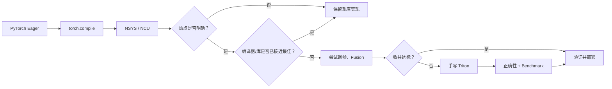


| 场景                            | 是否建议手写 Triton      | 原因                            |
| ------------------------------- | ------------------------ | ------------------------------- |
| 普通大矩阵 MatMul               | 通常不优先               | cuBLAS/cuBLASLt 已高度优化      |
| Elementwise Fusion              | 可以研究                 | 减少中间 Tensor 和 Launch       |
| LayerNorm / RMSNorm             | 值得考虑                 | Reduction 与 Fusion 优化空间    |
| 特殊 Shape 的 MatMul            | 值得测评                 | 通用库可能不是最优              |
| 自定义 Attention / 特殊数据布局 | 可能很有价值             | 可以结合特定业务访问模式        |
| 单个 Kernel 只占总耗时 0.1%     | 不建议                   | 端到端收益很小                  |
| 主要瓶颈是 H2D 或 CPU 调度      | 不建议优先手写           | Kernel 不是主要限制因素         |
| 需要特定芯片指令或极致底层控制  | 视情况使用 Triton / CUDA | Triton 抽象未必覆盖所有硬件能力 |

手写 Triton 的前提不是“能写得比 PyTorch 更底层”，而是通过 Profiling 找到了可以量化的优化机会。

实际项目中，应该先证明 `torch.compile`、现有库、调整配置仍无法满足目标，然后再决定是否维护自定义 Kernel。


# vllm


在模型部署推理的过程中，用户更多注重的是模型推理的精度与性能，在精度上，通过一系列不同的评测数据集进行测试来验证模型精度，在性能上，通过性能指标衡量模型的推理性能。

模型的性能指标通常有：Throughput（吞吐）、TTFT、TPOT、Latency、P99 延迟等。

- **Throughput（吞吐）**：衡量的是单位时间内可以处理的数据量或者生成的 token 数量。
- **TTFT**：衡量的是从发送请求到接收到第一个标记（token）所需的时间。
- **TPOT**：衡量的是处理每个 token 所需的平均时间。
- **Latency**：衡量的是从请求到完整输出所有 tokens 的总耗时（生成完整的文本或高分辨率图片）。
- **P99 延迟**：衡量的是长尾延迟（少数极端耗时的请求），确保系统在高并发或复杂输入时仍能保持稳定性。


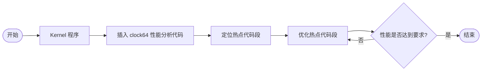


```shell
# 启用 Profiler
vllm serve /models/llama3-8b-gptq \
  --served-model-name llama3-gptq \
  --quantization gptq \
  --profiler-config '{
    "profiler": "torch",
    "torch_profiler_dir": "/tmp/vllm_profile",
    "torch_profiler_dump_cuda_time_total": true
  }'

# 先正常发送一次请求，完成模型及运行环境预热
curl http://localhost:8000/v1/completions \
  -H "Content-Type: application/json" \
  -d '{
    "model": "llama3-gptq",
    "prompt": "Explain CUDA memory optimization.",
    "max_tokens": 128
  }'

# 开始正式采样
curl -X POST http://localhost:8000/start_profile

# 再发送几次相同请求：
for i in {1..3}; do
  curl -s http://localhost:8000/v1/completions \
    -H "Content-Type: application/json" \
    -d '{
      "model": "llama3-gptq",
      "prompt": "Explain CUDA memory optimization.",
      "max_tokens": 128
    }' > /dev/null
done

# 停止采样并保存结果：
curl -X POST http://localhost:8000/stop_profile
```


# Kernel Agent

[TongmingLAIC/AKO4ALL](https://github.com/TongmingLAIC/AKO4ALL/tree/main)


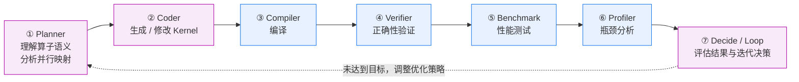

- 蓝色：Agent 可以通过工具自动执行的环节。
- 紫色：依赖 CUDA 专家经验的高阶判断与策略设计环节。

Kernel Agent 的本质是：**模拟 CUDA Kernel 专家的优化过程，将可自动化的执行工作交给 Agent，让人类专家聚焦于高阶诊断、策略设计与最终决策。**


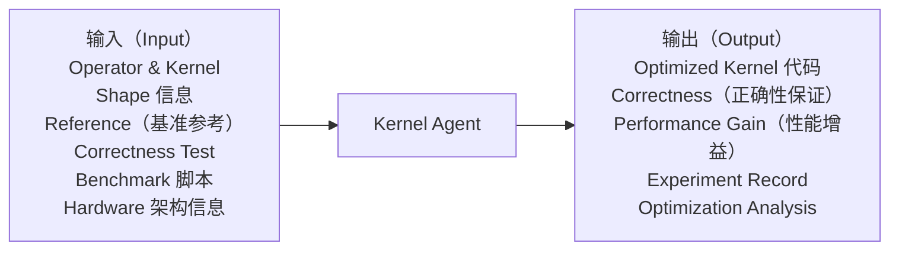


## 构建格式架构

初步构建 基本可以60%

**通过 Manifest 统一定义算子规范、Workload、Roofline 公式与验收标准，让 Agent 只修改 Kernel 实现，并通过正确性测试和性能测试形成优化闭环。**

```
TileOPs-Metax-dev/
├── tileops/
│   ├── manifest/
│   │   └── normalization.yaml       # 规格声明（唯一真理源）
│   ├── ops/
│   │   └── norm/
│   │       ├── norm_base.py          # 家族共享工具（ALIGNMENT 等）
│   │       └── rms_norm.py           # Op 层：接口 / dispatch / shape 处理
│   ├── kernels/
│   │   └── norm/
│   │       └── rms_norm.py           # Kernel 层：GPU 实现 ← 只改这里
│   └── perf/
│       └── formulas.py               # Roofline 公式（SOL% 计算依据）
├── workloads/
│   └── rms_norm.py                   # 输入数据生成
├── tests/
│   └── ops/
│       └── test_rms_norm.py          # 正确性测试
└── benchmarks/
    └── ops/
        └── bench_rms_norm.py         # 性能测试
```

**输入 Prompt**

````
你是一个 GPU kernel 优化 agent。只改 `tileops/kernels/norm/rms_norm.py`，不动其他文件。

优化目标、workload 形状、roofline 公式都在 `tileops/manifest/normalization.yaml` 的 `RMSNormFwdOp` 条目里，先读它再动手。

改完跑：

```bash
python -m pytest tests/ops/test_rms_norm.py -m smoke -v
python -m pytest benchmarks/ops/bench_rms_norm.py -v -s
```

第一条必须全过，第二条看每个 workload 的 `bandwidth_tbs`，结合 manifest 里的 bytes 公式算 SOL%。

目标是达到 xx SOL 阈值。
````

yaml example

```yaml
RMSNormFwdOp:
  ref_api: "torch.nn.functional.rms_norm"
  family: normalization
  status: implemented

  signature:
    inputs:
      x: {dtype: "float16 | bfloat16"}
      weight: {dtype: "same_as(x)"}
    outputs:
      output: {dtype: "same_as(x)"}
    params:
      normalized_shape: {type: "list[int] | tuple[int, ...]"}
      eps: {type: "float | None", default: null}
    shape_rules:
      - "len(normalized_shape) > 0"
      - "tuple(x.shape[-len(normalized_shape):]) == tuple(normalized_shape)"
      - "weight.shape == tuple(normalized_shape)"
      - "output.shape == x.shape"

  workloads:
    # Llama-3.1-8B (hidden_dim=4096)
    - {x_shape: [2048, 4096], normalized_shape: [4096], dtypes: [float16, bfloat16], label: "llama-3.1-8b-prefill"}
    - {x_shape: [1, 4096], normalized_shape: [4096], dtypes: [bfloat16], label: "llama-3.1-8b-decode"}

    # Llama-3.1-70B (hidden_dim=8192)
    - {x_shape: [2048, 8192], normalized_shape: [8192], dtypes: [float16, bfloat16], label: "llama-3.1-70b-prefill"}
    - {x_shape: [1, 8192], normalized_shape: [8192], dtypes: [bfloat16], label: "llama-3.1-70b-decode"}

    # Llama-3.1-405B (hidden_dim=16384)
    - {x_shape: [2048, 16384], normalized_shape: [16384], dtypes: [float16, bfloat16], label: "llama-3.1-405b-prefill"}
    - {x_shape: [1, 16384], normalized_shape: [16384], dtypes: [bfloat16], label: "llama-3.1-405b-decode"}

  roofline:
    vars:
      M: "product(x.shape[:x.ndim - len(normalized_shape)])"
      N: "product(normalized_shape)"

    # Per row: N squares + (N-1) adds + div + add
    # + rsqrt + N muls (normalize) + N muls (weight) ≈ 4N
    flops: "4 * M * N"

    # Read x (M*N) + read weight (N)
    # + write output (M*N), x elem_size
    bytes: "(2 * M * N + N) * elem_bytes"

  source:
    kernel: tileops/kernels/norm/rms_norm.py
    kernel_map:
      rms_norm: RMSNormKernel
    op: tileops/ops/norm/rms_norm.py
    test: tests/ops/test_rms_norm.py
    bench: benchmarks/ops/bench_rms_norm.py
    bench_manifest_driven: true
```

核心是把三个东西独立出来：

- **Manifest：** 定义什么叫正确、哪些 Shape 必须覆盖、优化目标是什么。
- **Kernel：** Agent 唯一允许修改的算子实现。
- **Test + Benchmark：** 为每次修改提供可重复的验证结果。

这样可以避免 Agent 通过修改测试条件、缩小输入范围或改变统计公式来制造虚假的性能提升


## 加入专家知识库

**核心目标：让 Kernel Agent 不只是反复生成代码、跑 Benchmark，而是能够利用 CUDA 专家的经验，完成「识别瓶颈 → 提出假设 → 选择优化方法 → 验证收益 → 积累经验」的过程。完全可以skill化**


**L3 · 案例知识（Cases）**

算子类型 + Shape 特征 + 原始瓶颈 → 修改内容 + Profile 前后变化 + 性能收益 + 适用边界

**L2 · 优化方法（Methods）**

观察到什么问题 → 可能的原因 → 可以尝试什么 → 前提条件、验证方式和风险

**L1 · 静态知识（Static Knowledge）**

编程模型、指令集、编译器参数、内存层级、Warp / Block / Tile、向量化与对齐要求

| 知识层           | 主要解决的问题           | Agent 如何使用                 |
| ---------------- | ------------------------ | ------------------------------ |
| Static Knowledge | GPU 是怎么工作的？       | 理解硬件约束，避免错误方案     |
| Methods          | 发现瓶颈后应该怎么优化？ | 形成优化假设、选择候选策略     |
| Cases            | 类似问题以前怎么解决？   | 参考已验证的实验，减少盲目搜索 |


## 使用profile工具

**让 Kernel Agent 不仅知道 Kernel 运行得慢，还能通过 Profiling 定位性能瓶颈**

完成下面的问题

- **Benchmark**：测量 Kernel 性能，回答「慢不慢？」
- **Nsight Systems（NSYS）**：分析端到端时间线，回答「时间花在哪里？」
- **Nsight Compute（NCU）**：分析 Kernel 硬件性能，回答「为什么慢？」
- **Roofline**：判断计算和访存性能上限，回答「还有多少优化空间？」
- **Kernel Agent**：结合 Profile 与专家知识，决定「下一步优化什么？」


| 阶段          | 工作内容                                            | 输出                                 |
| ------------- | --------------------------------------------------- | ------------------------------------ |
| 0. Preflight  | 验证 NSYS / NCU 可用、设备可见、Profiling 权限      | 环境检查结果                         |
| 1. Collection | 采集 CUDA Timeline、GPU 硬件指标，失败最多重试 3 次 | `.nsys-rep` / `.ncu-rep`             |
| 2. Analysis   | 解析原始数据、分类瓶颈、触发诊断规则                | 结构化瓶颈结论                       |
| 3. Rendering  | 生成摘要、完整报告和 JSON                           | `digest` / `REPORT` / `metrics.json` |

## Workflow 串联诊断与验证的完整执行闭环

**将 专家知识（Knowledge）和 性能分析工具（NCU / NSYS）整合成可自动迭代的 Kernel 优化工作流。**做到这里基本是80分

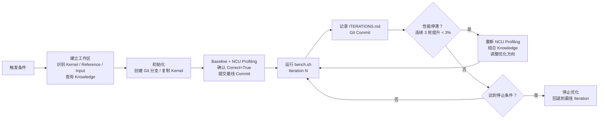

## Kernel Agent 当前能力与实际挑战

| Agent 已经可以完成 | 实际运行仍面临的问题 |
| ------------------ | -------------------- |
| ✓ 阅读 Kernel 代码 | ✗ 修改错误目标文件   |
| ✓ 修改 Kernel 实现 | ✗ 被历史信息干扰     |
| ✓ 调用编译工具     | ✗ 重复尝试失败方案   |
| ✓ 执行正确性测试   | ✗ 偏离优化目标       |
| ✓ Benchmark 性能   | ✗ 无法复现优化过程   |


## 进阶工程化


1. **Experience Evolution**：让 Agent 从成功和失败的实验中持续学习。经验库、检索和决策策略持续改进
2. **Auto Research / Multi-Agent**：通过长期搜索（**在明确实验预算和正确性约束的前提下，持续尝试更多不同方案**）、多候选优化和智能体协作探索更大的优化空间。
3. **Reliable Engineering**：借助权限、隔离、Hooks、外部验证实现可靠优化。
4. **Industrial Optimization**：从单算子 Benchmark 扩展到多 Shape、算子融合、跨硬件及端到端模型性能。


保留成功经验，但工程上也应该保存失败案例。失败经验能够帮助 Agent 排除已经验证无效的方向，避免重复搜索。


## agent 工程化


**最值得工程落地时保留的部分**。

| 原则                           | 解决的问题                          | 核心机制                   |
| ------------------------------ | ----------------------------------- | -------------------------- |
| **1. Permission（权限控制）**  | Agent 修改 Baseline、测试或评价规则 | 限制可修改文件和执行权限   |
| **2. Isolation（上下文隔离）** | 长上下文污染、多 Agent 相互干扰     | 通过结构化 Artifact 交互   |
| **3. Hooks（流程守卫）**       | Agent 忘记或绕过关键规则            | 在流水线中强制执行检查     |
| **4. Evolution（知识积累）**   | 每轮重新探索、重复失败              | 将成功与失败经验结构化沉淀 |

**不再只沿着单条优化路径迭代，而是同时探索多个候选方案**。

| 框架           | 核心技术                           | 主要思路                                 |
| -------------- | ---------------------------------- | ---------------------------------------- |
| **AdaExplore** | MCTS + 多尺度搜索                  | 结合历史经验，搜索不同幅度的 Kernel 修改 |
| **AVO**        | LLM Variation Operators + 进化搜索 | 批量生成代码变异，测试并选择优秀候选     |
| **MKEvolve**   | 模块化多 Agent + Beam Search       | 拆分复杂算子，分别优化子 Kernel，再融合  |

- **MCTS（Monte Carlo Tree Search，蒙特卡洛树搜索）** 的核心是把 Kernel 优化过程表示为一棵搜索树。

  每个节点代表一个候选 Kernel 或优化状态，边代表一次修改动作。根据正确性和性能评价，决定后续优先探索哪些节点。

- 这里的 **Lineage（谱系）** 是一个重要概念，记录候选 Kernel 从哪个父版本演变而来、经过什么修改、获得什么性能结果。

  它相比只记录一个 Git Commit 更有价值，因为可以分析不同优化路径的效果，并在多个候选之间做选择。

- **Beam Search** 与 MCTS 的主要区别是：Beam Search 每轮保留一定数量的较优候选继续扩展；MCTS 则通过树搜索机制在探索新方向和利用已有结果之间分配搜索资源。


[**KDA 工作流程**](https://github.com/NVlabs/kda)

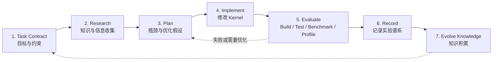

重点模块：

| 阶段             | 主要内容                                                |
| ---------------- | ------------------------------------------------------- |
| Task Contract    | Objective、Constraints、Validation、Benchmark、Hardware |
| Research         | KernelWiki、硬件知识、历史案例                          |
| Plan             | 瓶颈分析、优化假设、修改方案、预期收益与风险            |
| Implement        | 生成或修改 Kernel，设计实验                             |
| Evaluate         | Build、Test、Benchmark、NCU Profiling、Diagnose         |
| Record           | 保存候选谱系、性能结果、经验总结                        |
| Evolve Knowledge | 更新知识库，沉淀优化模式                                |

**Claude + Codex 交叉审查**

**Claude 负责修改代码，Codex 负责检查完成度与缺陷，配合多个子任务和迭代流程，减少 Agent 对自身结果的过度自信。**

但 Reviewer 只能作为辅助审查，真正的 Correctness 和 Performance 仍然需要独立测试程序验证


## 落地差距

| 方向                    | 工程难点                       | 建议重点                                |
| ----------------------- | ------------------------------ | --------------------------------------- |
| **Multi-Shape**         | 单个 Kernel 无法兼顾全部 Shape | Workload 分布、Shape 分组、性能回退检测 |
| **Kernel Fusion**       | 融合后访存与资源占用发生变化   | Fusion 前后端到端性能比较               |
| **Cross Hardware**      | 不同 GPU 架构资源约束不同      | 架构能力识别、独立测试与编译配置        |
| **Knowledge Evolution** | 经验容易过时或误用             | 经验版本、可信度、适用条件              |
| **Dispatch**            | 如何选择合适的 Kernel 实现     | 按 Shape、dtype、Layout、Hardware 分发  |


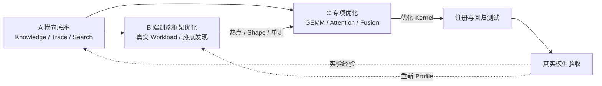

**A 是底座，B 是业务闭环，C 是专项突破。B 与 C 双向联动，最终将经验沉淀回 A。**
